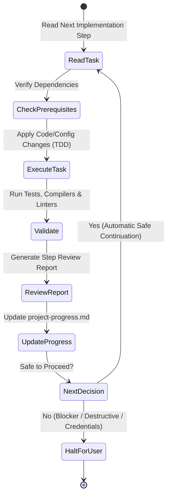

# Antigravity Autonomous Execution & Review Protocol

## 1. Operating Model: Single-Task Execution with Validation Gate
To ensure high stability, architectural fidelity, and continuous quality, the agent operates in an autonomous, step-wise execution loop:

## 2. Step-by-Step Execution Rules
1. **One Step at a Time**:
   - The agent strictly executes one defined numbered step per milestone (e.g., Step 0, Step 1, Step 2).
   - Never skip steps or batch multiple complex implementation tasks without validating intermediate states.
2. **Post-Task Validation**:
   - Immediately following any code or configuration change:
     - Execute build / syntax checks (`mvn test-compile`, `npm run build`, `docker compose config`).
     - Execute applicable unit and integration tests (`mvn test`).
     - Confirm all tests pass 100%.
3. **Step Review Report Generation**:
   - For every completed step, author a dedicated review report in:
     `documentation/implementation/phase-16/step-XX-<step-name>-review.md`.
   - The report must document:
     - Step Objective and Scope.
     - Completed Changes (files created, modified).
     - Automated Validation Results (commands executed, exit codes, test outputs).
     - Invariant Rules Compliance Audit (Zero placeholders, anti-enumeration, outbox, etc.).
     - Blockers / Next Step Readiness.
4. **Project Progress Synchronization**:
   - Update `documentation/project-progress.md` with the new step status, deliverables, and next planned action.
5. **Safe Automatic Progression**:
   - If all automated checks pass, tests are green, and no blockers exist, the agent automatically outlines and prepares the next sequential step.

## 3. Mandatory Halting Conditions (Stop & Ask User)
The agent must **halt execution and request explicit user confirmation** under any of the following conditions:
1. **Critical Blocker**: Build failure, missing system tool (e.g. Docker daemon not running), or irrecoverable test failure.
2. **Destructive Action**: Any operation involving data deletion, dropping tables, removing git branches, or overwriting uncommitted manual user edits.
3. **Architecture Change**: Any requirement or scenario that contradicts or necessitates changing an approved Architecture Decision Record (`ADR-001` through `ADR-008`) or database-per-service isolation.
4. **External Credentials Required**: Any step requiring external account sign-ins, private keys, or third-party secrets that are not available in the local environment.

