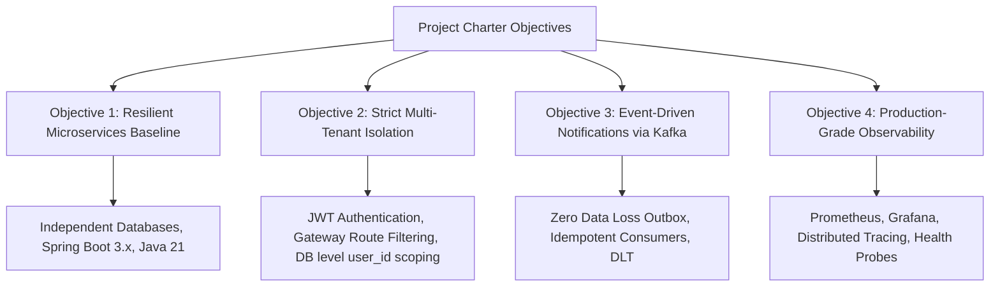

# Project Charter: Task Management System – Microservices Architecture

| Metadata Item | Details |
|---|---|
| **Document ID** | DOC-INIT-001 |
| **Document Version** | 1.0.0 |
| **Status** | Approved Baseline |
| **Author / Owner Role** | Senior Business Analyst & Solution Architect |
| **Creation Date** | 2026-11-03 |
| **Target Audience** | Engineering Leadership, Architects, Developers, DevOps, QA |

---

## 1. Executive Summary
The **Task Management System (TMS)** is a modern, distributed microservices web application engineered to enable individual professionals to efficiently organize, prioritize, track, and complete tasks with real-time in-app awareness. Designed from first principles using clean architecture, bounded contexts, database-per-service isolation, and asynchronous event messaging via Apache Kafka, TMS replaces monolithic, brittle task tracking with a resilient, horizontally scalable platform.

---

## 2. Business Need & Justification
Modern personal and workplace productivity requires task tracking that is:
1. **Available & Responsive**: Sub-second query latency and high availability even during traffic spikes or component degradation.
2. **Strictly Isolated**: Complete data segregation ensuring zero unauthorized data bleed between tenants.
3. **Event-Driven**: Immediate notification fan-out without blocking user-facing task transaction execution.
4. **Extensible**: Decoupled domain services allowing future expansion (e.g., enterprise team collaboration, automated scheduling) without refactoring core modules.

---

## 3. Project Objectives & Success Criteria

### Key Performance Indicators (KPIs)
- **Architecture Integrity**: 100% adherence to Database-per-Service (zero shared database schemas or cross-service SQL joins).
- **Security & Authorization**: 0% unauthorized cross-user access across all CRUD task endpoints.
- **Asynchronous Reliability**: Zero message loss in task lifecycle events via the Transactional Outbox pattern and Idempotent consumer design.
- **Performance**: API p95 response times < 200ms for read operations and < 350ms for write operations via API Gateway.

---

## 4. Technology Baseline
- **Language / Runtime**: Java 21 LTS
- **Core Framework**: Spring Boot 3.3.x, Spring Cloud 2023.x (Gateway, Eureka)
- **Security**: Spring Security 6.x, Stateless JWT (HMAC-SHA256 or RSA-256)
- **Data Persistence**: PostgreSQL 16+, Spring Data JPA, Hibernate 6.x, Flyway Migration
- **Event Messaging**: Apache Kafka 3.7+
- **Frontend SPA**: React 18, TypeScript 5, Vite/TailwindCSS
- **CI/CD & Containers**: Docker, Docker Compose, Jenkins Pipeline
- **Observability**: Prometheus, Grafana, Micrometer, Distributed Tracing (OpenTelemetry/Zipkin)

---

## 5. Roles & Governance Structure

| Project Role | Nominated Responsibility |
|---|---|
| **Project Sponsor** | Executive Engineering Director |
| **Solution Architect** | System topology, inter-service contracts, boundary governance |
| **Product Manager / Lead BA**| Requirement validation, user stories, prioritization |
| **Software Architect** | LLD, package designs, domain entities, design patterns |
| **Database Architect** | PostgreSQL schema design, indexing, isolation, migration |
| **Security Architect** | JWT lifecycle, RBAC, input sanitization, threat modeling |
| **DevOps & Infrastructure Lead** | Dockerization, Compose topology, Jenkins CI/CD, Prometheus |
| **QA & Test Lead** | Test strategy, test suites (Unit, Integration, Kafka, E2E) |

---

## 6. High-Level Timeline & Milestones

| Milestone ID | Phase Name | Key Deliverable | Status |
|---|---|---|---|
| **M01** | Phase 1 – Initiation | Project Charter, Scope, Risk Register, Glossary | In Progress |
| **M02** | Phase 2 – Requirements | BRD, PRD, SRS, RTM, User Stories | Scheduled |
| **M03** | Phase 3 – Business Analysis | Business Process, BPMN Workflows, Data Dictionary | Scheduled |
| **M04** | Phase 4 – System Architecture | High-Level Architecture, C4 Models, ADRs | Scheduled |
| **M05** | Phase 5 & 6 – Design | Low-Level Design & Database Schemas | Scheduled |
| **M06** | Phase 7 & 8 – API & Events | OpenAPI specs & Kafka Event Catalogue | Scheduled |
| **M07** | Phase 9 to 11 – Security & Infra | Security Blueprint, Docker Compose topology | Scheduled |
| **M08** | Phase 12 to 15 – Dev, QA, Ops | Implementation Guides, QA Suites, CI/CD, Observability | Scheduled |

---

## 7. Assumptions, Dependencies & Constraints
- **Assumption**: The initial MVP targets individual single-user task management. Multi-user shared boards and organizations are deferred to Post-MVP.
- **Dependency**: Docker engine and local environment resources capable of hosting 5 Java microservices, PostgreSQL instances, and Kafka brokers.
- **Constraint**: Pure open-source stack. No proprietary third-party cloud services or paid SaaS APIs.

---

## 8. Review & Approval Sign-Off
- **Solution Architect**: *Approved* (2026-11-03)
- **Product Manager**: *Approved* (2026-11-03)
- **DevOps Lead**: *Approved* (2026-11-03)

---

## 9. Change History
| Version | Date | Author | Summary of Changes |
|---|---|---|---|
| 1.0.0 | 2026-11-03 | Solution Architect & Lead BA | Initial baseline project charter creation. |

