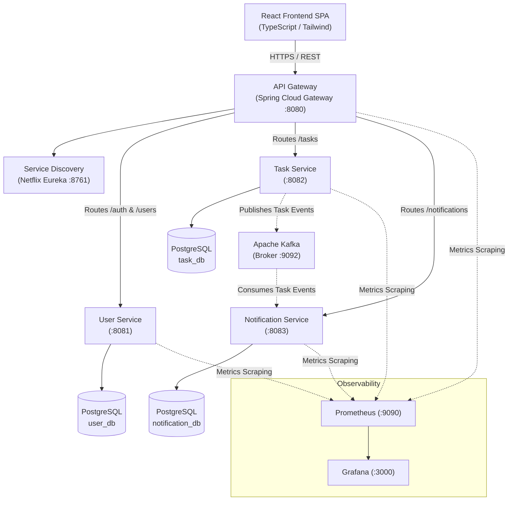

# Project Overview: Task Management Microservices

| Metadata Item | Details |
|---|---|
| **Document ID** | DOC-INIT-002 |
| **Document Version** | 1.0.0 |
| **Status** | Approved Baseline |
| **Author / Owner Role** | Solution Architect & Technical Documentation Specialist |
| **Creation Date** | 2026-11-03 |
| **Related Requirements** | BR-001 to BR-010 |

---

## 1. Introduction & Context
The **Task Management System (TMS)** is a distributed application structured around microservices principles. It is engineered to solve the scalability, maintainability, and domain entanglement challenges commonly experienced in monolithic task tracking applications. 

The application provides an intuitive React frontend, a unified Spring Cloud API Gateway entry point, independent Spring Boot microservices backed by dedicated PostgreSQL databases, and an event mesh powered by Apache Kafka for reactive, asynchronous in-app notification processing.

---

## 2. Existing Repository State & Gap Analysis
Prior to this documentation baseline, a physical inspection of repository `D:\learning\task_manager` (origin `https://github.com/ezhilselvan1109/task_manager`) was conducted:

| Component / Directory | Discovered State on Disk | Required Project Baseline | Gap & Remediation Action |
|---|---|---|---|
| `api-gateway` | Bare Spring Initializr skeleton; `pom.xml` configured with Java 17, `spring-boot-starter` only. | Spring Cloud Gateway, Java 21, Eureka Client, Actuator, Security. | Upgrade to Java 21, add Spring Cloud Gateway & Eureka Client dependencies. |
| `user-service` | Bare Spring Initializr skeleton; Java 17, starter only. | Java 21, Spring Boot Web, Spring Security, JWT, Spring Data JPA, PostgreSQL, Flyway. | Upgrade to Java 21; add Web, JPA, Security, Flyway, Postgres drivers. |
| `task-service` | Bare Spring Initializr skeleton; Java 17, starter only. | Java 21, Spring Boot Web, Spring Data JPA, PostgreSQL, Kafka Producer, Flyway. | Upgrade to Java 21; add Web, JPA, Kafka, Postgres, Outbox support. |
| `notification-service` | Bare Spring Initializr skeleton; Java 17, starter only. | Java 21, Spring Boot Web, Spring Data JPA, Kafka Consumer, PostgreSQL, Flyway. | Upgrade to Java 21; add Web, JPA, Kafka Consumer, Postgres. |
| `service-discovery` | Bare Spring Initializr skeleton; Java 17, starter only. | Java 21, Spring Cloud Netflix Eureka Server. | Upgrade to Java 21; add `spring-cloud-starter-netflix-eureka-server`. |
| `frontend` | Empty directory. | React 18, TypeScript, Vite, Tailwind CSS SPA. | Design complete SPA architecture, views, API integration in Phase 12. |
| `infrastructure` | Empty directory. | Docker Compose files, PostgreSQL configs, Kafka scripts, Prometheus configs. | Design multi-container Docker Compose and configuration in Phase 11. |
| `documentation` | Previously empty. | Full 15-phase SDLC documentation suite. | Authoring complete phase-by-phase documentation in progress. |

---

## 3. High-Level Service Responsibilities

### 3.1 API Gateway
- Central ingress reverse proxy on port `8080`.
- Validates JWT tokens on incoming protected requests before forwarding upstream.
- Extracts `sub` (userId) and injects `X-User-Id` header into upstream service requests.
- Implements route matching, rate limiting, and global CORS handling.

### 3.2 User Service
- Autonomous service on port `8081` managing user identities, credentials, and profiles.
- Validates registration and login inputs.
- Hashes passwords using BCrypt ($2a$ or $2b$ with cost 12).
- Issues signed HMAC-SHA256 JWT access and refresh tokens.
- Manages its own isolated `user_db` database via Flyway migrations.

### 3.3 Task Service
- Autonomous core business service on port `8082`.
- Manages personal task CRUD, filtering, pagination, sorting, status transitions, and productivity metrics.
- Enforces multi-tenant data isolation: every database query is strictly scoped to `userId`.
- Uses the Transactional Outbox pattern to write task state changes and domain events (`TASK_CREATED`, `TASK_UPDATED`, `TASK_COMPLETED`, `TASK_DELETED`) atomically to `task_db`.
- Publishes events to Kafka topic `task.events.v1`.

### 3.4 Notification Service
- Autonomous event-driven service on port `8083`.
- Subscribes to `task.events.v1` as consumer group `notification-service-group`.
- Ensures idempotency via `consumed_events` table tracking `event_id`.
- Transforms domain events into human-readable in-app notifications in `notification_db`.
- Provides REST APIs for users to retrieve and mark notifications as read.

### 3.5 Service Discovery
- Spring Cloud Netflix Eureka server on port `8761`.
- Enables dynamic microservice registration, heartbeat tracking, and zero-hardcoded-IP client-side routing from the Gateway.

---

## 4. Key Architectural Tenets
1. **Database-Per-Service**: Zero direct database sharing. Inter-service queries never occur via direct SQL; data queries flow via REST contracts or async Kafka projections.
2. **Stateless Operations**: Services do not maintain server-side HTTP sessions; all authentication is cryptographically verified via JWT tokens.
3. **Asynchronous Decoupling**: Downstream services (e.g., Notification) do not hold HTTP connections open during Task mutations.
4. **Resilience & Fault Isolation**: An outage in Notification Service or Kafka broker does not prevent users from creating, updating, or viewing their tasks.

---

## 5. Review Checklist
- [x] Clear executive summary and system topology diagram provided.
- [x] Existing repository gap analysis accurately documents disk state vs project targets.
- [x] Service boundaries and non-shared database rules articulated.
- [x] Core technologies aligned with master instruction baseline.

---

## 6. Change History
| Version | Date | Author | Summary of Changes |
|---|---|---|---|
| 1.0.0 | 2026-11-03 | Solution Architect | Initial baseline project overview creation. |

