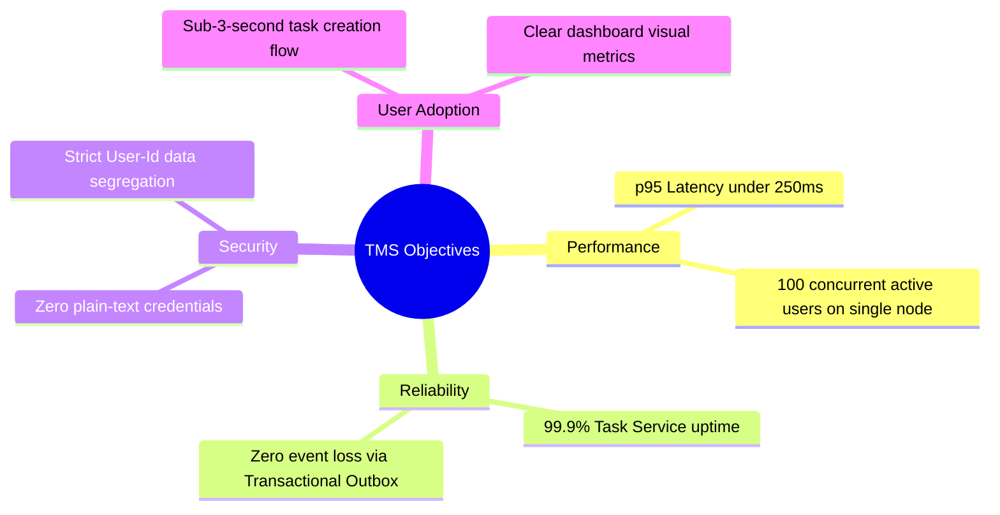
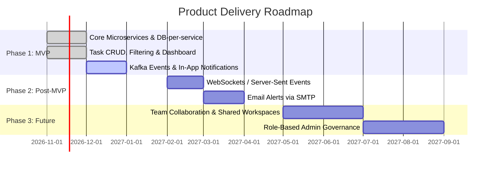

# Project Vision and Objectives: Task Management System

| Metadata Item | Details |
|---|---|
| **Document ID** | DOC-INIT-003 |
| **Document Version** | 1.0.0 |
| **Status** | Approved Baseline |
| **Author / Owner Role** | Product Manager & Lead Business Analyst |
| **Creation Date** | 2026-11-03 |
| **Related Requirements** | BR-001 to BR-010 |

---

## 1. Vision Statement
> *"To deliver an exceptionally intuitive, distraction-free, and blazing-fast task management platform that empowers individual knowledge workers to capture, organize, prioritize, and accomplish their daily goals with absolute privacy, continuous availability, and real-time situational awareness."*

TMS transforms chaotic personal to-do lists into a structured, priority-driven execution workflow backed by enterprise-grade distributed infrastructure.

---

## 2. Strategic Value Proposition
- **High Focus & Zero Clutter**: Clean, responsive web UI designed specifically for personal productivity without the bloat of overly complex enterprise tooling.
- **Architectural Scalability**: Built natively as microservices so that high-volume task operations, notification ingestion, and search workloads scale independently.
- **Bulletproof Privacy**: Zero cross-tenant data leakage guaranteed at both API Gateway and JPA repository layers.
- **Uncompromising Resilience**: Decoupled asynchronous messaging ensures that downstream notification or analytical services can fail or restart without impacting the user's core task flow.

---

## 3. SMART Objectives

| ID | SMART Objective | Metric / Target | Time Horizon |
|---|---|---|---|
| **OBJ-001** | Rapid Task Ingestion | User can capture a new task in < 3 clicks and < 500ms total interaction time. | MVP Launch |
| **OBJ-002** | Independent Service Scaling | Task Service and Notification Service can scale horizontally without schema locks. | Architecture Baseline |
| **OBJ-003** | Zero Event Loss Delivery | 100% of state change domain events are reliably queued in PostgreSQL outbox and delivered to Kafka brokers. | MVP Launch |
| **OBJ-004** | Sub-Second Query Speeds | Dashboard productivity summary queries execute in < 150ms under peak load. | MVP Launch |
| **OBJ-005** | Production Observability | 100% of microservice instances export Prometheus metrics, JVM telemetry, and health probes. | Release Candidate |

---

## 4. Target User Personas

### Persona 1: "Priya" – The Software Engineer & Knowledge Worker
- **Profile**: Manages multiple concurrent feature tasks, bug fixes, and personal learning goals.
- **Pain Point**: Monolithic apps are slow, frequently log out, or suffer outages during peak hours.
- **Goal**: Needs instant task capture, priority sorting (`URGENT`, `HIGH`), and clear status tracking (`TODO`, `IN_PROGRESS`, `COMPLETED`).

### Persona 2: "David" – The Freelance Project Consultant
- **Profile**: Juggles deadlines across multiple deliverables.
- **Pain Point**: Forgets overdue deadlines; needs quick high-level dashboard summaries of pending workloads.
- **Goal**: Uses filtering by due dates, status, and priorities; reviews dashboard progress metrics every morning.

---

## 5. Strategic Roadmap vs. MVP Scope

---

## 6. Review Checklist
- [x] Clear vision statement articulating the product purpose.
- [x] SMART objectives established with measurable targets.
- [x] Target personas defined and mapped to product value proposition.
- [x] Phased roadmap cleanly delineates MVP from Post-MVP features.

---

## 7. Change History
| Version | Date | Author | Summary of Changes |
|---|---|---|---|
| 1.0.0 | 2026-11-03 | Product Manager | Initial baseline vision and objectives document. |

