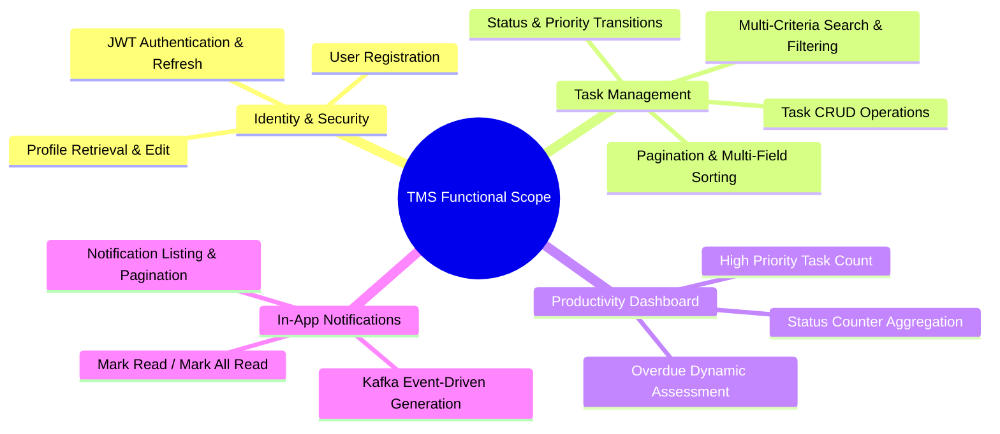

# Project Scope Document: Task Management System

| Metadata Item                  | Details                                    |
| ------------------------------ | ------------------------------------------ |
| **Document ID**          | DOC-INIT-004                               |
| **Document Version**     | 1.0.0                                      |
| **Status**               | Approved Baseline                          |
| **Author / Owner Role**  | Solution Architect & Lead Business Analyst |
| **Creation Date**        | 2026-11-03                                 |
| **Related Requirements** | BR-001 to BR-010, FR-001 to FR-020         |

---

## 1. Project Scope Statement

The scope of the **Task Management System (TMS)** project encompasses the architecture, design, documentation, backend microservices development, frontend web SPA implementation, containerized infrastructure orchestration, automated CI/CD pipeline definition, and comprehensive quality assurance for a multi-service personal task tracking application.

---

## 2. Functional Scope Breakdown

### 2.1 User Management Domain

- **Included**: Registration with unique email validation, BCrypt password hashing, authentication with JWT access tokens (15-min TTL) and refresh tokens (7-day TTL), user profile view and update.
- **Excluded**: Social single sign-on (OAuth2 Google/GitHub), multi-factor authentication (MFA/TOTP), self-service password reset emails (deferred to v1.1).

### 2.2 Task Management Domain

- **Included**:
  - Full CRUD operations on tasks.
  - Mandatory fields: `id` (UUID), `userId` (UUID), `title` (String 1..255), `status` (Enum: `TODO`, `IN_PROGRESS`, `COMPLETED`, `CANCELLED`), `priority` (Enum: `LOW`, `MEDIUM`, `HIGH`, `URGENT`), `createdAt` (UTC), `updatedAt` (UTC).
  - Optional fields: `description` (Text up to 2000 chars), `dueDate` (ISO-8601 UTC timestamp).
  - Searching by text keywords across `title` and `description`.
  - Filtering by `status`, `priority`, and `dueDate` ranges.
  - Sorting by `dueDate`, `priority`, `createdAt`, `title` (Ascending / Descending).
  - Pagination (`page`, `size`, total elements, total pages).
  - Metrics endpoint calculating user task aggregates.

### 2.3 Notification Domain

- **Included**:
  - Consumption of task lifecycle events from Kafka (`TASK_CREATED`, `TASK_UPDATED`, `TASK_COMPLETED`, `TASK_DELETED`).
  - Storage of in-app notification records in `notification_db`.
  - User retrieval of notifications with pagination.
  - Read status toggling (`read = true`, `readAt = UTC`).
  - Deduplication via consumer idempotency table.
- **Excluded**: Real-time push protocols (WebSockets/SSE), Email, SMS, Web Push (all deferred).

---

## 3. Technical & Architectural Scope

| Architectural Dimension         | In-Scope Technical Specification                                                                                    |
| ------------------------------- | ------------------------------------------------------------------------------------------------------------------- |
| **Service Composition**   | `api-gateway`, `user-service`, `task-service`, `notification-service`, `service-discovery`                |
| **Frontend SPA**          | React 18, TypeScript, TailwindCSS, Axios with JWT interceptors, React Query                                         |
| **Service Communication** | Synchronous REST for external client-to-gateway; Eureka for dynamic discovery; Apache Kafka for async event pub/sub |
| **Database Architecture** | Database-per-service: `user_db`, `task_db`, `notification_db` on PostgreSQL 16                                |
| **Data Migration**        | Flyway versioned SQL scripts in each service repository                                                             |
| **Event Reliability**     | Transactional Outbox pattern in `task-service`, Idempotent consumer in `notification-service`                   |
| **Deployment Packaging**  | Multi-stage Dockerfiles for all microservices and frontend; Docker Compose local orchestrator                       |
| **CI / CD Automation**    | Jenkins declarative pipeline running Maven builds, tests, container packaging                                       |
| **Observability**         | Prometheus metrics scraping via Actuator (`/actuator/prometheus`), Grafana dashboards                             |

---

## 4. Deliverables Checklist

1. **Full 15-Phase SDLC Documentation Suite** (Architecture, LLD, Database, API, Kafka, Security, DevOps, Observability).
2. **Containerized Infrastructure Definitions** (`docker-compose.yml`, Prometheus configs, Kafka setup).
3. **Database Migration Scripts** (Flyway V1__ schemas for all 3 databases).
4. **Backend Microservices Source Code** (Java 21, Spring Boot 3.3.x, Eureka, Gateway).
5. **Frontend Application Source Code** (React + TypeScript SPA).
6. **Automated Test Suites** (Unit tests, MockMvc integration tests, Embedded Kafka tests, Testcontainers).
7. **Operational Runbooks & Post-Mortem Templates**.

---

## 5. Scope Management & Change Control

Any deviation or addition to this baseline must follow the Project Change Control Procedure:

1. Log an enhancement proposal or register item.
2. Evaluate architectural and timeline impact.
3. Formally update this Scope Document, the RTM, and the Open Questions Register.
4. Obtain Solution Architect and Product Manager sign-off before implementation.

---

## 6. Change History

| Version | Date       | Author                       | Summary of Changes                       |
| ------- | ---------- | ---------------------------- | ---------------------------------------- |
| 1.0.0   | 2026-11-03 | Solution Architect & Lead BA | Initial baseline project scope document. |
