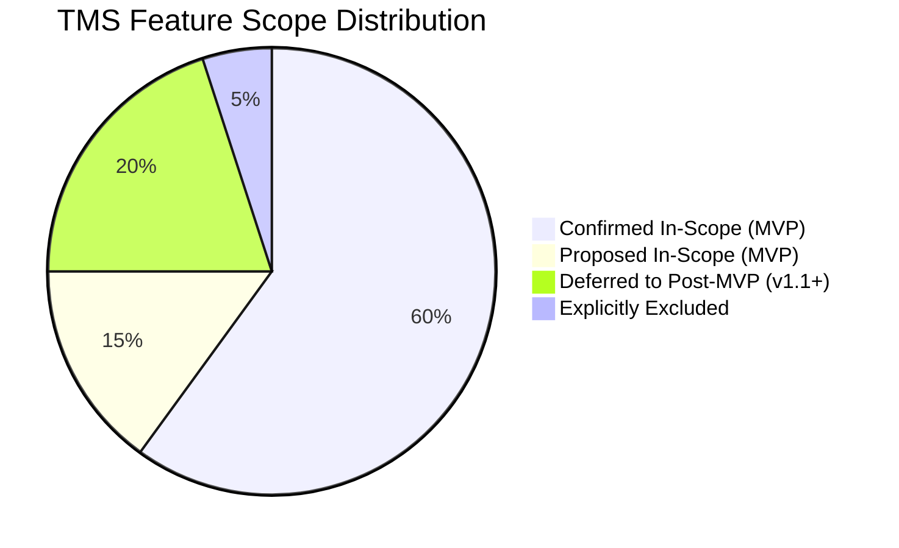

# In-Scope and Out-of-Scope Document: Task Management System

| Metadata Item | Details |
|---|---|
| **Document ID** | DOC-INIT-005 |
| **Document Version** | 1.0.0 |
| **Status** | Approved Baseline |
| **Author / Owner Role** | Product Manager & Solution Architect |
| **Creation Date** | 2026-11-03 |
| **Related Requirements** | BR-001 to BR-010 |

---

## 1. Purpose
This document establishes strict, unambiguous boundary criteria for the Task Management System MVP. Explicit classification prevents scope creep, sets realistic deliverables, and aligns engineering, QA, and operational stakeholders.

---

## 2. Scope Classification Matrix

### 2.1 Functional Boundaries

| Feature Domain | Confirmed In-Scope (MVP) | Proposed In-Scope (MVP) | Deferred to Post-MVP (v1.1+) | Explicitly Excluded |
|---|---|---|---|---|
| **User Management** | • User Registration (Email, Password) • Login & JWT Issuance • Profile Retrieval & Update • Password Hashing (BCrypt) | • Refresh Token Rotation • Client-side token storage best practices | • Password Reset via Email link • Multi-Factor Authentication (MFA) • Social Login (Google, GitHub) | • Enterprise LDAP / Active Directory integration • Biometric authentication |
| **Authorization & Security** | • Stateless JWT verification at Gateway • `X-User-Id` downstream header injection • Strict multi-tenant isolation in Task/Notification DBs | • Role enum baseline (`ROLE_USER`) | • Granular RBAC (`ROLE_ADMIN`, `ROLE_MANAGER`) • Tenant domain organizations | • Public unauthenticated task sharing |
| **Task Management** | • Task Creation, Read, Update, Delete • Status (`TODO`, `IN_PROGRESS`, `COMPLETED`, `CANCELLED`) • Priority (`LOW`, `MEDIUM`, `HIGH`, `URGENT`) • Title, Description, Due Date • Soft Deletion (`is_deleted`) | • Overdue dynamic query evaluation flag | • Recurring tasks (daily, weekly) • Task subtasks / checklists • File/Image attachments • Task tagging / labels | • Gantt charts & sprint planning tools • Collaborative multi-user task assignment |
| **Search & Organization** | • Full-text keyword search on title/desc • Filter by status, priority, due date • Sort by title, priority, due date • Server-side pagination | • Combined multi-attribute filtering | • Elasticsearch / OpenSearch indexing • Saved search filters | • AI-based automated task categorization |
| **Dashboard & Metrics** | • Aggregate counts (Total, TODO, IN_PROGRESS, COMPLETED, CANCELLED) • High-priority task counts | • Overdue task count based on current timestamp | • Historical velocity charts • Export to CSV/PDF | • Predictive analytics & machine learning timelines |
| **Notifications** | • Kafka event publishing on Task mutations • In-app notification creation & persistence • Notification listing & pagination • Mark as read / mark all as read • Consumer deduplication | • Notification retention cleanup job (30 days) | • Real-time WebSocket / SSE push to browser • Email delivery via SMTP • Mobile push notifications | • SMS / Twilio notifications • Slack / Discord webhook dispatch |

---

## 3. Technical & Architectural Boundaries

| Area | Confirmed In-Scope (MVP) | Deferred / Excluded |
|---|---|---|
| **Microservices Topology** | `api-gateway`, `user-service`, `task-service`, `notification-service`, `service-discovery` (Eureka) | Kubernetes deployment, Service Mesh (Istio), Consul, ZooKeeper |
| **Databases** | PostgreSQL 16 independent instances / databases (`user_db`, `task_db`, `notification_db`) | MongoDB, Redis cluster for caching, Cassandra, Oracle |
| **Event Messaging** | Apache Kafka 3.7+ single broker local topology with Zookeeper or KRaft mode | RabbitMQ (explicitly disallowed per master instruction), AWS SQS, ActiveMQ |
| **Frontend Framework** | React 18, TypeScript, TailwindCSS, Axios | Angular, Vue, Next.js SSR, React Native mobile apps |
| **CI / CD Tools** | Local Jenkins Docker container running declarative Jenkinsfile | Paid cloud CI (GitHub Actions paid minutes, CircleCI, GitLab Enterprise) |
| **Observability** | Prometheus server, Grafana community edition, Spring Actuator, Micrometer | Datadog, Dynatrace, New Relic, Splunk (commercial SaaS) |

---

## 4. Review Checklist
- [x] Clear four-tier categorization across every capability.
- [x] Confirmation that RabbitMQ is excluded and Apache Kafka is confirmed.
- [x] Clear demarcation that external notifications (Email, SMS) are deferred.
- [x] Free and open-source baseline maintained without third-party paid services.

---

## 5. Change History
| Version | Date | Author | Summary of Changes |
|---|---|---|---|
| 1.0.0 | 2026-11-03 | Product Manager | Initial baseline In-Scope / Out-of-Scope specification. |

