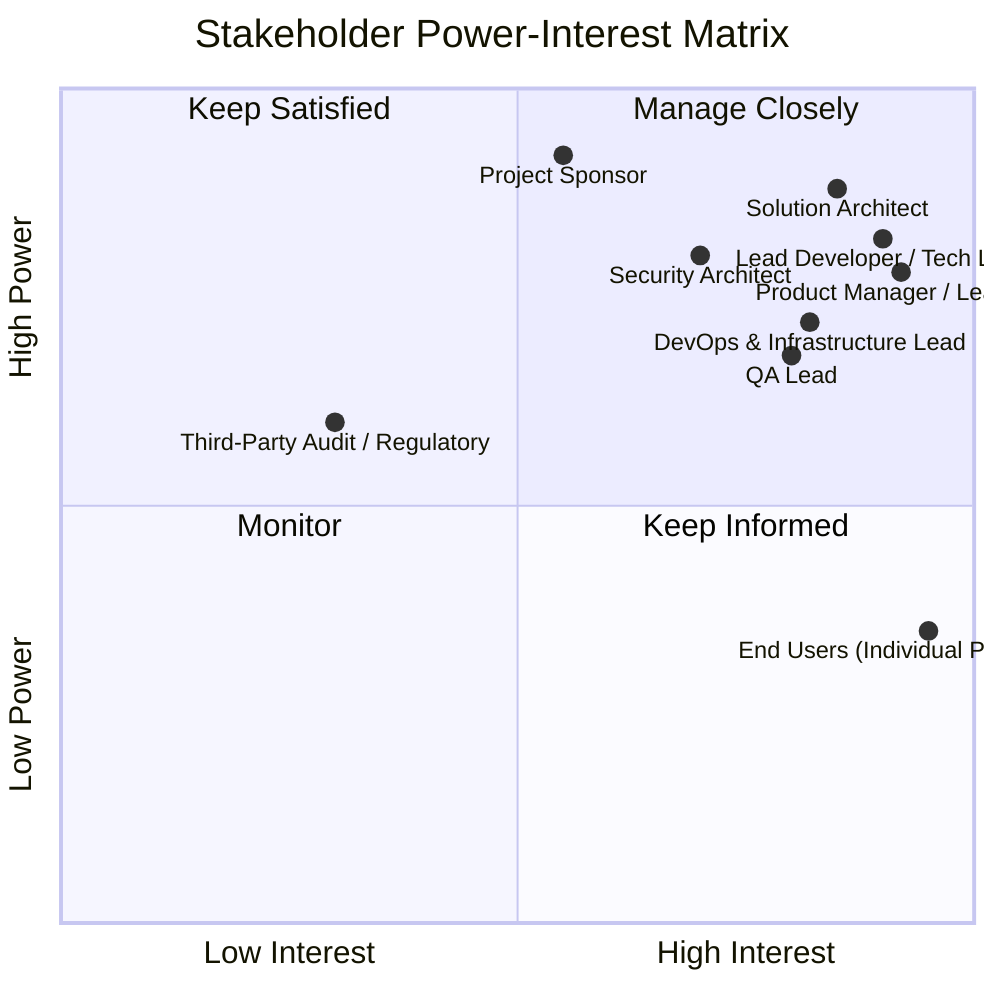

# Stakeholder Identification: Task Management System

| Metadata Item | Details |
|---|---|
| **Document ID** | DOC-INIT-006 |
| **Document Version** | 1.0.0 |
| **Status** | Approved Baseline |
| **Author / Owner Role** | Senior Business Analyst & Project Manager |
| **Creation Date** | 2026-11-03 |
| **Related Requirements** | BR-001 to BR-010 |

---

## 1. Stakeholder Classification & Power-Interest Grid
Effective project governance requires proactive engagement with all internal and external parties who influence or are impacted by the Task Management System.

---

## 2. Comprehensive Stakeholder Roster

| Stakeholder Role / Group | Representative Persona | Category | Power (High/Med/Low) | Interest (High/Med/Low) | Primary Objective / Concern | Preferred Engagement Channel |
|---|---|---|---|---|---|---|
| **Project Sponsor** | VP of Engineering | Executive | High | Medium | On-time delivery, architecture quality, adherence to zero-cost open-source stack. | Monthly Steering Review / Executive Briefing |
| **Product Manager / Lead BA** | Lead BA & PM | Product | High | High | Alignment with business needs, scope discipline, user story validation. | Sprint Ceremonies, Daily Slack, PR reviews |
| **Solution Architect** | Lead Enterprise Architect | Architecture | High | High | Structural boundaries, decoupled databases, clean contracts, resilience. | Architecture Review Board (ARB), Design reviews |
| **Security Architect** | AppSec Lead | Security & Compliance | High | High | Zero-trust authentication, JWT lifecycle, data isolation, OWASP compliance. | Threat Modeling reviews, SAST/DAST audits |
| **Software Engineers (Backend & Frontend)** | Core Engineering Team | Development | Medium | High | Clear API specs, clean package designs, fast builds, local Docker environment. | Git Pull Requests, Technical RFCs, Standups |
| **Database Architect** | Lead DBA | Data Engineering | High | Medium | PostgreSQL performance, connection pooling, Flyway migrations, indexing. | Database schema reviews, migration approvals |
| **DevOps & Platform Engineer** | Infrastructure Lead | Operations | Medium | High | Container reliability, Jenkins CI/CD pipeline stability, Prometheus metrics. | DevOps runbook reviews, pipeline status checks |
| **QA & Test Lead** | Lead QA Engineer | Quality Assurance | Medium | High | Testability, trace matrix coverage, Kafka event mockability, defect SLAs. | Test plan reviews, automated test result triage |
| **Target End-Users** | Individual Knowledge Workers | External / Customer | Low | High | Ease of use, responsiveness, zero data loss, intuitive task status flows. | User feedback sessions, UAT walkthroughs |

---

## 3. Communication & Engagement Strategy

| Stakeholder Group | Information Needs | Delivery Mechanism | Frequency | Feedback Loop |
|---|---|---|---|---|
| **Executive Leadership** | Project milestone progress, risk status, budget compliance | Executive Status Summary (`project-progress.md`) | Bi-weekly | Milestone Sign-offs |
| **Architecture & Engineering** | Detailed specs (LLD, APIs, Kafka schemas, Docker configs) | Markdown artifacts in `documentation/`, Git PRs | Continuous / Daily | Code & Design Reviews |
| **Quality Assurance** | Requirements Traceability Matrix, API contracts, acceptance criteria | RTM document, OpenAPI specs, Postman collections | Each Phase Completion | Automated test reports & bug logs |
| **DevOps & Operations** | Infrastructure ports, Docker specs, environment variables, health endpoints | Infrastructure Architecture & Runbooks | Phase Milestones | Health probe audits, container checks |

---

## 4. Review Checklist
- [x] All key internal and external stakeholders cataloged.
- [x] Power-Interest quadrant chart visualizes governance positioning.
- [x] Tailored communication cadence established for each group.
- [x] Clear accountability for technical and architectural decisions.

---

## 5. Change History
| Version | Date | Author | Summary of Changes |
|---|---|---|---|
| 1.0.0 | 2026-11-03 | Senior Business Analyst | Initial stakeholder identification baseline. |

