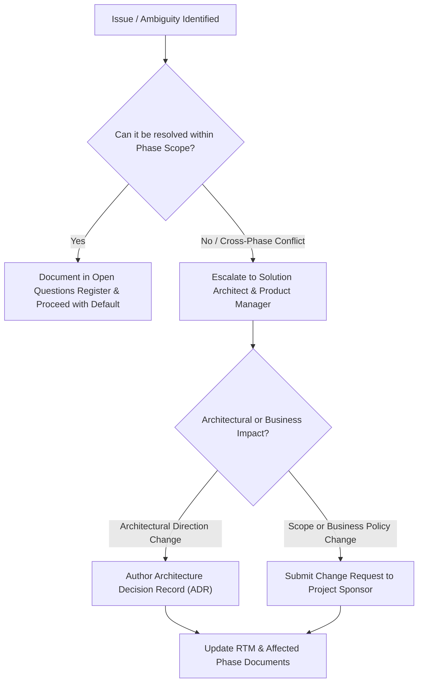

# Stakeholder Responsibility Matrix (RACI): Task Management System

| Metadata Item | Details |
|---|---|
| **Document ID** | DOC-INIT-007 |
| **Document Version** | 1.0.0 |
| **Status** | Approved Baseline |
| **Author / Owner Role** | Project Manager & Solution Architect |
| **Creation Date** | 2026-11-03 |
| **Related Requirements** | BR-001 to BR-010 |

---

## 1. Governance Model & RACI Definitions
To ensure accountability, prevent decision gridlocks, and streamline phase progression across the 15 SDLC phases, roles are mapped using the standard RACI framework:
- **R - Responsible**: The role that performs the activity or authors the artifact.
- **A - Accountable**: The sole role with final approval and veto authority. Exactly one 'A' per activity.
- **C - Consulted**: Subject matter experts whose input and feedback must be solicited prior to finalization.
- **I - Informed**: Stakeholders kept updated on progress, outcomes, and milestones.

---

## 2. SDLC Phase RACI Matrix

| SDLC Phase & Key Deliverable | Project Sponsor | Product Manager / BA | Solution Architect | Software Architect / Dev | Database Architect | Security Architect | DevOps Lead | QA Lead |
|---|:---:|:---:|:---:|:---:|:---:|:---:|:---:|:---:|
| **Phase 1: Project Initiation** (Charter, Scope, Risks, Glossary) | I | **A** | R | C | C | C | C | I |
| **Phase 2: Requirements & Analysis** (BRD, PRD, SRS, RTM) | I | **A** / R | C | C | C | C | I | C |
| **Phase 3: Business Analysis** (Processes, Workflows, Data Dict) | I | **A** / R | C | C | C | I | I | C |
| **Phase 4: High-Level Architecture** (C4, Topologies, ADRs) | I | C | **A** / R | C | C | C | C | I |
| **Phase 5: Low-Level Design** (Classes, Sequence, Patterns) | I | I | C | **A** / R | C | C | I | C |
| **Phase 6: Database Design** (PostgreSQL schemas, Flyway, DBR) | I | I | C | C | **A** / R | C | I | C |
| **Phase 7: API Design** (REST specs, OpenAPI contracts) | I | C | C | **A** / R | C | C | I | C |
| **Phase 8: Kafka & Event Design** (Event schemas, Outbox, DLT) | I | I | C | **A** / R | C | I | C | C |
| **Phase 9: Security & Resilience** (JWT, Threat model, CB) | I | I | C | C | I | **A** / R | C | C |
| **Phase 10: Antigravity Automation** (Rules, Workflows, Templates) | I | I | C | **A** / R | I | I | C | C |
| **Phase 11: Infrastructure & Env** (Docker Compose, Ports, Setup) | I | I | C | C | C | C | **A** / R | I |
| **Phase 12: Development Guides** (Coding Standards, Backend/Frontend) | I | I | C | **A** / R | C | I | C | C |
| **Phase 13: Testing & QA** (Test Strategy, Test Cases, Suites) | I | C | I | C | I | I | C | **A** / R |
| **Phase 14: DevOps & CI/CD** (Jenkins Pipeline, Packaging) | I | I | I | C | I | C | **A** / R | C |
| **Phase 15: Observability & Runbooks** (Prometheus, Grafana, Ops Runbooks) | I | I | C | C | I | I | **A** / R | I |
| **Final Documentation Review & Handover** | **A** | R | R | R | R | R | R | R |

---

## 3. Decision Escalation Protocol

---

## 4. Review Checklist
- [x] Clear RACI assignments across all 15 SDLC phases.
- [x] Exactly one 'A' (Accountable) designated for every deliverable.
- [x] Clear escalation flowchart for handling technical and business blockers.

---

## 5. Change History
| Version | Date | Author | Summary of Changes |
|---|---|---|---|
| 1.0.0 | 2026-11-03 | Project Manager | Initial baseline RACI matrix creation. |

