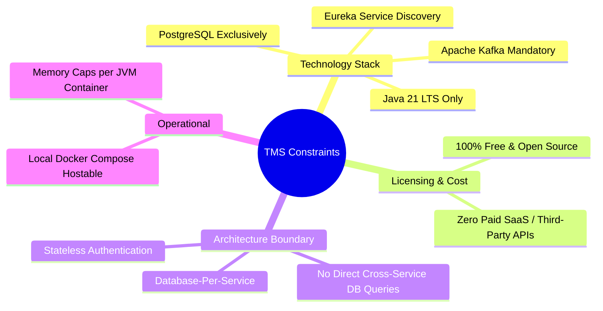

# Project Constraints: Task Management System

| Metadata Item | Details |
|---|---|
| **Document ID** | DOC-INIT-009 |
| **Document Version** | 1.0.0 |
| **Status** | Approved Baseline |
| **Author / Owner Role** | Solution Architect & DevOps Lead |
| **Creation Date** | 2026-11-03 |
| **Related Requirements** | NFR-001 to NFR-010 |

---

## 1. Overview
Project constraints represent firm boundaries, mandated standards, and technical restrictions that cannot be altered without formal architectural review and stakeholder re-negotiation.

---

## 2. Master Constraints Register

| Constraint ID | Category | Constraint Statement | Rationale | Enforcement Mechanism |
|---|---|---|---|---|
| **CST-001** | Language / Runtime | **Java 21 LTS** is the mandatory backend language version across all microservices. | Ensures modern virtual threads (Project Loom) readiness, record classes, pattern matching, and LTS stability. | Maven compiler plugin enforcement (`<release>21</release>`) in all `pom.xml` files. |
| **CST-002** | Messaging Platform | **Apache Kafka** is mandatory. RabbitMQ or other message brokers are explicitly disallowed. | Meets the asynchronous event log, partitioning, and replayability baseline required by the solution architecture. | Docker Compose Kafka container definition; Spring Kafka dependencies. |
| **CST-003** | Database Engine | **PostgreSQL** is the sole persistent relational database engine. No NoSQL or secondary database engines are permitted in MVP. | Proven ACID compliance, JSON support, indexing capabilities, and containerized lightweight footprint. | PostgreSQL 16 containers; Spring Data JPA dialect configuration. |
| **CST-004** | Architecture Boundary | **Database-per-Service** is mandatory. Services must never share databases, schemas, or execute cross-service SQL joins. | Enforces bounded contexts, prevents tight schema coupling, and allows services to scale and migrate independently. | Architecture review, isolated Flyway locations, distinct DB credentials. |
| **CST-005** | Service Discovery | **Spring Cloud Netflix Eureka** must be used for service discovery and dynamic instance registration. | Provides resilient client-side load balancing and decouples the API Gateway from hardcoded IP addresses. | `service-discovery` Eureka Server module; `@EnableEurekaClient` on services. |
| **CST-006** | Cost & Licensing | The application must use **100% Free and Open-Source Software (FOSS)**. No paid third-party cloud services (AWS, SendGrid, Auth0) permitted. | Preserves zero-budget educational and deployment portability. | Solution Architect review of all dependencies and Docker specifications. |
| **CST-007** | Local Host Footprint | The entire multi-service stack must be orchestratable via Docker Compose on a standard developer workstation (16GB RAM). | Enables rapid local development, automated testing, and CI/CD execution without dedicated cloud clusters. | JVM memory tuning (`-Xms256m -Xmx512m`) per container in `docker-compose.yml`. |
| **CST-008** | Security & Compliance | Plaintext passwords must never be stored, logged, or transmitted in responses. Multi-tenant data bleed must be impossible. | OWASP Top 10 compliance and user data confidentiality. | BCrypt password hashing; Spring Security filter chains; DTO masking. |

---

## 3. Review Checklist
- [x] All 8 core constraints cataloged with unique IDs (`CST-xxx`).
- [x] Explicit mandate of Java 21, Kafka, PostgreSQL, and Eureka confirmed.
- [x] Enforcement mechanisms and technical rationale documented.

---

## 4. Change History
| Version | Date | Author | Summary of Changes |
|---|---|---|---|
| 1.0.0 | 2026-11-03 | Solution Architect | Initial baseline project constraints document. |

