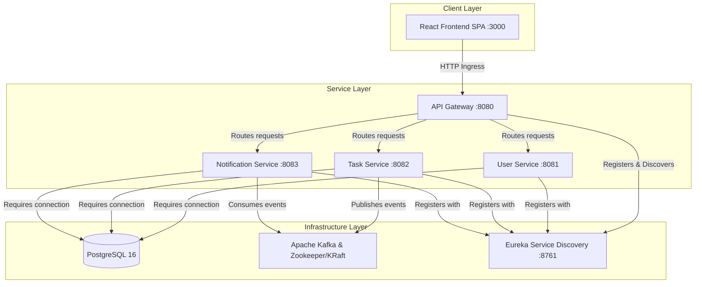

# Project Dependencies: Task Management System

| Metadata Item | Details |
|---|---|
| **Document ID** | DOC-INIT-010 |
| **Document Version** | 1.0.0 |
| **Status** | Approved Baseline |
| **Author / Owner Role** | Solution Architect & DevOps Lead |
| **Creation Date** | 2026-11-03 |
| **Related Requirements** | NFR-001 to NFR-010 |

---

## 1. Overview
This document catalogs internal, external, infrastructural, and lifecycle dependencies required for the design, development, execution, and verification of the Task Management System.

---

## 2. Infrastructure & Runtime Dependencies



---

## 3. Master Dependencies Register

| Dependency ID | Category | Dependency Name & Description | Minimum Required Version | Criticality | Failure Impact & Fallback |
|---|---|---|---|---|---|
| **DEP-001** | Tooling / Runtime | **Java Development Kit (JDK)**<br>Local developer and CI build runtime. | OpenJDK 21 LTS | Critical | Build fails immediately. Maven wrapper verifies Java version. |
| **DEP-002** | Tooling / Build | **Apache Maven**<br>Build, dependency management, and packaging tool. | Maven 3.9+ (or included Maven Wrapper `mvnw`) | Critical | Services cannot compile or run automated tests. `mvnw` guarantees consistency. |
| **DEP-003** | Tooling / Frontend | **Node.js & npm / yarn**<br>Runtime for compiling and serving React TypeScript SPA. | Node.js 20 LTS (Active) | High | Frontend build and dev server cannot run. Docker multi-stage build provides fallback. |
| **DEP-004** | Container Platform | **Docker & Docker Compose**<br>Container virtualization for local microservices, DBs, and Kafka. | Docker 24+, Compose v2 | Critical | Multi-container local orchestration cannot run. Services must be started manually if missing. |
| **DEP-005** | Service Ingress | **Eureka Service Discovery**<br>Registry must be available before Gateway or microservices start routing. | Spring Cloud 2023.x Eureka Server | High | Gateway cannot dynamically resolve upstream service hostnames (`lb://task-service`). Gateway falls back to direct URL config if needed. |
| **DEP-006** | Data Persistence | **PostgreSQL Database Instances**<br>Dedicated databases (`user_db`, `task_db`, `notification_db`) must be reachable. | PostgreSQL 16 Alpine | Critical | Spring Boot fail-fast on startup if datasource connection fails during Flyway migration. |
| **DEP-007** | Event Messaging | **Apache Kafka Broker**<br>Broker cluster/single-node must accept connections on `:9092`. | Apache Kafka 3.7+ | High | Task service outbox poller pauses publishing; Notification service consumer enters retry/reconnect loop. |
| **DEP-008** | Security Ingress | **Shared JWT Secret / Public Key**<br>API Gateway and User Service must agree on signing key or RSA public key. | HMAC-SHA256 (256-bit min) or RSA-2048 | Critical | Gateway rejects all client tokens as invalid (`401 Unauthorized`). |
| **DEP-009** | CI / CD Tool | **Jenkins CI Server**<br>Containerized orchestrator for executing pipeline builds. | Jenkins LTS (JDK 21 base) | Medium | Manual `mvn clean verify` and `docker build` required as fallback. |

---

## 4. Phase-by-Phase Documentation Dependencies

```mermaid
flowchart LR
    P1[Phase 1: Initiation] --> P2[Phase 2: Requirements]
    P2 --> P3[Phase 3: Business Analysis]
    P3 --> P4[Phase 4: High-Level Architecture]
    P4 --> P5[Phase 5: LLD]
    P4 --> P6[Phase 6: DB Design]
    P5 & P6 --> P7[Phase 7: API Design]
    P4 & P6 --> P8[Phase 8: Kafka Design]
    P4 & P7 --> P9[Phase 9: Security Design]
    P1 to P9 --> P10[Phase 10: Antigravity Automation]
    P4 to P9 --> P11[Phase 11: Infrastructure]
    P5 to P11 --> P12[Phase 12: Development]
    P2 & P7 & P8 --> P13[Phase 13: QA & Testing]
    P11 & P12 --> P14[Phase 14: DevOps]
    P11 to P14 --> P15[Phase 15: Observability]
```

---

## 5. Review Checklist
- [x] Complete infrastructure and service dependency graph mapped.
- [x] Detailed versions and criticality cataloged for all runtimes.
- [x] Strict phase-to-phase documentation dependencies visualised.

---

## 6. Change History
| Version | Date | Author | Summary of Changes |
|---|---|---|---|
| 1.0.0 | 2026-11-03 | DevOps Lead & Solution Architect | Initial baseline project dependencies document. |

