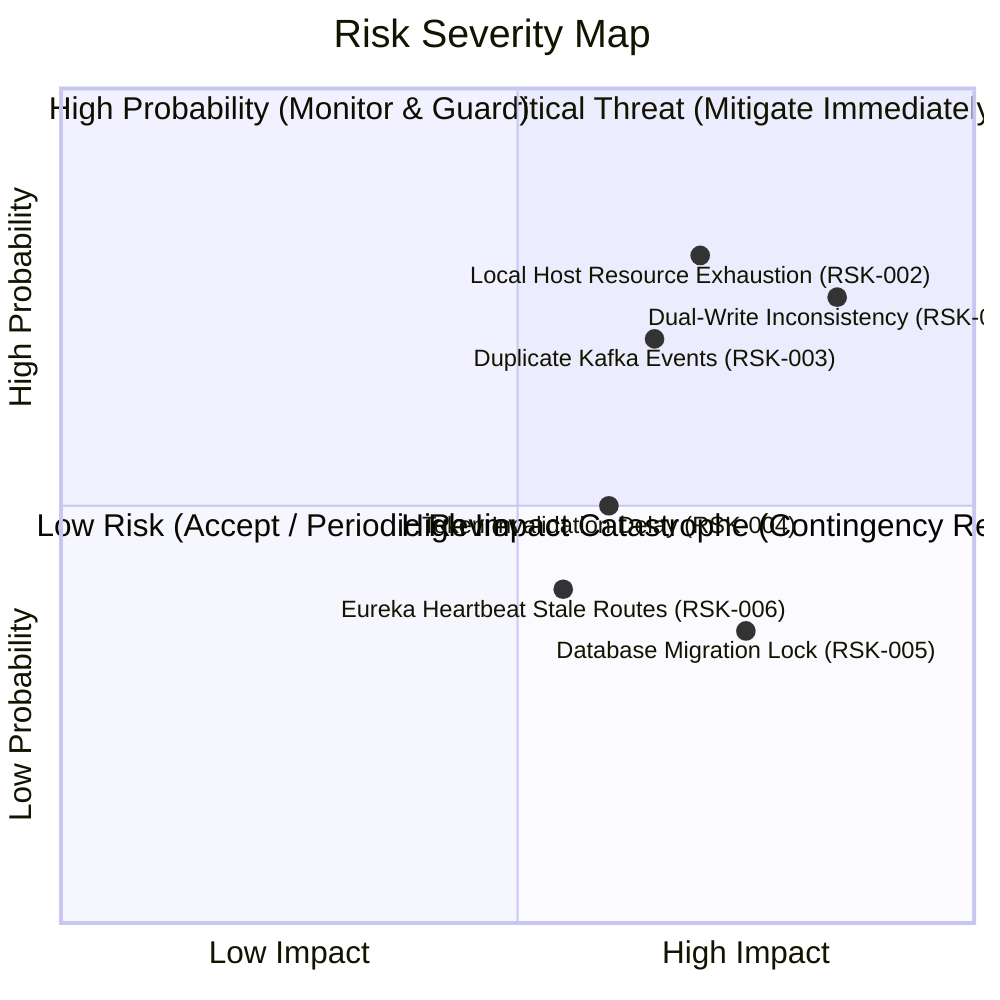

# Initial Risk Register: Task Management System

| Metadata Item | Details |
|---|---|
| **Document ID** | DOC-INIT-011 |
| **Document Version** | 1.0.0 |
| **Status** | Approved Baseline |
| **Author / Owner Role** | Solution Architect & Quality Assurance Lead |
| **Creation Date** | 2026-11-03 |
| **Related Requirements** | All BRs, NFRs, and Security Requirements |

---

## 1. Risk Assessment Framework
Risks are evaluated using a standard 3x3 Probability-Impact matrix:
- **Probability ($P$)**: Low (1), Medium (2), High (3)
- **Impact ($I$)**: Low (1), Medium (2), High (3)
- **Risk Score ($R = P \times I$)**:
  - **1 to 2**: Low Risk (Monitor)
  - **3 to 4**: Medium Risk (Mitigate actively)
  - **6 to 9**: High / Critical Risk (Mandatory architectural safeguard)

---

## 2. Master Risk Register

| Risk ID | Category | Risk Description | Probability (1-3) | Impact (1-3) | Score | Mitigation Strategy | Contingency Plan | Owner | Status |
|---|---|---|:---:|:---:|:---:|---|---|---|---|
| **RSK-001** | Architecture / Consistency | **Dual-Write Inconsistency** Task Service commits task row to DB but fails to publish Kafka event due to network blip, leading to lost notifications. | 2 | 3 | **6** | Implement the **Transactional Outbox Pattern**: write event to `outbox_events` table in same DB transaction; publish asynchronously. | Background scheduled poller retries pending outbox rows with exponential backoff. | Software Architect | Mitigated by Design |
| **RSK-002** | Infrastructure / Local | **Local Resource Exhaustion** Running 5 Spring Boot JVMs, 3 PostgreSQL DBs, Kafka, Zookeeper, Prometheus, and Grafana simultaneously exhausts 16GB developer RAM. | 3 | 2 | **6** | Enforce strict JVM memory caps in `docker-compose.yml` (`-Xms128m -Xmx256m`); use lightweight Alpine base images; consolidate DB instances under single PG cluster with separate DBs. | Allow running individual services natively on host during local development while keeping infra in Docker. | DevOps Lead | Open / Monitored |
| **RSK-003** | Messaging / Data | **Duplicate Kafka Delivery** Network retries or rebalances cause Notification Service to consume the same event multiple times, creating duplicate notifications. | 2 | 2 | **4** | Enforce **Idempotent Consumer Pattern**: maintain `consumed_events` table with unique constraint on `event_id`; insert inside processing transaction. | Log warning and discard event if primary key violation occurs on `event_id`. | Lead Backend Dev | Mitigated by Design |
| **RSK-004** | Security | **JWT Revocation Latency** Stateless JWT tokens remain valid until expiration even after user logs out or changes password. | 2 | 2 | **4** | Configure short Access Token lifetime (15 minutes). Enforce Refresh Token rotation in User Service database. | Client deletes access token from local storage immediately on logout. | Security Architect | Resolved (Design Accepted) |
| **RSK-005** | Database | **Flyway Migration Failure on Startup** Schema migration script syntax error or lock contention blocks microservice startup. | 1 | 3 | **3** | Require strict pre-merge local and CI automated migration validation; test migrations against disposable PostgreSQL containers. | Flyway repair commands and rollback script templates documented in Phase 6. | Database Architect | Mitigated by CI |
| **RSK-006** | Service Ingress | **Eureka Stale Routing Cache** A terminated microservice instance remains in Eureka registry during heartbeat timeout window (30s), leading to gateway 503 errors. | 2 | 2 | **4** | Configure Spring Cloud Gateway retry filter with circuit breaker (Resilience4j) on `ConnectException`. Tune Eureka lease renewal interval to 10s. | Gateway retries alternate active instance or returns graceful error response. | Solution Architect | Mitigated by Design |
| **RSK-007** | Code Quality | **Discrepancy Between Skeletons and Java 21 Target** Existing repository generated with Java 17 and starter POMs without Spring Cloud dependencies. | 3 | 2 | **6** | Systematically update all `pom.xml` configurations to Java 21, Spring Boot 3.3.x, and Spring Cloud 2023.x in Phase 11/12. | Validate builds using `./mvnw compile` during Phase 12 verification. | Software Architect | Scheduled for Phase 12 |

---

## 3. Review Checklist
- [x] All 7 core architectural and operational risks evaluated.
- [x] Clear numerical scoring and visual severity map provided.
- [x] Actionable mitigation and contingency plans defined for each risk.

---

## 4. Change History
| Version | Date | Author | Summary of Changes |
|---|---|---|---|
| 1.0.0 | 2026-11-03 | QA Lead & Solution Architect | Initial baseline risk register creation. |

