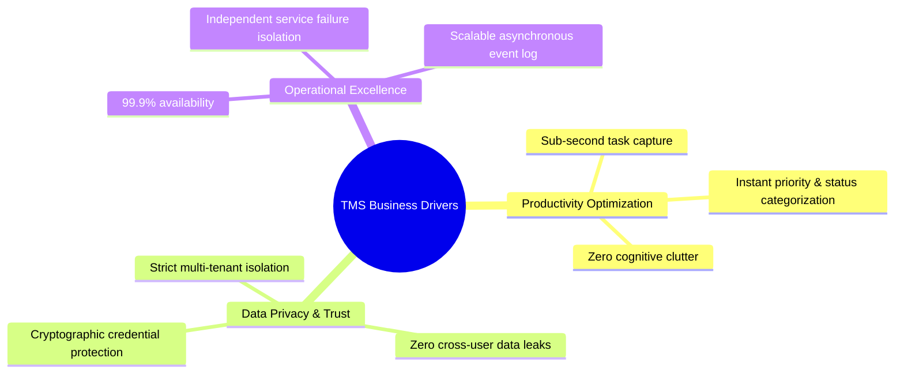

# Business Requirements Document (BRD): Task Management System

| Metadata Item | Details |
|---|---|
| **Document ID** | DOC-REQ-001 |
| **Document Version** | 1.0.0 |
| **Status** | Approved Baseline |
| **Author / Owner Role** | Lead Business Analyst & Product Manager |
| **Creation Date** | 2026-11-03 |
| **Related Documents** | `DOC-INIT-001`, `DOC-INIT-004`, `REG-RTM-001` |

---

## 1. Executive Summary & Business Rationale
Individual knowledge workers face cognitive overload from unstructured task streams, fragmented tools, and slow, monolithic tracking systems. The **Task Management System (TMS)** provides an agile, private, and resilient platform that centralizes personal task management, ensures absolute data privacy, delivers sub-second interaction speeds, and asynchronously notifies users of relevant task lifecycle events.

---

## 2. Business Drivers & Goals

- **Driver 1 (Speed to Action)**: Minimize time spent managing tasks rather than completing them. Target: Task creation in < 500ms.
- **Driver 2 (Zero Privacy Compromise)**: Provide rock-solid individual tenancy. Under no circumstance may one user inspect or modify another user's task.
- **Driver 3 (Fault Isolation)**: System operations must not experience cascading failures. If notification ingestion or search slows down, task creation must continue without degradation.

---

## 3. High-Level Business Requirements Catalogue

| BR ID | Business Requirement Title | Priority | Business Value | Confirmed / Proposed | Traceable Functional IDs |
|---|---|:---:|---|:---:|---|
| **BR-001** | Secure User Registration & Lifecycle | P1 (Must) | Enables unique user onboarding, identity establishment, and compliance with data isolation mandates. | Confirmed | FR-001, FR-002, SEC-001 |
| **BR-002** | User Authentication & Token Issuance | P1 (Must) | Secures access to personal data using stateless, cryptographically signed tokens. | Confirmed | FR-003, FR-004, SEC-002 |
| **BR-003** | User Profile Management | P2 (Should)| Empowers users to inspect and update account profile metadata. | Confirmed | FR-005, FR-006, SEC-003 |
| **BR-004** | Core Personal Task Lifecycle | P1 (Must) | Fundamental business capability: Create, Read, Update, and Delete personal tasks. | Confirmed | FR-007 to FR-010 |
| **BR-005** | Task State & Priority Transitions | P1 (Must) | Enables structured progression of tasks through standard workflow states and priority levels. | Confirmed | FR-011, FR-012, BRULE-002 |
| **BR-006** | Querying, Search, Filtering & Pagination | P1 (Must) | Enables users to quickly locate relevant tasks across large volumes without performance degradation. | Confirmed | FR-013 to FR-016 |
| **BR-007** | Dashboard Productivity Summary | P1 (Must) | Provides users with an instantaneous summary of task statuses, urgent priorities, and overdue items. | Confirmed | FR-017, BRULE-007 |
| **BR-008** | Asynchronous In-App Notifications | P2 (Should)| Keeps users aware of significant task events (creations, completions, deadline updates) via an in-app inbox. | Confirmed | FR-018 to FR-020, EVT-001 |
| **BR-009** | Strict Multi-Tenant Data Isolation | P1 (Must) | Guarantees that every task and notification query is strictly partitioned by the authenticated user's ID. | Confirmed | NFR-001, SEC-004, BRULE-001 |
| **BR-010** | Continuous System Observability | P2 (Should)| Ensures real-time operational visibility into microservice health, request latency, and Kafka event delivery. | Confirmed | NFR-002 to NFR-007 |

---

## 4. Detailed Business Requirement Specifications

### 4.1 BR-001: Secure User Registration & Lifecycle
- **Description**: The system must provide a public self-service registration mechanism where individual users create an account with a unique email address and a secure password.
- **Business Actors**: Anonymous Web Visitor.
- **Preconditions**: User does not possess an active account with the provided email.
- **Main Workflow**:
  1. Visitor submits email, display name, and password.
  2. System validates email format and password strength rules.
  3. System checks for email uniqueness in `user_db`.
  4. System hashes the password using BCrypt ($cost \ge 12$).
  5. System persists the user record with UUID identifier and returns HTTP 201 Created.
- **Exceptions / Alternative Workflows**:
  - Email already exists: Return HTTP 409 Conflict with clear error message; do not disclose existing password state.
  - Password does not meet complexity: Return HTTP 400 Bad Request with specific validation feedback.
- **Expected Business Outcome**: User is securely onboarded with zero plain-text credential persistence.

### 4.2 BR-004: Core Personal Task Lifecycle
- **Description**: Authenticated users must be able to create, retrieve, update, and delete tasks in their private personal task repository.
- **Business Actors**: Authenticated User.
- **Preconditions**: Valid JWT token issued by User Service.
- **Main Workflow**:
  1. User submits task creation request (`title`, optional `description`, `dueDate`, `priority`).
  2. System validates that `title` is non-empty (1..255 characters).
  3. System assigns a UUID, defaults status to `TODO` and priority to `MEDIUM` (if unspecified), and binds the record to the authenticated `userId`.
  4. System persists task in `task_db` and queues a `TASK_CREATED` event in the Outbox.
  5. System returns HTTP 201 Created with full task entity.
- **Alternative Workflows (Deletion)**:
  - User requests deletion of task: System marks task as soft-deleted (`is_deleted = true`), publishes `TASK_DELETED` event, and returns HTTP 204 No Content.
- **Expected Business Outcome**: Complete, reliable personal task tracking with event-driven audit trail.

### 4.3 BR-007: Dashboard Productivity Summary
- **Description**: The system must provide real-time aggregate counts of tasks categorized by status (`TODO`, `IN_PROGRESS`, `COMPLETED`, `CANCELLED`), count of `HIGH`/`URGENT` priority items, and count of dynamically evaluated overdue items.
- **Business Actors**: Authenticated User.
- **Preconditions**: User is authenticated; request scoped to user's identity.
- **Main Workflow**:
  1. User navigates to the dashboard view.
  2. Frontend requests `/tasks/metrics/summary`.
  3. Task Service executes an indexed aggregation query filtered strictly by `userId` and `is_deleted = false`.
  4. System evaluates `overdueCount` where `dueDate < now(UTC)` and status is not `COMPLETED` or `CANCELLED`.
  5. System returns HTTP 200 OK with the aggregate counts.
- **Expected Business Outcome**: User obtains instant visibility into daily productivity and urgent deadlines.

---

## 5. Review Checklist
- [x] All 10 Business Requirements documented with unique IDs (`BR-001` to `BR-010`).
- [x] Clear prioritization, value statements, workflows, and alternative paths defined.
- [x] Alignment with multi-tenant data isolation and event-driven architecture confirmed.

---

## 6. Change History
| Version | Date | Author | Summary of Changes |
|---|---|---|---|
| 1.0.0 | 2026-11-03 | Lead Business Analyst | Initial baseline Business Requirements Document. |

