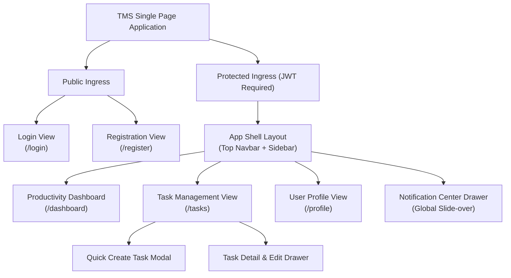

# Product Requirements Document (PRD): Task Management System

| Metadata Item | Details |
|---|---|
| **Document ID** | DOC-REQ-002 |
| **Document Version** | 1.0.0 |
| **Status** | Approved Baseline |
| **Author / Owner Role** | Product Manager |
| **Creation Date** | 2026-11-03 |
| **Related Documents** | `DOC-REQ-001`, `DOC-INIT-004`, `REG-RTM-001` |

---

## 1. Product Vision & User Experience (UX) Principles
The **Task Management System (TMS)** delivers a lightning-fast, distraction-free task management experience. The product adheres to three guiding UX tenets:
1. **Zero-Latency Feel**: UI updates optimistically; state changes reflect immediately with subtle asynchronous synchronization indicators.
2. **Context-Preserving Navigation**: Modal and drawer-based creation flows prevent users from losing their current filter or search context.
3. **Information Density with Breathing Room**: Visual badges (color-coded priorities and statuses) provide scannable density without visual noise.

---

## 2. Information Architecture & Navigation Hierarchy

---

## 3. Product Feature Specifications

### 3.1 Authentication & Onboarding Views
- **Registration Screen (`/register`)**:
  - Fields: Full Name (1..100 chars), Email (RFC 5322), Password (min 8 chars, 1 uppercase, 1 number, 1 special char), Confirm Password.
  - Inline validation feedback on blur.
  - One-click submission with submit-button disable state during network call.
- **Login Screen (`/login`)**:
  - Fields: Email, Password, "Remember Me" checkbox.
  - Action: On success, persists Access Token in memory and Refresh Token in secure storage; redirects user to `/dashboard`.

### 3.2 Productivity Dashboard View (`/dashboard`)
- **Metric KPI Cards**:
  - *Total Tasks*: Total active tasks (`is_deleted = false`).
  - *To Do*: Tasks in `TODO` state (Blue accent).
  - *In Progress*: Tasks in `IN_PROGRESS` state (Amber accent).
  - *Completed*: Tasks in `COMPLETED` state (Green accent).
  - *Cancelled*: Tasks in `CANCELLED` state (Gray accent).
  - *Urgent & High*: Tasks requiring immediate action (Red accent).
  - *Overdue*: Tasks whose due date is in the past and status is not completed/cancelled (Pulse alert icon).
- **Recent Activity Feed**: Displays the 5 most recent in-app notifications with quick click-through to affected tasks.

### 3.3 Task Management View (`/tasks`)
- **Control Bar**:
  - *Search Input*: Debounced (300ms) full-text query bar searching across title and description.
  - *Status Filter*: Multi-select dropdown (`All`, `TODO`, `IN_PROGRESS`, `COMPLETED`, `CANCELLED`).
  - *Priority Filter*: Multi-select dropdown (`All`, `LOW`, `MEDIUM`, `HIGH`, `URGENT`).
  - *Sort Control*: Dropdown selecting sort field (`Due Date`, `Priority`, `Creation Date`, `Title`) and direction (`Ascending`, `Descending`).
  - *New Task Button*: High-contrast CTA opening Quick Create Modal.
- **Task Table / Card Grid**:
  - Responsive toggle (Table view on desktop, Card view on mobile/tablet).
  - Columns: Checkbox/Status toggle, Title & description snippet, Priority badge, Due date (relative time e.g., "Tomorrow at 5 PM" with overdue highlight), Actions (Edit, Delete).
- **Pagination Bar**:
  - Page size selector (`10`, `25`, `50` items per page).
  - Page navigation (`First`, `Previous`, `Current of Total`, `Next`, `Last`).

### 3.4 Task Create & Edit Modals
- **Fields**:
  - Title (mandatory, max 255 chars, auto-focus on open).
  - Description (optional, rich plain-text textarea, max 2000 chars).
  - Priority (segmented button group: Low, Medium [default], High, Urgent).
  - Status (dropdown: defaults to TODO on create; editable on update).
  - Due Date & Time (HTML5 datetime-local picker, stored in UTC).
- **Keyboard Shortcuts**: `Ctrl/Cmd + Enter` saves; `Escape` closes modal.

### 3.5 Global In-App Notification Center
- **Access**: Bell icon in top navbar showing unread badge count (e.g., `3`).
- **Drawer Behavior**: Clicking bell opens a slide-over drawer displaying chronological list of notifications.
- **Notification Card Content**:
  - Icon indicating event type (New Task, Status Transition, Due Date Update, Task Deletion).
  - Notification message (e.g., *"Task 'Prepare Architecture Review' was marked COMPLETED"*).
  - Timestamp (relative, e.g., "10 minutes ago").
  - Unread indicator dot.
- **Actions**: "Mark All as Read" header button; individual click marks single notification as read.

---

## 4. Non-Functional Product Targets
- **Performance**: Time to Interactive (TTI) < 1.2s on standard broadband; search debounce response < 200ms.
- **Accessibility**: WCAG 2.1 AA compliance across contrast, keyboard navigation, and aria labels.
- **Responsiveness**: Fully fluid layout supporting screen resolutions from 360px (mobile) to 4K displays.

---

## 5. Review Checklist
- [x] Information architecture and route hierarchy visualized with Mermaid.
- [x] Detailed UI widget and interaction specs documented for all views.
- [x] Accessibility and responsiveness targets explicitly defined.

---

## 6. Change History
| Version | Date | Author | Summary of Changes |
|---|---|---|---|
| 1.0.0 | 2026-11-03 | Product Manager | Initial baseline Product Requirements Document. |

