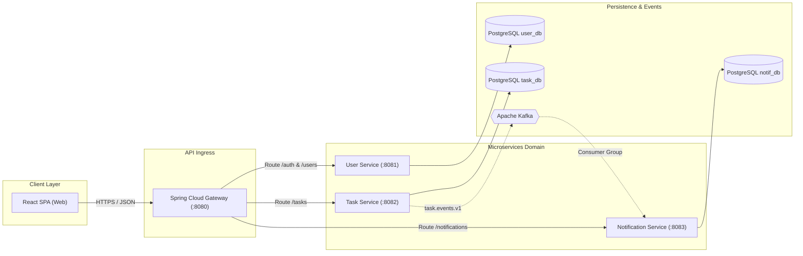

# Software Requirements Specification (SRS): Task Management System

| Metadata Item | Details |
|---|---|
| **Document ID** | DOC-REQ-003 |
| **Standard Compliance** | IEEE 830 / ISO/IEC/IEEE 29148 |
| **Document Version** | 1.0.0 |
| **Status** | Approved Baseline |
| **Author / Owner Role** | Software Architect & Lead Business Analyst |
| **Creation Date** | 2026-11-03 |
| **Related Documents** | `DOC-REQ-001`, `DOC-REQ-002`, `REG-RTM-001` |

---

## 1. Introduction

### 1.1 Purpose
This Software Requirements Specification (SRS) establishes the definitive technical requirements for the **Task Management System (TMS)**. It specifies functional interfaces, performance metrics, data constraints, system security, and asynchronous event interactions.

### 1.2 Scope of the Software
The software comprises five containerized Spring Boot backend microservices, a React TypeScript Single Page Application (SPA), an Apache Kafka event backbone, and three independent PostgreSQL databases.

---

## 2. Overall Description

### 2.1 Product Perspective & Microservice Topology
TMS operates as a decoupled distributed system. Each service maintains isolated data persistence and business logic:
- `api-gateway`: Handles client TLS termination, CORS, routing, and JWT token authentication.
- `user-service`: Manages user credentials, password hashing, and token issuance.
- `task-service`: Manages tasks, queries, pagination, and transactional outbox event publishing.
- `notification-service`: Consumes task domain events and persists in-app notifications.
- `service-discovery`: Eureka registry providing dynamic service location.

### 2.2 User Characteristics
The primary users are individual knowledge workers with basic web browser literacy who require private, reliable, and responsive personal task organization.

### 2.3 General Constraints
1. Must execute on Java 21 LTS runtime.
2. Must run fully containerized under Docker and Docker Compose on a 16GB developer machine.
3. Zero direct database connections between microservices.
4. All inter-service event communication must use Apache Kafka (RabbitMQ is prohibited).

---

## 3. External Interface Requirements

### 3.1 User Interfaces
- Responsive React 18 web application delivering accessible (WCAG 2.1 AA) interfaces across mobile (360px+), tablet, and desktop viewports.

### 3.2 Hardware & Hosting Interfaces
- Standard x86-64 or ARM64 container host. Minimum host allocation: 4 vCPU, 8 GB RAM, 20 GB disk storage.

### 3.3 Software & Protocol Interfaces
- **HTTP / REST**: RESTful JSON over HTTP/1.1 (HTTPS in staging/production).
- **Service Discovery**: Spring Cloud Netflix Eureka REST API.
- **Event Mesh**: Apache Kafka binary TCP protocol on port `9092`.
- **Database Driver**: PostgreSQL JDBC driver over TCP port `5432`.

### 3.4 Communications Interfaces
- Ingress: Port `8080` (API Gateway).
- Downstream Internal: Port `8081` (User), `8082` (Task), `8083` (Notification), `8761` (Eureka).
- Telemetry: Spring Boot Actuator endpoints on `/actuator/health` and `/actuator/prometheus`.

---

## 4. Master Functional Requirements Catalogue

| FR ID | Feature Domain | Requirement Statement | Priority | Verification Method |
|---|---|---|:---:|---|
| **FR-001** | User / Auth | System shall register new users with email, password, and full name, enforcing email format and password complexity. | P1 | Automated API Test |
| **FR-002** | User / Auth | System shall securely hash passwords using BCrypt with salt rounds $\ge 12$ prior to persistence. | P1 | Unit & Security Audit |
| **FR-003** | User / Auth | System shall authenticate valid credentials and issue an HMAC-SHA256 signed JWT Access Token (15m) and Refresh Token (7d). | P1 | Automated API Test |
| **FR-004** | User / Auth | System shall exchange a valid Refresh Token for a new Access Token and invalidate the prior refresh token (rotation). | P1 | Integration Test |
| **FR-005** | User / Profile | System shall return the authenticated user's profile metadata via `GET /users/me`. | P2 | Automated API Test |
| **FR-006** | User / Profile | System shall update profile fields (`fullName`) via `PUT /users/me` for the authenticated user only. | P2 | Automated API Test |
| **FR-007** | Task / CRUD | System shall create a task with mandatory `title`, default status `TODO`, default priority `MEDIUM`, and assigned `userId`. | P1 | API & DB Test |
| **FR-008** | Task / CRUD | System shall retrieve a specific task by UUID, returning HTTP 404 if not found or if owned by another user. | P1 | Multi-Tenant Test |
| **FR-009** | Task / CRUD | System shall update title, description, priority, and due date of an existing task owned by the user. | P1 | Automated API Test |
| **FR-010** | Task / CRUD | System shall soft delete a task (`is_deleted = true`, `deleted_at = UTC timestamp`) upon `DELETE /tasks/{id}`. | P1 | API & DB Test |
| **FR-011** | Task / Workflow | System shall transition task status (`TODO` $\rightarrow$ `IN_PROGRESS` $\rightarrow$ `COMPLETED` $\rightarrow$ `CANCELLED`) via `PATCH /tasks/{id}/status`. | P1 | State Machine Test |
| **FR-012** | Task / Workflow | System shall update task priority (`LOW`, `MEDIUM`, `HIGH`, `URGENT`) via `PATCH /tasks/{id}/priority`. | P1 | Automated API Test |
| **FR-013** | Task / Query | System shall search tasks by keyword case-insensitively across `title` and `description`. | P1 | Integration Test |
| **FR-014** | Task / Query | System shall filter tasks by exact match on `status`, `priority`, and date range on `dueDate`. | P1 | Integration Test |
| **FR-015** | Task / Query | System shall sort tasks by `dueDate`, `priority`, `createdAt`, or `title` in ascending or descending order. | P1 | Integration Test |
| **FR-016** | Task / Query | System shall paginate task queries returning `page`, `size`, `totalElements`, and `totalPages`. | P1 | Integration Test |
| **FR-017** | Dashboard | System shall aggregate task counts by status, high priority, and dynamic overdue flag via `/tasks/metrics/summary`. | P1 | Integration Test |
| **FR-018** | Event / PubSub | Task Service shall publish `TASK_CREATED`, `TASK_UPDATED`, `TASK_COMPLETED`, `TASK_DELETED` events to Kafka topic `task.events.v1` using Transactional Outbox. | P1 | Embedded Kafka Test |
| **FR-019** | Notification | Notification Service shall consume task events, deduplicate via `event_id`, and persist in-app notifications. | P1 | Integration Test |
| **FR-020** | Notification | System shall list user notifications, support pagination, and permit marking individual or all notifications as read. | P2 | Automated API Test |

---

## 5. Non-Functional Requirements Summary

| NFR ID | Category | Metric / Specification | Verification Method |
|---|---|---|---|
| **NFR-001** | Security / Isolation | 100% of data queries must enforce `user_id = :authenticatedUserId`. Zero cross-tenant data bleed. | Security & Multi-tenant Tests |
| **NFR-002** | Latency (Read) | API Gateway p95 latency for task list and detail queries shall be $< 200\text{ ms}$ under 50 concurrent requests. | JMeter / Gatling Load Test |
| **NFR-003** | Latency (Write) | API Gateway p95 latency for task creation/update shall be $< 350\text{ ms}$ under 50 concurrent requests. | Load Test |
| **NFR-004** | Availability | Services shall achieve 99.9% uptime with independent failure isolation. | Chaos / Health Probe Audits |
| **NFR-005** | Event Reliability | Zero event loss during broker downtime using Transactional Outbox table in PostgreSQL. | Broker Partition Simulation |
| **NFR-006** | Memory Footprint | Total heap memory per JVM microservice shall be constrained to max 512MB (`-Xmx512m`). | Container Metric Inspection |
| **NFR-007** | Observability | Microservices shall export Prometheus metrics and Actuator health probes on `/actuator`. | Prometheus Scrape Test |

---

## 6. Review Checklist
- [x] Conforms to IEEE 830 / ISO/IEC/IEEE 29148 standards structure.
- [x] All 20 Functional Requirements (`FR-001` to `FR-020`) cataloged with priority and verification methods.
- [x] Non-Functional Requirements defined with quantitative targets.

---

## 7. Change History
| Version | Date | Author | Summary of Changes |
|---|---|---|---|
| 1.0.0 | 2026-11-03 | Software Architect | Initial baseline Software Requirements Specification. |

