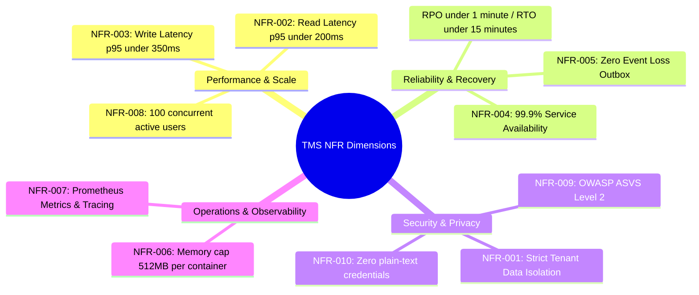

# Non-Functional Requirements Document (NFRD): Task Management System

| Metadata Item | Details |
|---|---|
| **Document ID** | DOC-REQ-005 |
| **Document Version** | 1.0.0 |
| **Status** | Approved Baseline |
| **Author / Owner Role** | Solution Architect & DevOps Lead |
| **Creation Date** | 2026-11-03 |
| **Related Documents** | `DOC-REQ-003`, `REG-RTM-001` |

---

## 1. Overview
Non-Functional Requirements (NFRs) define the operational quality attributes, performance ceilings, architectural constraints, security benchmarks, and reliability characteristics of the Task Management System.

---

## 2. NFR Classification & Architecture Cross-Reference

---

## 3. Detailed Non-Functional Requirements

### 3.1 Security & Data Isolation
- **NFR-001: Strict Multi-Tenant Data Scoping**:
  - *Specification*: Under no circumstance shall any SQL query or API response return data belonging to a user other than the authenticated principal (`X-User-Id`).
  - *Verification*: Automated integration tests verify that User B receives HTTP 404 (or 403) when attempting `GET`, `PUT`, `DELETE`, or `PATCH` on a task or notification created by User A.
- **NFR-009: OWASP Security Standard Compliance**:
  - *Specification*: The application must mitigate OWASP Top 10 vulnerabilities. Protection against SQL injection via parameterized queries (Spring Data JPA), XSS protection via React output encoding, and CSRF protection via stateless JWT tokens.
- **NFR-010: Credential Protection**:
  - *Specification*: Passwords must be hashed using BCrypt ($cost = 12$). Passwords and JWT secrets must never appear in application logs or stack traces.

### 3.2 Performance & Scalability
- **NFR-002: Read Query Latency**:
  - *Specification*: The 95th percentile (p95) response latency measured at the API Gateway for `GET /api/v1/tasks`, `GET /api/v1/tasks/{id}`, and `GET /api/v1/tasks/metrics/summary` must be $< 200\text{ ms}$ under a load of 50 concurrent requests.
- **NFR-003: Mutation Query Latency**:
  - *Specification*: The p95 response latency for `POST /api/v1/tasks`, `PUT /api/v1/tasks/{id}`, and `PATCH` endpoints must be $< 350\text{ ms}$ under 50 concurrent requests.
- **NFR-008: Scalability & Connection Pooling**:
  - *Specification*: Each microservice must configure HikariCP connection pooling (`maximum-pool-size: 10`, `minimum-idle: 5`) to ensure database connection stability under load spikes without exhausting PostgreSQL server connection limits.

### 3.3 Reliability & Fault Tolerance
- **NFR-004: Service Availability SLA**:
  - *Specification*: Core services (`api-gateway`, `user-service`, `task-service`) must achieve 99.9% uptime during planned operation.
  - *Fault Isolation*: If `notification-service` or Kafka experiences downtime, `task-service` operations must remain 100% available without user-facing disruption.
- **NFR-005: Zero Event Loss Guarantee**:
  - *Specification*: Task domain events must be durably stored in PostgreSQL `outbox_events` within the same ACID transaction as the task change. Events must not be discarded if Kafka brokers are temporarily unreachable.
  - *Recovery*: Poller retries until Kafka broker acknowledges message publish.

### 3.4 Resource & Operational Constraints
- **NFR-006: Local Container Memory Ceiling**:
  - *Specification*: Every backend Spring Boot container must be configured with JVM heap bounds `-Xms128m -Xmx384m` (max container memory limit: 512MB in `docker-compose.yml`). The entire local developer environment (5 services, 3 DBs, Kafka, Prometheus) must not exceed 10GB total RAM usage.
- **NFR-007: Observability & Telemetry**:
  - *Specification*: Every microservice must expose Actuator endpoints (`/actuator/health`, `/actuator/info`, `/actuator/prometheus`). HTTP request durations, JVM garbage collection, database connection pool statistics, and Kafka consumer lag must be exported to Prometheus.

---

## 4. Verification & Audit Matrix

| NFR ID | Quality Metric | Target Value | Test Strategy | Pass Criteria |
|---|---|---|---|---|
| NFR-001 | Cross-tenant isolation | 0 data leaks | Security multi-tenant test suite | 100% requests pass with 404/403 |
| NFR-002 | Read Latency (p95) | $< 200\text{ ms}$ | Gatling load test at 50 req/sec | Latency report shows p95 $< 200\text{ ms}$ |
| NFR-003 | Write Latency (p95) | $< 350\text{ ms}$ | Gatling load test at 30 req/sec | Latency report shows p95 $< 350\text{ ms}$ |
| NFR-004 | Service Availability | 99.9% uptime | Health probe monitoring during tests | Zero unintended 5xx errors |
| NFR-005 | Event Reliability | 0 lost events | Kill Kafka container during task inserts | Outbox table accumulates; drains on restart |
| NFR-006 | Max Container RAM | $\le 512\text{ MB}$ | `docker stats` inspection | Zero OOMKilled events |
| NFR-007 | Metric Availability | 100% endpoints | Prometheus scrape validation | All service targets show `UP` |

---

## 5. Review Checklist
- [x] All 10 Non-Functional Requirements documented with quantitative benchmarks.
- [x] Verification methods and acceptance pass criteria specified for each NFR.
- [x] Clear memory and local footprint limits aligned with project constraints.

---

## 6. Change History
| Version | Date | Author | Summary of Changes |
|---|---|---|---|
| 1.0.0 | 2026-11-03 | Solution Architect & DevOps Lead | Initial baseline Non-Functional Requirements Document. |

