# User Stories Document: Task Management System

| Metadata Item | Details |
|---|---|
| **Document ID** | DOC-REQ-006 |
| **Document Version** | 1.0.0 |
| **Status** | Approved Baseline |
| **Author / Owner Role** | Product Manager & Lead Business Analyst |
| **Creation Date** | 2026-11-03 |
| **Related Documents** | `DOC-REQ-003`, `DOC-REQ-004`, `REG-RTM-001` |

---

## 1. User Story Index & Epics Overview

```mermaid
graph TD
    Epic1[Epic 1: User Identity & Security] --> US001[US-001: User Registration]
    Epic1 --> US002[US-002: User Login & JWT]
    Epic1 --> US003[US-003: Token Refresh]
    Epic1 --> US004[US-004: Profile Management]

    Epic2[Epic 2: Core Task Management] --> US005[US-005: Create Task]
    Epic2 --> US006[US-006: View Task Details]
    Epic2 --> US007[US-007: Edit Task]
    Epic2 --> US008[US-008: Delete Task]
    Epic2 --> US009[US-009: Change Task Status]
    Epic2 --> US010[US-010: Change Task Priority]

    Epic3[Epic 3: Task Discovery & Analytics] --> US011[US-011: Filter & Search Tasks]
    Epic3 --> US012[US-012: Sort & Paginate Tasks]
    Epic3 --> US013[US-013: Dashboard Metrics]

    Epic4[Epic 4: Event-Driven Notifications] --> US014[US-014: View In-App Notifications]
    Epic4 --> US015[US-015: Mark Notifications as Read]
    Epic4 --> US016[US-016: Resilient Event Dispatch]
```

---

## 2. Detailed User Stories

### Epic 1: User Identity & Security

#### US-001: User Self-Registration
- **User Story**: *As a new visitor, I want to create an account with my email, password, and name, so that I can securely manage my personal tasks.*
- **Priority**: Must Have (P1) | **Story Points**: 3
- **Traceability**: `BR-001`, `FR-001`, `SEC-001`
- **Acceptance Criteria**:
  - **Given** I am on the `/register` screen.
  - **When** I submit a valid RFC 5322 email, strong password ($\ge 8$ chars, uppercase, lowercase, digit, special char), and my name.
  - **Then** my account is created with status `ACTIVE`, password hashed via BCrypt, and I receive HTTP 201 Created.
  - **Given** an email that already exists in the system.
  - **When** I attempt registration with that email.
  - **Then** the system returns HTTP 409 Conflict with an informative message.

#### US-002: User Login & JWT Session Issuance
- **User Story**: *As a registered user, I want to log in using my email and password, so that I receive an access token to interact with protected APIs.*
- **Priority**: Must Have (P1) | **Story Points**: 3
- **Traceability**: `BR-002`, `FR-003`, `SEC-002`
- **Acceptance Criteria**:
  - **Given** active user credentials in `users` table.
  - **When** I submit correct credentials to `/api/v1/auth/login`.
  - **Then** I receive HTTP 200 OK containing an HMAC-SHA256 JWT Access Token (15m expiry) and a Refresh Token (7d expiry).

#### US-003: Refresh Token Exchange
- **User Story**: *As an authenticated user, I want my client to automatically refresh my access token before it expires, so that my session remains uninterrupted.*
- **Priority**: Must Have (P1) | **Story Points**: 3
- **Traceability**: `BR-002`, `FR-004`, `SEC-002`
- **Acceptance Criteria**:
  - **Given** an active, unrevoked refresh token.
  - **When** the client submits it to `/api/v1/auth/refresh`.
  - **Then** the old refresh token is marked revoked and a new access token and refresh token pair are returned.

#### US-004: User Profile View & Update
- **User Story**: *As an authenticated user, I want to view and edit my profile details, so that my account information is current.*
- **Priority**: Should Have (P2) | **Story Points**: 2
- **Traceability**: `BR-003`, `FR-005`, `FR-006`

---

### Epic 2: Core Task Management

#### US-005: Create a New Task
- **User Story**: *As an authenticated user, I want to create a task with a title, optional description, priority, and due date, so that I can track work items.*
- **Priority**: Must Have (P1) | **Story Points**: 5
- **Traceability**: `BR-004`, `FR-007`
- **Acceptance Criteria**:
  - **Given** I am authenticated.
  - **When** I send a POST request with `title = "Draft LLD Document"`, `priority = "HIGH"`, and `dueDate = "2026-11-10T18:00:00Z"`.
  - **Then** the task is persisted in `tasks` table with status `TODO`, my `userId`, and a `TASK_CREATED` event is saved in the outbox.

#### US-006: View Task Details
- **User Story**: *As an authenticated user, I want to view details of a specific task, so that I can read its description and deadlines.*
- **Priority**: Must Have (P1) | **Story Points**: 2
- **Traceability**: `BR-004`, `FR-008`
- **Acceptance Criteria**:
  - **Given** a task belonging to my user.
  - **When** I request `GET /api/v1/tasks/{id}`.
  - **Then** I receive HTTP 200 OK with the task payload.
  - **Given** a task belonging to User B.
  - **When** User A attempts to view it.
  - **Then** system returns HTTP 404 Not Found (zero information leakage).

#### US-007: Edit Task Attributes
- **User Story**: *As an authenticated user, I want to edit a task's title, description, and due date, so that it reflects updated requirements.*
- **Priority**: Must Have (P1) | **Story Points**: 3
- **Traceability**: `BR-004`, `FR-009`

#### US-008: Soft Delete Task
- **User Story**: *As an authenticated user, I want to delete a task, so that it no longer appears in my active task lists.*
- **Priority**: Must Have (P1) | **Story Points**: 2
- **Traceability**: `BR-004`, `FR-010`
- **Acceptance Criteria**:
  - **When** I send `DELETE /api/v1/tasks/{id}`.
  - **Then** `is_deleted` becomes `true`, `deleted_at` is set, `TASK_DELETED` event is stored in outbox, and HTTP 204 No Content is returned.

#### US-009: Change Task Status
- **User Story**: *As an authenticated user, I want to transition a task status (e.g. from TODO to IN_PROGRESS to COMPLETED), so that I can track progress.*
- **Priority**: Must Have (P1) | **Story Points**: 3
- **Traceability**: `BR-005`, `FR-011`
- **Acceptance Criteria**:
  - **When** I send `PATCH /api/v1/tasks/{id}/status` with `{ "status": "COMPLETED" }`.
  - **Then** status updates in database, `TASK_COMPLETED` event is queued in outbox, and HTTP 200 OK is returned.

#### US-010: Change Task Priority
- **User Story**: *As an authenticated user, I want to change a task's priority level, so that I can organize my tasks by urgency.*
- **Priority**: Must Have (P1) | **Story Points**: 2
- **Traceability**: `BR-005`, `FR-012`

---

### Epic 3: Task Discovery & Analytics

#### US-011: Search & Filter Tasks
- **User Story**: *As an authenticated user, I want to search tasks by keyword and filter by status, priority, and date range, so that I can quickly find relevant tasks.*
- **Priority**: Must Have (P1) | **Story Points**: 5
- **Traceability**: `BR-006`, `FR-013`, `FR-014`

#### US-012: Sort & Paginate Tasks
- **User Story**: *As an authenticated user, I want to paginate and sort my task list by due date or priority, so that I can navigate large sets smoothly.*
- **Priority**: Must Have (P1) | **Story Points**: 3
- **Traceability**: `BR-006`, `FR-015`, `FR-016`

#### US-013: View Productivity Dashboard Metrics
- **User Story**: *As an authenticated user, I want to see an overview of my total tasks, status breakdowns, urgent tasks, and overdue items on my dashboard.*
- **Priority**: Must Have (P1) | **Story Points**: 5
- **Traceability**: `BR-007`, `FR-017`

---

### Epic 4: Event-Driven Notifications

#### US-014: View In-App Notifications
- **User Story**: *As an authenticated user, I want to see a list of my in-app notifications generated from task events, so that I stay informed of activity.*
- **Priority**: Should Have (P2) | **Story Points**: 3
- **Traceability**: `BR-008`, `FR-019`, `FR-020`

#### US-015: Mark Notifications as Read
- **User Story**: *As an authenticated user, I want to mark notifications as read individually or all at once, so that my unread badge clears.*
- **Priority**: Should Have (P2) | **Story Points**: 2
- **Traceability**: `BR-008`, `FR-020`

#### US-016: Reliable Event Dispatch & Processing
- **User Story**: *As a system operator, I want task domain events to be published reliably via Kafka with deduplication, so that users receive accurate notifications without duplicates.*
- **Priority**: Must Have (P1) | **Story Points**: 5
- **Traceability**: `BR-008`, `FR-018`, `FR-019`, `NFR-005`

---

## 3. Review Checklist
- [x] All 16 User Stories documented (`US-001` to `US-016`) across 4 epics.
- [x] Given-When-Then acceptance criteria specified.
- [x] Story points and priority assigned.
- [x] Traceability mapped to Business and Functional requirements.

---

## 4. Change History
| Version | Date | Author | Summary of Changes |
|---|---|---|---|
| 1.0.0 | 2026-11-03 | Product Manager | Initial baseline User Stories document. |

