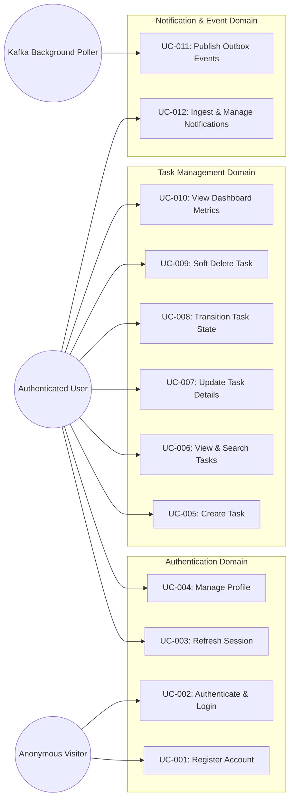

# Use Case Document: Task Management System

| Metadata Item | Details |
|---|---|
| **Document ID** | DOC-REQ-007 |
| **Document Version** | 1.0.0 |
| **Status** | Approved Baseline |
| **Author / Owner Role** | Senior Business Analyst |
| **Creation Date** | 2026-11-03 |
| **Related Documents** | `DOC-REQ-004`, `DOC-REQ-006`, `REG-RTM-001` |

---

## 1. System Use Case Overview

---

## 2. Detailed Use Case Specifications

### UC-001: Register Account
- **Primary Actor**: Anonymous Web Visitor.
- **Preconditions**: Visitor possesses an unallocated email address.
- **Trigger**: Visitor submits registration form on React SPA.
- **Main Success Scenario**:
  1. Visitor inputs `email`, `fullName`, and `password`.
  2. System validates input constraints (email syntax, password complexity).
  3. System checks that `email` does not exist in `user_db`.
  4. System hashes password via BCrypt (cost factor 12).
  5. System persists new User entity with status `ACTIVE` and created timestamp.
  6. System returns HTTP 201 Created with user ID and email.
  7. Client redirects user to `/login` with success alert.
- **Extensions**:
  - `3a. Email already registered`: System returns HTTP 409 Conflict. Client displays "Email address already registered. Please log in or use a different email."
  - `2a. Validation failure`: System returns HTTP 400 Bad Request with field-level errors.

---

### UC-005: Create Personal Task
- **Primary Actor**: Authenticated User.
- **Preconditions**: User presents valid Bearer JWT.
- **Main Success Scenario**:
  1. User fills out task creation form (`title`, `description`, `priority`, `dueDate`) and clicks "Save Task".
  2. Frontend sends `POST /api/v1/tasks` with JSON payload.
  3. API Gateway validates JWT signature and expiry, injects `X-User-Id` header, and forwards request to `task-service`.
  4. Task Service validates that `title` is 1..255 characters.
  5. Task Service begins database transaction:
     - Inserts record into `tasks` table with UUID `id`, `userId = X-User-Id`, `status = TODO`, `priority = MEDIUM` (or supplied), `createdAt = now(UTC)`.
     - Inserts event record into `outbox_events` with `eventType = TASK_CREATED`, `aggregateId = task.id`, and JSON payload.
  6. Database transaction commits atomically.
  7. Task Service returns HTTP 201 Created with persisted entity.
  8. Frontend appends task to active task board and closes modal.
- **Extensions**:
  - `4a. Title missing or whitespace only`: Task Service returns HTTP 400 Bad Request (`ERR_TITLE_REQUIRED`).
  - `5a. Database failure`: Transaction rolls back completely; returns HTTP 500.

---

### UC-008: Transition Task State
- **Primary Actor**: Authenticated User.
- **Preconditions**: Task exists in `tasks` table, is owned by user (`user_id = X-User-Id`), and `is_deleted = false`.
- **Main Success Scenario**:
  1. User toggles status dropdown or moves task card to a new column (e.g., `COMPLETED`).
  2. Frontend sends `PATCH /api/v1/tasks/{id}/status` with `{ "status": "COMPLETED" }`.
  3. Task Service checks existence and ownership.
  4. Task Service updates `status = 'COMPLETED'`, `updated_at = now(UTC)`.
  5. Task Service writes `TASK_COMPLETED` event into `outbox_events`.
  6. Commits transaction and returns HTTP 200 OK.
- **Extensions**:
  - `3a. Task belongs to another user`: Task Service returns HTTP 404 Not Found (information hiding).
  - `3b. Invalid status value`: Returns HTTP 400 Bad Request (`ERR_INVALID_STATUS`).

---

### UC-010: View Dashboard Metrics
- **Primary Actor**: Authenticated User.
- **Main Success Scenario**:
  1. User navigates to `/dashboard`.
  2. Frontend issues `GET /api/v1/tasks/metrics/summary`.
  3. Task Service runs aggregate count query filtered by `user_id`:
     - Counts by status (`TODO`, `IN_PROGRESS`, `COMPLETED`, `CANCELLED`).
     - Counts high priority (`HIGH`, `URGENT`).
     - Evaluates overdue: `due_date < now(UTC)` and status NOT IN (`COMPLETED`, `CANCELLED`).
  4. Returns HTTP 200 OK with metrics DTO.
  5. Frontend renders animated metric cards.

---

### UC-011: Publish Outbox Events
- **Primary Actor**: Spring `@Scheduled` Outbox Poller Worker.
- **Trigger**: Periodic timer (every 1000ms).
- **Main Success Scenario**:
  1. Poller queries `outbox_events` for rows where `processed = false ORDER BY created_at ASC LIMIT 50` with row lock `FOR UPDATE SKIP LOCKED`.
  2. For each row, poller constructs `ProducerRecord` for Kafka topic `task.events.v1` using `aggregate_id` as message partition key.
  3. Poller executes `kafkaTemplate.send()`.
  4. On successful broker acknowledgment, poller marks row `processed = true`, `processed_at = now(UTC)`.
- **Extensions**:
  - `3a. Kafka broker unreachable`: Poller increments retry counter, backoff sleeps, leaves row `processed = false`. No data is lost.

---

### UC-012: Ingest & Manage In-App Notifications
- **Primary Actor**: Kafka Listener (`notification-service`) / Authenticated User.
- **Workflow**:
  1. Listener receives Kafka record from `task.events.v1`.
  2. Listener checks `consumed_events` table for `event_id`.
  3. If not previously consumed, listener maps domain event to user notification and inserts into `notifications` table (`read = false`).
  4. Listener records `event_id` into `consumed_events` within the same transaction.
  5. User queries `GET /api/v1/notifications` to inspect recent notifications.
  6. User clicks "Mark Read", triggering `PATCH /api/v1/notifications/{id}/read`.

---

## 3. Review Checklist
- [x] Use Case diagram and 12 detailed use cases documented.
- [x] Preconditions, postconditions, triggers, and extensions detailed.
- [x] Multi-tenancy and outbox failure branches explicitly modeled.

---

## 4. Change History
| Version | Date | Author | Summary of Changes |
|---|---|---|---|
| 1.0.0 | 2026-11-03 | Senior Business Analyst | Initial baseline Use Case document. |

