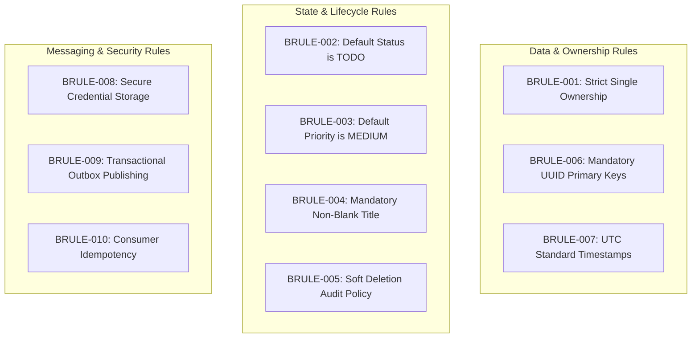

# Business Rules Document: Task Management System

| Metadata Item | Details |
|---|---|
| **Document ID** | DOC-REQ-009 |
| **Document Version** | 1.0.0 |
| **Status** | Approved Baseline |
| **Author / Owner Role** | Lead Business Analyst & Software Architect |
| **Creation Date** | 2026-11-03 |
| **Related Documents** | `DOC-REQ-003`, `DOC-REQ-004`, `REG-RTM-001` |

---

## 1. Overview
Business rules govern system behavior, data integrity, authorization boundaries, and state transitions. These rules are non-negotiable policies enforced consistently across API validation, service domain logic, and database schemas.

---

## 2. Master Business Rules Catalogue

| Rule ID | Rule Name | Category | Enforcement Layer | Description & Policy | Violation Behavior |
|---|---|---|---|---|---|
| **BRULE-001** | Strict Single Ownership | Authorization / Data | Gateway & Service Layer | Every task and notification record belongs to exactly one user (`userId`). Users may never view, modify, or delete another user's records. | Returns HTTP `404 Not Found` (to prevent ID enumeration and information disclosure). |
| **BRULE-002** | Default Task Status | State Transition | Domain Entity & DB | When a task is created without an explicit status, the system must assign status `TODO`. Valid statuses: `TODO`, `IN_PROGRESS`, `COMPLETED`, `CANCELLED`. | Default applied automatically if omitted; HTTP `400 Bad Request` if invalid string provided. |
| **BRULE-003** | Default Task Priority | Domain Policy | Domain Entity & DB | When a task is created without an explicit priority, the system must assign priority `MEDIUM`. Valid priorities: `LOW`, `MEDIUM`, `HIGH`, `URGENT`. | Default applied automatically if omitted; HTTP `400 Bad Request` if invalid priority supplied. |
| **BRULE-004** | Mandatory Non-Blank Title | Data Validation | Bean Validation (`@NotBlank`) & DB | Task title is strictly mandatory. Must contain at least 1 non-whitespace character and cannot exceed 255 characters. | Request rejected with HTTP `400 Bad Request` (`ERR_TITLE_REQUIRED`). Database has `NOT NULL` constraint. |
| **BRULE-005** | Soft Deletion Policy | Data Lifecycle | Repository & DB | Task deletion does not physically remove database rows. The system sets `is_deleted = true` and records `deleted_at = now(UTC)`. Soft-deleted tasks are filtered out from regular read queries. | Direct physical `DELETE` queries are prohibited at the repository layer. |
| **BRULE-006** | UUID Identifier Standard | Data Architecture | Domain Entity & DB | All entity primary keys (`id`, `userId`, `eventId`, `notificationId`) must use UUID Version 4 represented in standard 36-character hyphenated canonical format. | Rejects malformed strings with HTTP `400 Bad Request`. |
| **BRULE-007** | UTC Timestamp Standard | Data Architecture | Service & DB | All timestamps (`createdAt`, `updatedAt`, `dueDate`, `readAt`, `occurredAt`) must be stored and transmitted in Coordinated Universal Time (UTC) conforming to ISO-8601 (`YYYY-MM-DDTHH:mm:ssZ`). | Offsets converted to UTC on ingestion; non-ISO strings rejected with HTTP `400`. |
| **BRULE-008** | Secure Credential Storage | Security Policy | User Service Domain | User passwords must never be stored in plain text or reversible encryption. Passwords must be hashed using BCrypt ($cost \ge 12$). Passwords must never be logged. | Loggers configured with masking filters; entities use `@JsonProperty(access = WRITE_ONLY)`. |
| **BRULE-009** | Outbox Event Reliability | Messaging | Service / Outbox Table | Every task state mutation (`CREATE`, `UPDATE`, `STATUS_CHANGE`, `DELETE`) must write an event record into `outbox_events` in the same database transaction as the task change. | If the outbox write fails, the entire transaction rolls back; no orphaned entity changes exist. |
| **BRULE-010** | Consumer Idempotency | Messaging | Notification Consumer | Notification Service consumers must check `consumed_events` for `event_id` prior to generating in-app notifications. If already processed, the message is safely acknowledged and discarded. | Duplicate message skipped; zero duplicate notifications generated. |

---

## 3. Review Checklist
- [x] All 10 Business Rules documented with unique IDs (`BRULE-001` to `BRULE-010`).
- [x] Enforcement layers and violation behaviors explicitly defined.
- [x] Precedence and cross-service architectural consistency verified.

---

## 4. Change History
| Version | Date | Author | Summary of Changes |
|---|---|---|---|
| 1.0.0 | 2026-11-03 | Lead Business Analyst | Initial baseline Business Rules Document. |

