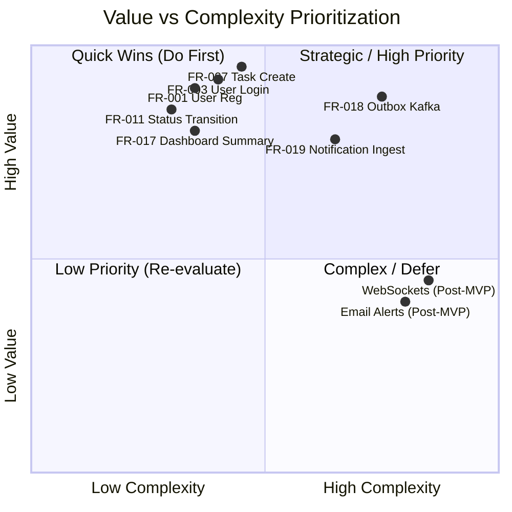

# Requirements Prioritization Matrix: Task Management System

| Metadata Item | Details |
|---|---|
| **Document ID** | DOC-REQ-010 |
| **Document Version** | 1.0.0 |
| **Status** | Approved Baseline |
| **Author / Owner Role** | Product Manager & Solution Architect |
| **Creation Date** | 2026-11-03 |
| **Related Documents** | `DOC-REQ-003`, `DOC-REQ-005`, `REG-RTM-001` |

---

## 1. Prioritization Framework
Requirements are scored and prioritized using two complementary frameworks:
1. **MoSCoW Categorization**:
   - **Must Have (M)**: Non-negotiable requirements for MVP launch. Without them, the system cannot function.
   - **Should Have (S)**: Highly valuable features that complete the user experience (e.g., profile updates, read-all notifications).
   - **Could Have (C)**: Desirable enhancements deferred if timeline constrains delivery.
   - **Won't Have (W)**: Explicitly excluded from MVP baseline; slated for future releases.
2. **Value vs. Complexity Matrix**:
   - Business Value ($1-5$): User satisfaction and business criticality.
   - Architectural Complexity ($1-5$): Development effort, distributed systems coordination, and infrastructure footprint.

---

## 2. Requirements Prioritization Matrix

| Req ID | Requirement Name | MoSCoW | Business Value (1-5) | Technical Complexity (1-5) | Priority Rank | Target Release |
|---|---|:---:|:---:|:---:|:---:|:---:|
| **FR-001** | User Registration | Must | 5 | 2 | 1 | MVP Baseline |
| **FR-002** | Secure BCrypt Password Hashing | Must | 5 | 2 | 2 | MVP Baseline |
| **FR-003** | User Login & JWT Generation | Must | 5 | 3 | 3 | MVP Baseline |
| **FR-004** | Refresh Token Rotation | Must | 4 | 3 | 4 | MVP Baseline |
| **FR-007** | Task Creation with Defaults | Must | 5 | 3 | 5 | MVP Baseline |
| **FR-008** | Task Detail Retrieval & Isolation | Must | 5 | 2 | 6 | MVP Baseline |
| **FR-009** | Task Attribute Update | Must | 5 | 2 | 7 | MVP Baseline |
| **FR-010** | Task Soft Deletion | Must | 4 | 2 | 8 | MVP Baseline |
| **FR-011** | Task Status Transitions | Must | 5 | 2 | 9 | MVP Baseline |
| **FR-012** | Task Priority Updates | Must | 4 | 2 | 10 | MVP Baseline |
| **FR-013** | Task Keyword Search | Must | 4 | 3 | 11 | MVP Baseline |
| **FR-014** | Task Multi-Filter (Status, Priority, Date) | Must | 4 | 3 | 12 | MVP Baseline |
| **FR-015** | Task Multi-Field Sorting | Must | 4 | 2 | 13 | MVP Baseline |
| **FR-016** | Server-Side Pagination | Must | 4 | 2 | 14 | MVP Baseline |
| **FR-017** | Dashboard Productivity Summary | Must | 5 | 3 | 15 | MVP Baseline |
| **FR-018** | Transactional Outbox Kafka Publishing | Must | 5 | 4 | 16 | MVP Baseline |
| **FR-019** | Idempotent Notification Consumer | Must | 4 | 4 | 17 | MVP Baseline |
| **FR-020** | In-App Notification Listing & Read State | Should | 4 | 2 | 18 | MVP Baseline |
| **FR-005** | User Profile Retrieval | Should | 3 | 2 | 19 | MVP Baseline |
| **FR-006** | User Profile Update | Should | 3 | 2 | 20 | MVP Baseline |
| **DEF-001**| Real-Time WebSocket / SSE Push | Could | 3 | 4 | 21 | Release v1.1 |
| **DEF-002**| SMTP Email Notifications | Could | 3 | 4 | 22 | Release v1.1 |
| **DEF-003**| Social Single Sign-On (OAuth2) | Won't | 3 | 4 | 23 | Release v2.0 |
| **DEF-004**| Team Collaboration & Shared Workspaces | Won't | 5 | 5 | 24 | Release v2.0 |

---

## 3. Review Checklist
- [x] MoSCoW framework and Value-Complexity metrics systematically applied.
- [x] Clear prioritization ranking from 1 to 24 established.
- [x] Unambiguous milestone release alignment (MVP vs v1.1 vs v2.0).

---

## 4. Change History
| Version | Date | Author | Summary of Changes |
|---|---|---|---|
| 1.0.0 | 2026-11-03 | Product Manager | Initial baseline Requirements Prioritization Matrix. |

