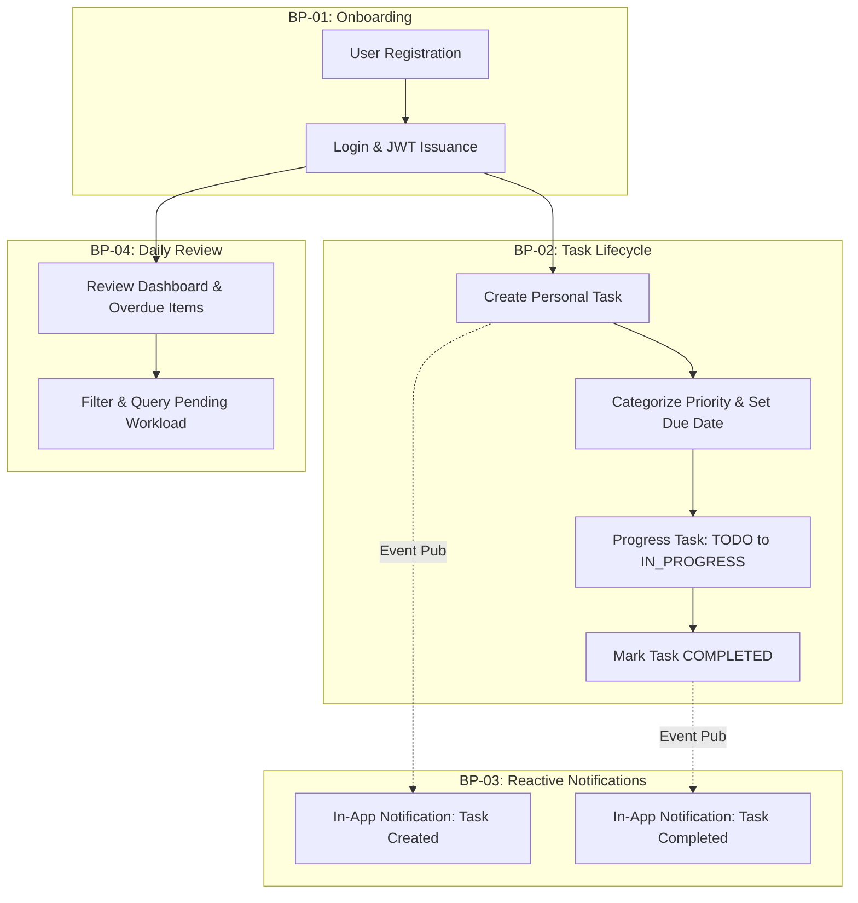

# Business Process Document: Task Management System

| Metadata Item | Details |
|---|---|
| **Document ID** | DOC-BA-001 |
| **Document Version** | 1.0.0 |
| **Status** | Approved Baseline |
| **Author / Owner Role** | Senior Business Analyst |
| **Creation Date** | 2026-11-03 |
| **Related Documents** | `DOC-REQ-001`, `DOC-REQ-004`, `REG-RTM-001` |

---

## 1. Business Process Architecture Overview
Business processes in the Task Management System model the real-world operational flows executed by individual knowledge workers to achieve personal productivity goals.

---

## 2. Core Business Processes

### 2.1 BP-01: User Onboarding & Identity Establishment
- **Process ID**: `BP-USER-001`
- **Objective**: Establish a secure, authenticated identity with isolated data tenancy.
- **Trigger**: New visitor accesses the web portal.
- **Process Steps**:
  1. Visitor submits email, full name, and password.
  2. System enforces syntax, uniqueness, and password complexity criteria.
  3. System salts and hashes password via BCrypt.
  4. System assigns UUID and persists active user record in `user_db`.
  5. User logs in with validated credentials.
  6. System issues signed JWT Access Token and Refresh Token.
- **Business KPI**: Successful onboarding conversion rate $> 95\%$; zero credential exposure.

---

### 2.2 BP-02: Daily Personal Task Execution
- **Process ID**: `BP-TASK-001`
- **Objective**: Rapidly record, organize, execute, and complete work tasks.
- **Trigger**: User needs to track a new responsibility or update ongoing progress.
- **Process Steps**:
  1. **Capture**: User enters task title (e.g., "Review Security Architecture") with optional notes, priority (`URGENT`), and due date.
  2. **Persistence & Outbox**: System saves task in `task_db` with status `TODO` and writes domain event into `outbox_events`.
  3. **In-Flight Progress**: As the user begins work, status transitions to `IN_PROGRESS`.
  4. **Completion**: Upon finishing, status transitions to `COMPLETED`. Outbox captures `TASK_COMPLETED`.
  5. **Notification Fan-Out**: Notification Service generates an in-app confirmation item in `notification_db`.
- **Business KPI**: Sub-second task capture; 0% event loss.

---

### 2.3 BP-03: Morning Review & Workload Triage
- **Process ID**: `BP-DASH-001`
- **Objective**: Assess current workload, identify urgent and overdue deadlines, and organize the day's focus.
- **Trigger**: User accesses the TMS dashboard at the start of a workday.
- **Process Steps**:
  1. User navigates to `/dashboard`.
  2. Dashboard requests aggregated productivity metrics from Task Service.
  3. System returns total tasks, counts by status, high-priority counts, and overdue items.
  4. User clicks "Overdue" or "High Priority" KPI card to filter the task list view automatically.
  5. User re-prioritizes or updates due dates accordingly.
- **Business KPI**: Dashboard rendering time $< 200\text{ ms}$; immediate clarity on daily priorities.

---

## 3. Process Responsibility & Boundary Matrix

| Process Name | Process Owner | Participating Systems | Primary Data Store | Hand-off Event |
|---|---|---|---|---|
| User Onboarding | User Service | React Frontend, Gateway, User Service | `user_db` | User Created |
| Task Capture | Task Service | React Frontend, Gateway, Task Service | `task_db` | `TASK_CREATED` (Outbox) |
| State Transition | Task Service | Task Service, Kafka Cluster | `task_db` | `TASK_COMPLETED` (Outbox) |
| Notification Handling| Notification Service | Kafka, Notification Service | `notification_db` | In-App Notification Record |
| Dashboard Review | Task Service | React Frontend, Task Service | `task_db` | Read Aggregation Response |

---

## 4. Review Checklist
- [x] Core business processes defined with clear triggers, steps, and KPIs.
- [x] Process boundary matrix defines system interactions and data store ownership.
- [x] Asynchronous event hand-offs incorporated into process lifecycles.

---

## 5. Change History
| Version | Date | Author | Summary of Changes |
|---|---|---|---|
| 1.0.0 | 2026-11-03 | Senior Business Analyst | Initial baseline Business Process Document. |

