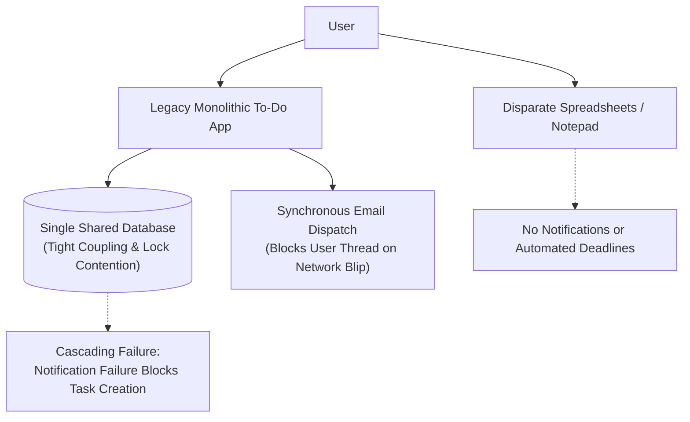
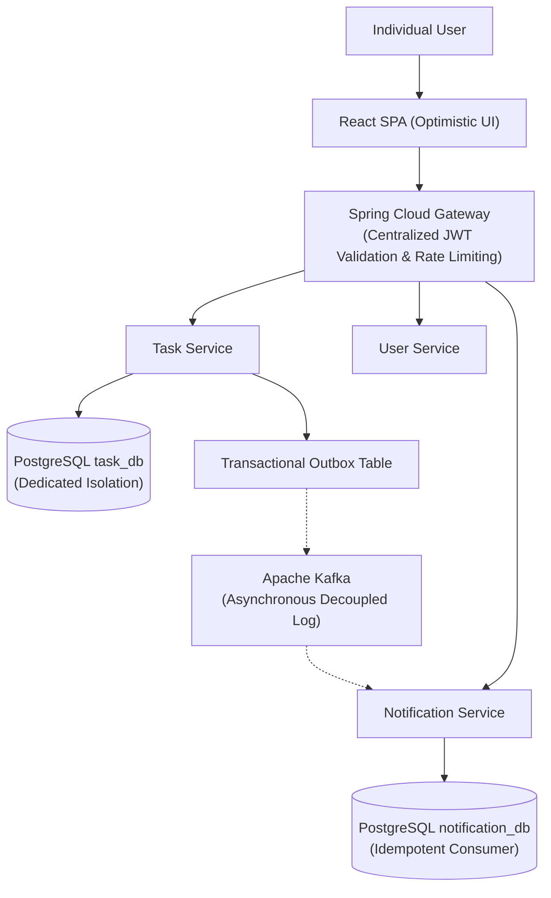

# As-Is and To-Be Process Document: Task Management System

| Metadata Item | Details |
|---|---|
| **Document ID** | DOC-BA-002 |
| **Document Version** | 1.0.0 |
| **Status** | Approved Baseline |
| **Author / Owner Role** | Senior Business Analyst & Solution Architect |
| **Creation Date** | 2026-11-03 |
| **Related Documents** | `DOC-BA-001`, `DOC-REQ-001` |

---

## 1. Executive Context
This document evaluates the transition from fragmented, legacy task management methods (As-Is) to a decoupled, event-driven microservices architecture (To-Be), highlighting performance gains, reliability improvements, and security enhancements.

---

## 2. As-Is Process Analysis (Current State)

### 2.1 Critical Pain Points in As-Is State
1. **Coupled Failures**: In legacy monolithic applications, failures in peripheral subsystems (e.g., notification email timeouts or analytics batch jobs) hold database locks or thread pools, blocking core task creation.
2. **Data Leakage Risks**: Shared database tables with poorly enforced queries risk exposing records across user accounts.
3. **Loss of In-Flight Events**: Direct dual-writes (saving to DB and immediately calling remote services) cause lost updates whenever temporary network blips occur.
4. **Poor Observability**: Lack of centralized metrics and distributed trace IDs leaves operators blind during degraded performance periods.

---

## 3. To-Be Process Analysis (Target Architecture State)

### 3.1 Key Architectural Enhancements in To-Be State
1. **Asynchronous Resilience**: The user’s task creation is persisted in milliseconds. Event propagation to downstream notification services occurs asynchronously via the Transactional Outbox pattern and Kafka, eliminating blocking latency.
2. **Absolute Data Isolation**: Microservices maintain independent databases (`user_db`, `task_db`, `notification_db`). Cross-tenant SQL joins are architecturally impossible.
3. **Idempotent Notification Handling**: Duplicate network deliveries from Kafka are safely discarded by consumer deduplication tables.
4. **Full Observability**: Prometheus metrics, health probes, and correlation IDs (`X-Correlation-Id`) track requests across service hops.

---

## 4. As-Is vs. To-Be Comparative Matrix

| Evaluation Dimension | As-Is (Legacy / Monolith) | To-Be (TMS Microservices Baseline) | Business Impact |
|---|---|---|---|
| **Service Independence** | Monolithic codebase; single point of failure. | Decoupled microservices (`user`, `task`, `notification`, `gateway`, `eureka`). | Uptime improves to 99.9%; notifications cannot crash task creation. |
| **Data Architecture** | Single shared database; tables coupled across modules. | Database-per-service on PostgreSQL; zero shared schemas. | Clean domain boundaries; independent schema migrations via Flyway. |
| **Inter-Service Communication** | Synchronous internal method calls or blocking HTTP. | Asynchronous event streaming via Apache Kafka and Transactional Outbox. | Zero data loss; resilient to downstream downtime. |
| **Security & Authentication** | Server-side sticky sessions or plain cookies. | Stateless JWT with Refresh Token rotation; gateway validation. | Horizontally scalable; no session replication overhead. |
| **Event Reliability** | Dual-write vulnerability (lost notifications on crash). | Atomic DB transaction writes entity + event to outbox. | 100% event publishing consistency. |
| **Telemetry & Observability** | Fragmented local log files; no centralized metrics. | Micrometer, Prometheus scraping, Grafana dashboards, correlation IDs. | MTTR reduced from hours to minutes. |

---

## 5. Review Checklist
- [x] Clear As-Is limitations and To-Be improvements modeled with Mermaid diagrams.
- [x] Comparative matrix across 6 key architectural dimensions.
- [x] Clear business value metrics articulated for the transition.

---

## 6. Change History
| Version | Date | Author | Summary of Changes |
|---|---|---|---|
| 1.0.0 | 2026-11-03 | Senior Business Analyst | Initial baseline As-Is and To-Be Process document. |

