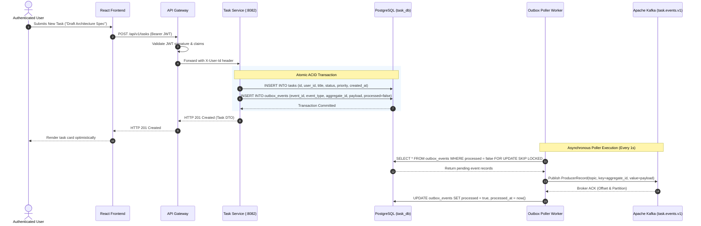

# Business Workflow Diagrams: Task Management System

| Metadata Item | Details |
|---|---|
| **Document ID** | DOC-BA-003 |
| **Document Version** | 1.0.0 |
| **Status** | Approved Baseline |
| **Author / Owner Role** | Senior Business Analyst & Solution Architect |
| **Creation Date** | 2026-11-03 |
| **Related Documents** | `DOC-BA-001`, `DOC-REQ-004` |

---

## 1. Overview
This document visualizes the end-to-end operational workflows of the Task Management System using standardized business process and sequence notations.

---

## 2. Core Workflows

### 2.1 User Registration & Login Workflow

```mermaid
sequenceDiagram
    autonumber
    actor User as Web Visitor
    participant SPA as React Frontend
    participant GW as API Gateway (:8080)
    participant US as User Service (:8081)
    participant UDB as PostgreSQL (user_db)

    Note over User, UDB: Registration Workflow
    User->>SPA: Enters Email, Full Name, Password
    SPA->>GW: POST /api/v1/auth/register
    GW->>US: Forwards Registration Request
    US->>UDB: Check if Email exists
    alt Email already registered
        UDB-->>US: Found matching record
        US-->>GW: HTTP 409 Conflict (ERR_EMAIL_ALREADY_EXISTS)
        GW-->>SPA: HTTP 409 Conflict
        SPA-->>User: Display error "Email already registered"
    else Email is unique
        US->>US: BCrypt Hash Password (cost 12)
        US->>UDB: INSERT INTO users (id, email, password_hash, full_name, status)
        UDB-->>US: 1 row inserted
        US-->>GW: HTTP 201 Created (User DTO without password)
        GW-->>SPA: HTTP 201 Created
        SPA-->>User: Show success banner; redirect to /login
    end

    Note over User, UDB: Authentication Workflow
    User->>SPA: Enters Email & Password
    SPA->>GW: POST /api/v1/auth/login
    GW->>US: Forwards Login Request
    US->>UDB: SELECT * FROM users WHERE email = :email
    US->>US: Verify password hash via BCrypt
    US->>US: Generate JWT Access Token (15m) & Refresh Token (7d)
    US->>UDB: INSERT INTO refresh_tokens (token, user_id, expires_at)
    US-->>GW: HTTP 200 OK (Tokens DTO)
    GW-->>SPA: HTTP 200 OK (Tokens DTO)
    SPA->>SPA: Store Access Token in memory
    SPA-->>User: Redirect to /dashboard
```

---

### 2.2 Task Creation & Outbox Event Workflow



---

### 2.3 Task State Progression & In-App Notification Workflow

```mermaid
sequenceDiagram
    autonumber
    actor User as Authenticated User
    participant SPA as React Frontend
    participant GW as API Gateway
    participant TS as Task Service
    participant TDB as PostgreSQL (task_db)
    participant KF as Apache Kafka
    participant NS as Notification Service (:8083)
    participant NDB as PostgreSQL (notification_db)

    User->>SPA: Clicks "Complete Task" on Task Card
    SPA->>GW: PATCH /api/v1/tasks/{id}/status (status = "COMPLETED")
    GW->>TS: Forwards request with X-User-Id
    TS->>TDB: UPDATE tasks SET status = 'COMPLETED', updated_at = now() WHERE id = :id AND user_id = :userId
    TS->>TDB: INSERT INTO outbox_events (eventType = 'TASK_COMPLETED', payload)
    TS-->>GW: HTTP 200 OK
    GW-->>SPA: HTTP 200 OK
    SPA-->>User: Task card updates to COMPLETED state

    Note over KF, NDB: Asynchronous Notification Ingestion
    TS->>KF: Outbox poller publishes TASK_COMPLETED event
    KF->>NS: Kafka Consumer receives record
    NS->>NDB: Check if event_id exists in consumed_events
    alt Event already consumed
        NS->>NS: Skip processing (Idempotent ignore)
    else New Event
        NS->>NDB: INSERT INTO notifications (id, user_id, event_type, message, read=false)
        NS->>NDB: INSERT INTO consumed_events (event_id, consumed_at)
        NDB-->>NS: Committed
    end

    Note over User, NS: User Notification Check
    User->>SPA: Clicks Notification Bell
    SPA->>GW: GET /api/v1/notifications
    GW->>NS: Forwards with X-User-Id
    NS->>NDB: SELECT * FROM notifications WHERE user_id = :userId ORDER BY created_at DESC
    NDB-->>NS: List of notifications
    NS-->>GW-->>SPA: HTTP 200 OK
    SPA-->>User: Display slide-over drawer with unread task notification
```

---

## 3. Review Checklist
- [x] Clear sequence diagrams with swimlanes and numbered message flows.
- [x] ACID boundary highlighted for Transactional Outbox pattern.
- [x] Idempotent Kafka consumption and notification generation modeled.

---

## 4. Change History
| Version | Date | Author | Summary of Changes |
|---|---|---|---|
| 1.0.0 | 2026-11-03 | Senior Business Analyst | Initial baseline Business Workflow Diagrams. |

