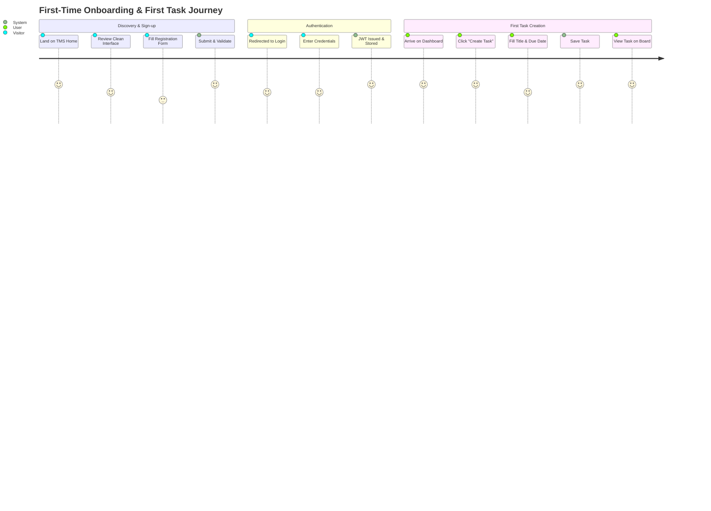
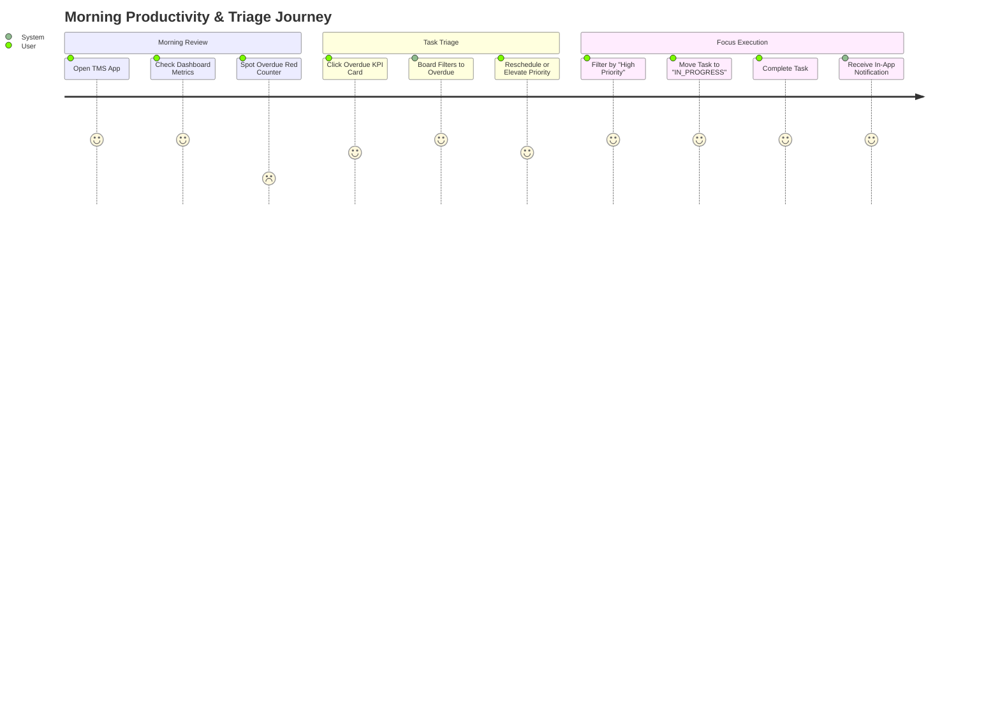

# User Journey Diagrams: Task Management System

| Metadata Item | Details |
|---|---|
| **Document ID** | DOC-BA-004 |
| **Document Version** | 1.0.0 |
| **Status** | Approved Baseline |
| **Author / Owner Role** | Product Manager & UX Designer |
| **Creation Date** | 2026-11-03 |
| **Related Documents** | `DOC-REQ-002`, `DOC-REQ-006` |

---

## 1. Overview
User Journey Maps trace the end-to-end emotional, cognitive, and functional experience of target personas navigating the Task Management System, from initial onboarding to daily task execution and deadline triage.

---

## 2. Core User Journeys

### 2.1 Journey 1: First-Time User Onboarding & First Task Creation

| Journey Phase | User Action & Thoughts | System Touchpoint | Friction / Risk | Mitigation Strategy |
|---|---|---|---|---|
| **1. Registration** | "I want to try this without lengthy form fills." | `/register` form | Password complexity frustration. | Real-time inline feedback checklist as user types. |
| **2. Authentication** | "Log me in immediately so I can see the board." | `/login` form | Token expiry causing sudden logouts. | Automatic background token refresh via Refresh Token rotation. |
| **3. Empty State** | "Where do I start?" | Empty dashboard | Intimidating blank screen. | Welcoming empty-state illustration with prominent "Create your first task" CTA. |
| **4. First Task** | "Quickly add 'Finish Microservice Architecture'." | Create Task modal | Heavy modal loading times. | Modal loads instantly from memory; optimistic board update. |

---

### 2.2 Journey 2: Morning Triage & Deadline Management

| Journey Phase | User Action & Thoughts | System Touchpoint | Emotional State | System Support |
|---|---|---|---|---|
| **Morning Overview** | "How overloaded am I today?" | `/dashboard` summary cards | Focused / Analytical | Clean counter badges (Total, TODO, In Progress, Completed, Overdue). |
| **Overdue Triage** | "Did I miss any hard deadlines yesterday?" | Overdue counter card click | Anxious $\rightarrow$ Relieved | One-click filter isolates past-due items; quick edit allows deadline adjustments. |
| **Focus Mode** | "I need to work on the urgent item right now." | Task board status dropdown | Energized | Drag/toggle status to `IN_PROGRESS`; subtle progress indicator. |
| **Completion** | "Done! Feels great to check this off." | Checkbox / Status toggle | Satisfied | Instant green check animation; in-app notification confirms completion. |

---

## 3. Review Checklist
- [x] Clear user journeys visualised with Mermaid `journey` diagrams.
- [x] Friction points, user emotional states, and technical mitigations documented.
- [x] Alignment with PRD features and acceptance criteria confirmed.

---

## 4. Change History
| Version | Date | Author | Summary of Changes |
|---|---|---|---|
| 1.0.0 | 2026-11-03 | Product Manager | Initial baseline User Journey Diagrams. |

