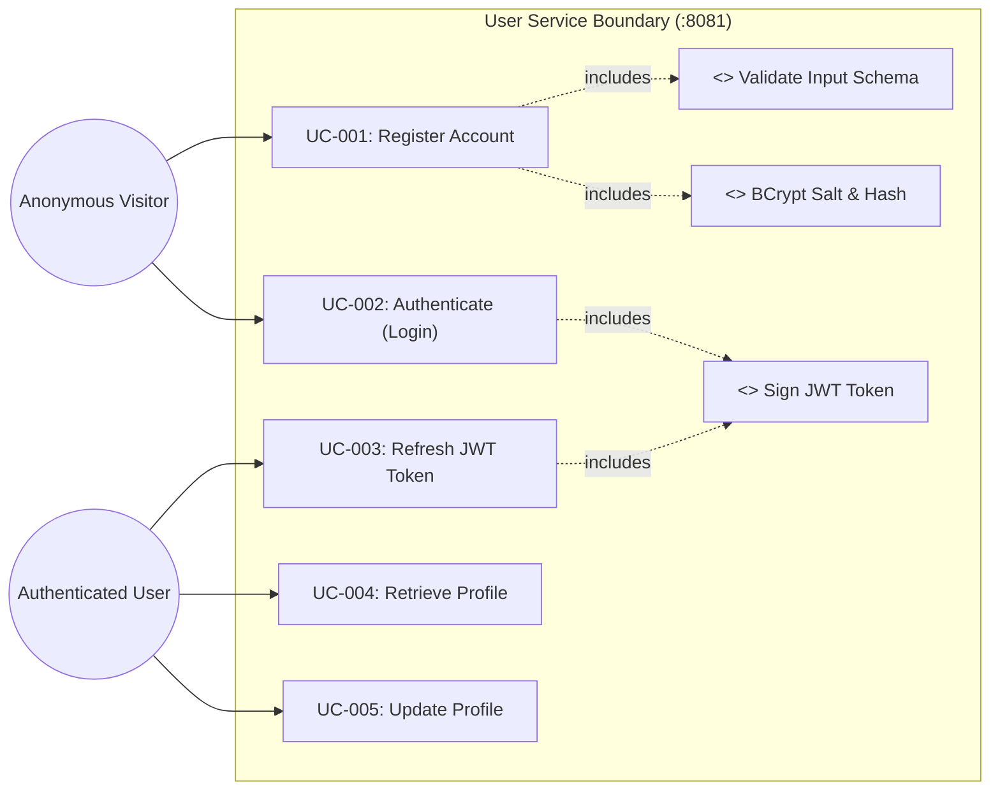
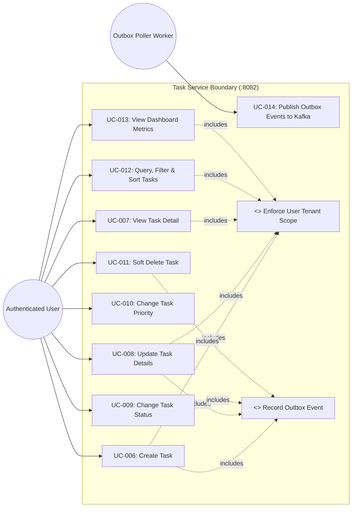
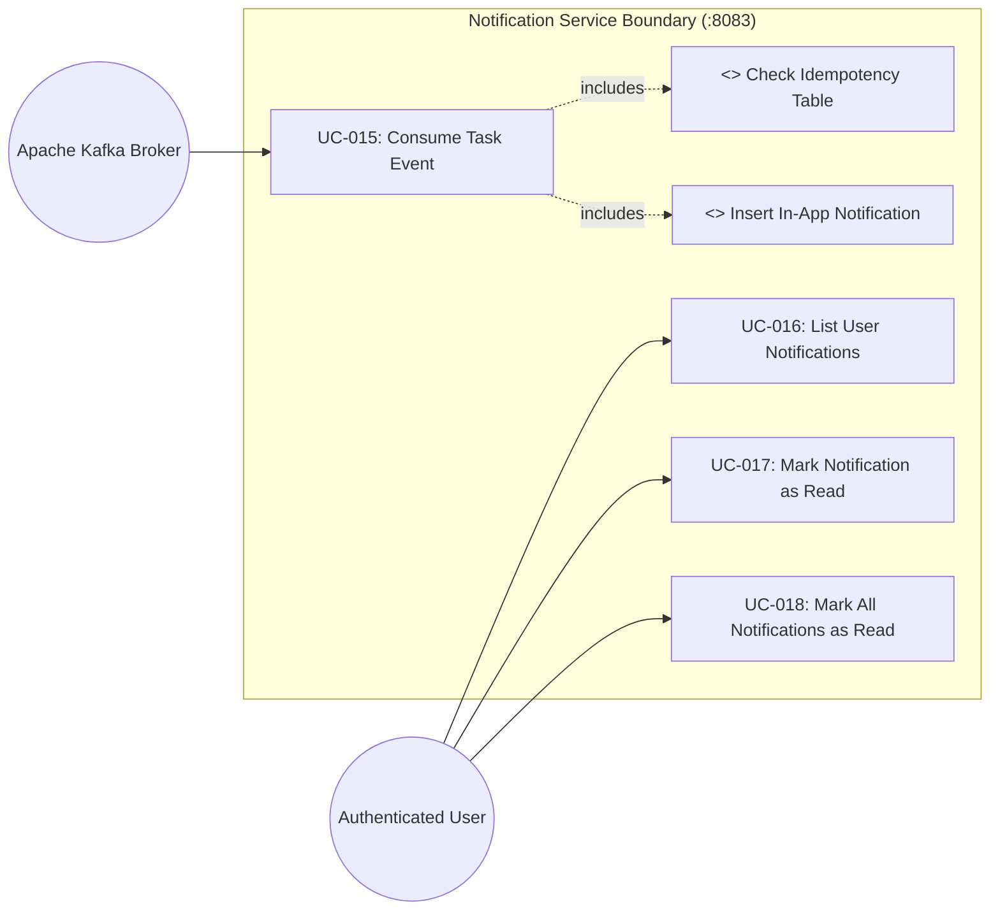

# Use Case Diagrams: Task Management System

| Metadata Item | Details |
|---|---|
| **Document ID** | DOC-BA-005 |
| **Document Version** | 1.0.0 |
| **Status** | Approved Baseline |
| **Author / Owner Role** | Senior Business Analyst |
| **Creation Date** | 2026-11-03 |
| **Related Documents** | `DOC-REQ-007`, `DOC-BA-003` |

---

## 1. Overview
This document catalogs subsystem-specific Use Case diagrams, illustrating actors, system boundaries, and functional relationships across the microservices domain.

---

## 2. Subsystem Use Case Diagrams

### 2.1 User Service & Authentication Subsystem

---

### 2.2 Task Service Subsystem

---

### 2.3 Notification Service Subsystem

---

## 3. Review Checklist
- [x] Clear subsystem boundary boxes defined for each microservice.
- [x] Actors (Human and System/Workers) mapped with distinct roles.
- [x] `<<include>>` and dependency associations explicitly diagrammed.

---

## 4. Change History
| Version | Date | Author | Summary of Changes |
|---|---|---|---|
| 1.0.0 | 2026-11-03 | Senior Business Analyst | Initial baseline Use Case Diagrams. |

