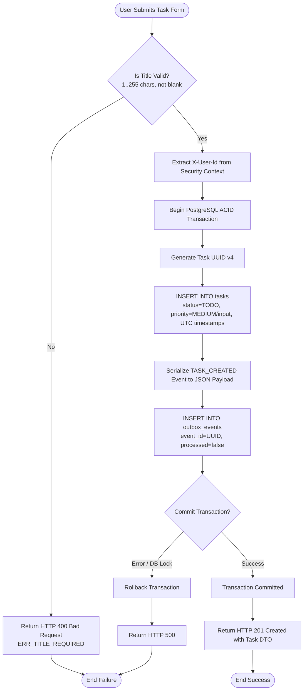
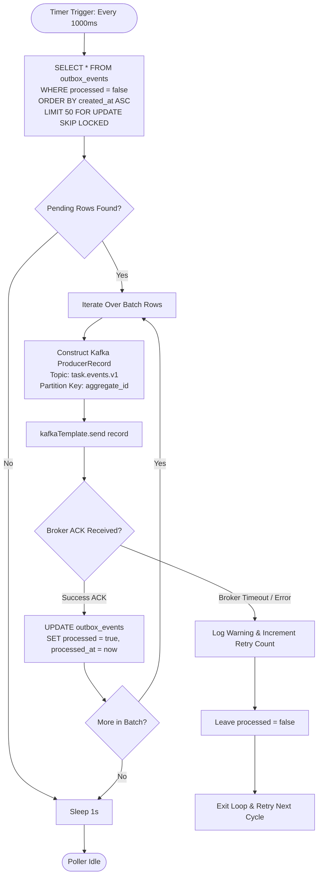
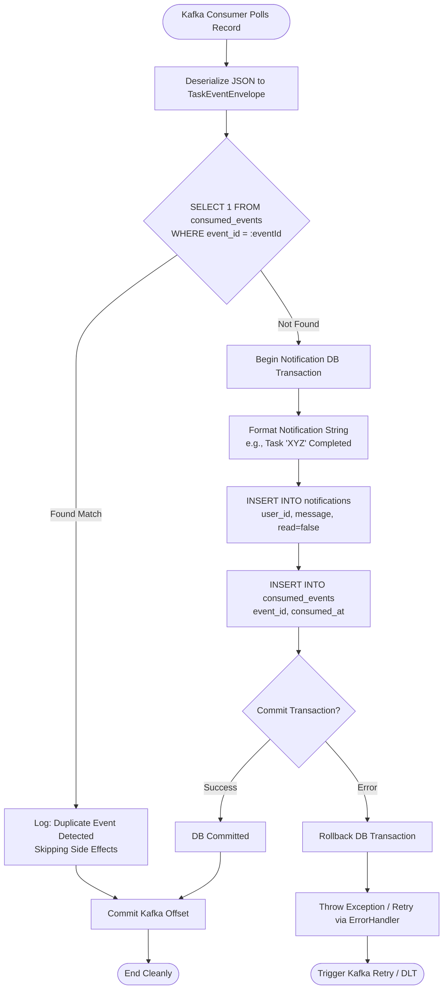

# Activity Diagrams: Task Management System

| Metadata Item | Details |
|---|---|
| **Document ID** | DOC-BA-006 |
| **Document Version** | 1.0.0 |
| **Status** | Approved Baseline |
| **Author / Owner Role** | Senior Business Analyst & Software Architect |
| **Creation Date** | 2026-11-03 |
| **Related Documents** | `DOC-BA-003`, `DOC-REQ-004` |

---

## 1. Overview
Activity diagrams illustrate procedural control flows, conditional decision logic, concurrent branches, and transactional commit boundaries within the Task Management System.

---

## 2. Core Activity Diagrams

### 2.1 Task Creation & Transactional Outbox Activity

---

### 2.2 Outbox Poller & Kafka Publishing Activity

---

### 2.3 Kafka Event Consumer & Idempotency Activity

---

## 3. Review Checklist
- [x] Clear decision gateways (`{ ... ? }`) and branch pathways modeled.
- [x] ACID database transaction boundaries explicitly demarcated.
- [x] Retry, error handling, and duplicate suppression logic mapped.

---

## 4. Change History
| Version | Date | Author | Summary of Changes |
|---|---|---|---|
| 1.0.0 | 2026-11-03 | Software Architect | Initial baseline Activity Diagrams. |

