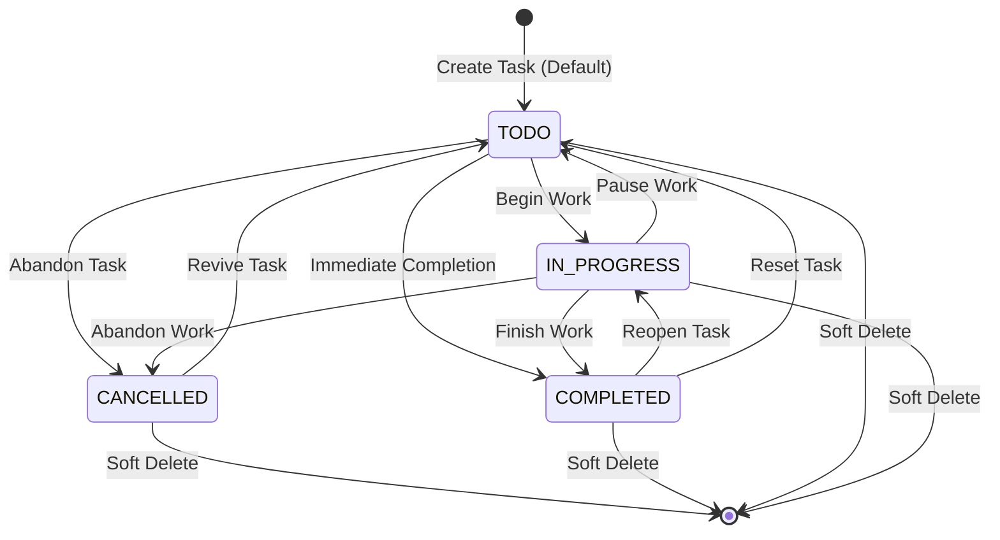

# Business Rules Catalogue: Task Management System

| Metadata Item | Details |
|---|---|
| **Document ID** | DOC-BA-007 |
| **Document Version** | 1.0.0 |
| **Status** | Approved Baseline |
| **Author / Owner Role** | Senior Business Analyst |
| **Creation Date** | 2026-11-03 |
| **Related Documents** | `DOC-REQ-009`, `DOC-REQ-004` |

---

## 1. Overview
The Business Rules Catalogue formalizes domain policies, validation criteria, data lifecycle rules, and state transition matrices across the Task Management System.

---

## 2. Task State Transition Matrix

| Source State | Target State: TODO | Target State: IN_PROGRESS | Target State: COMPLETED | Target State: CANCELLED | Soft Delete Allowed? |
|---|:---:|:---:|:---:|:---:|:---:|
| **[Creation]** | **Allowed (Default)** | Allowed (Explicit) | Prohibited | Prohibited | N/A |
| **TODO** | No-op (Same) | **Allowed** | **Allowed** | **Allowed** | **Yes** |
| **IN_PROGRESS** | **Allowed** (Pause) | No-op (Same) | **Allowed** | **Allowed** | **Yes** |
| **COMPLETED** | **Allowed** (Reset) | **Allowed** (Reopen) | No-op (Same) | Prohibited | **Yes** |
| **CANCELLED** | **Allowed** (Revive)| Prohibited | Prohibited | No-op (Same) | **Yes** |

---

## 3. Priority Rules & Ordering Hierarchy

| Priority Level | Visual Badge / Color | Numerical Weight | Sorting Precedence (Desc) | Description |
|---|---|:---:|:---:|---|
| **URGENT** | Crimson Red (`#DC2626`) | 4 | Highest (First) | Immediate blocker; requires completion today. |
| **HIGH** | Amber Orange (`#EA580C`) | 3 | Second | Critical milestone; target completion within 48h. |
| **MEDIUM** | Slate Blue (`#2563EB`) | 2 | Third (Default) | Standard daily activity. Assigned if priority omitted. |
| **LOW** | Neutral Gray (`#64748B`) | 1 | Fourth (Last) | Low urgency backlog task. |

---

## 4. Master Business Rules Matrix

| Rule ID | Domain | Rule Statement | Validation Formula / Logic | Enforcing Layer | Error Code on Breach |
|---|---|---|---|---|---|
| **BRULE-001** | Multi-Tenancy | Each record belongs to exactly one `userId`. Zero cross-tenant access. | `record.userId == securityContext.userId` | API Gateway / Service Filter | `ERR_RESOURCE_NOT_FOUND` (404) |
| **BRULE-002** | Status Baseline | Tasks created without explicit status receive `TODO`. | `task.status = coalesce(input.status, 'TODO')` | Task Service Entity | `ERR_INVALID_STATUS` (400) |
| **BRULE-003** | Priority Baseline | Tasks created without explicit priority receive `MEDIUM`. | `task.priority = coalesce(input.priority, 'MEDIUM')` | Task Service Entity | `ERR_INVALID_PRIORITY` (400) |
| **BRULE-004** | Title Integrity | Task title is mandatory, 1 to 255 non-whitespace chars. | `title != null && title.trim().length() in [1..255]` | DTO `@NotBlank` / DB `NOT NULL` | `ERR_TITLE_REQUIRED` (400) |
| **BRULE-005** | Soft Deletion | Tasks are never physically purged via regular deletion API. | `is_deleted = true, deleted_at = now()` | JPA `@SQLDelete` / Repository | `ERR_TASK_ALREADY_DELETED` |
| **BRULE-006** | Primary Key UUID | System IDs must conform to canonical UUID v4. | `UUID.fromString(id) != null` | DTO / DB Native UUID Type | `ERR_INVALID_UUID_FORMAT` (400) |
| **BRULE-007** | UTC Time Standard | All timestamps must be in UTC ISO-8601 format. | `timestamp.zone == ZoneOffset.UTC` | Jackson Serializer / DB `TIMESTAMPTZ` | `ERR_INVALID_TIMESTAMP` (400) |
| **BRULE-008** | Credential Hashing | Passwords hashed with BCrypt, salt $\ge 12$ rounds. | `BCrypt.checkpw(raw, hash)` | User Service Domain | `ERR_WEAK_PASSWORD` (400) |
| **BRULE-009** | Outbox Guarantee | Task mutation and outbox event write are atomic. | `@Transactional(propagation = REQUIRED)` | Spring Transaction Manager | `ERR_TRANSACTION_FAILED` (500) |
| **BRULE-010** | Event Idempotency | Notification events consumed exactly once. | `NOT EXISTS (SELECT 1 FROM consumed_events WHERE event_id = :id)` | Notification Service Consumer | `ERR_DUPLICATE_EVENT_SKIPPED` |

---

## 5. Review Checklist
- [x] State transition matrix defines all allowed, no-op, and prohibited transitions.
- [x] Priority ordering hierarchy with numerical weights established.
- [x] Business rules cataloged with validation logic, enforcing layers, and error codes.

---

## 6. Change History
| Version | Date | Author | Summary of Changes |
|---|---|---|---|
| 1.0.0 | 2026-11-03 | Senior Business Analyst | Initial baseline Business Rules Catalogue. |

