# Functional Decomposition Document: Task Management System

| Metadata Item | Details |
|---|---|
| **Document ID** | DOC-BA-009 |
| **Document Version** | 1.0.0 |
| **Status** | Approved Baseline |
| **Author / Owner Role** | Senior Business Analyst & Solution Architect |
| **Creation Date** | 2026-11-03 |
| **Related Documents** | `DOC-REQ-003`, `DOC-REQ-004` |

---

## 1. Functional Decomposition Hierarchy (FDD)

```mermaid
graph TD
    TMS["Level 1: Task Management System"]
    
    TMS --> D1["Level 2: Identity & Security"]
    TMS --> D2["Level 2: Task Operations"]
    TMS --> D3["Level 2: Analytics & Metrics"]
    TMS --> D4["Level 2: Notification & Events"]
    TMS --> D5["Level 2: Ingress & Discovery"]

    D1 --> D1_1["User Registration"]
    D1 --> D1_2["Authentication & JWT"]
    D1 --> D1_3["Session & Token Refresh"]
    D1 --> D1_4["User Profile"]

    D2 --> D2_1["Task Ingestion (Create)"]
    D2 --> D2_2["Task Modification (Edit)"]
    D2 --> D2_3["State Machine (Status)"]
    D2 --> D2_4["Priority Hierarchy"]
    D2 --> D2_5["Lifecycle (Soft Delete)"]
    D2 --> D2_6["Search & Keyword Match"]
    D2 --> D2_7["Filtering & Pagination"]

    D3 --> D3_1["Status Counters"]
    D3 --> D3_2["Urgency / Priority Aggregates"]
    D3 --> D3_3["Dynamic Overdue Calculation"]

    D4 --> D4_1["Transactional Outbox Writer"]
    D4 --> D4_2["Kafka Event Dispatcher"]
    D4 --> D4_3["Idempotent Event Consumer"]
    D4 --> D4_4["In-App Notification Inbox"]
    D4 --> D4_5["Read State Transitions"]

    D5 --> D5_1["Dynamic Service Registration"]
    D5 --> D5_2["Client Routing & TLS Termination"]
    D5 --> D5_3["Token Validation & Header Injection"]
```

---

## 2. Functional Domain Decomposition Table

| Level 2 Domain | Level 3 Subsystem | Level 4 Atomic Capability | Implementing Component | Bound Requirement ID |
|---|---|---|---|---|
| **Identity & Security** | Registration | Email uniqueness validation, BCrypt hashing, User persistence | User Service | `FR-001`, `FR-002` |
| | Authentication | Password verification, JWT Access Token & Refresh Token generation | User Service | `FR-003`, `SEC-002` |
| | Session Mgmt | Refresh token validation, rotation, and revocation | User Service | `FR-004` |
| | Profile Mgmt | Profile query (`GET /users/me`), profile update (`PUT /users/me`) | User Service | `FR-005`, `FR-006` |
| **Task Operations** | Task Ingestion | Field validations, UUID generation, defaults assignment, DB insert | Task Service | `FR-007`, `BRULE-002` |
| | Task Details | Multi-tenant scoped task retrieval (`GET /tasks/{id}`) | Task Service | `FR-008`, `BRULE-001` |
| | Task Edit | Title, description, due date, and priority modification | Task Service | `FR-009` |
| | State Machine | Status transition (`TODO` $\rightarrow$ `IN_PROGRESS` $\rightarrow$ `COMPLETED`) | Task Service | `FR-011` |
| | Priority Mgmt | Priority update (`PATCH /tasks/{id}/priority`) | Task Service | `FR-012` |
| | Soft Delete | Mark `is_deleted = true`, record `deleted_at`, outbox event | Task Service | `FR-010`, `BRULE-005` |
| | Search & Filter | ILIKE keyword search, status/priority filtering, date range filter | Task Service | `FR-013`, `FR-014` |
| | Pagination & Sort| Multi-column sorting (`sort=dueDate,desc`), pagination metadata | Task Service | `FR-015`, `FR-016` |
| **Analytics & Metrics**| Dashboard | Aggregation of status counts, urgent count, dynamic overdue count | Task Service | `FR-017`, `BRULE-007` |
| **Notification & Events**| Outbox Writer | Atomic insertion into `outbox_events` table during task mutations | Task Service | `FR-018`, `BRULE-009` |
| | Event Publisher | Poller worker querying outbox and publishing to `task.events.v1` | Task Service Poller | `EVT-001` |
| | Event Ingestion | Subscribing to Kafka, checking `consumed_events`, inserting notification | Notification Service | `FR-019`, `BRULE-010` |
| | In-App Inbox | Listing notifications, marking individual/all as read | Notification Service | `FR-020` |
| **Ingress & Discovery** | Registry | Eureka server heartbeats, dynamic instance lookup | Service Discovery | `CST-005` |
| | Gateway Routing | Central ingress, path matching (`/tasks/**`, `/auth/**`), CORS | API Gateway | `NFR-001` |
| | Auth Filter | JWT signature verification, claims extraction, `X-User-Id` injection | API Gateway | `SEC-004` |

---

## 3. Review Checklist
- [x] Four-level hierarchical functional decomposition modeled with Mermaid.
- [x] All 20 Functional Requirements mapped to atomic operational capabilities.
- [x] Clear demarcation between frontend ingress, service logic, and data layers.

---

## 4. Change History
| Version | Date | Author | Summary of Changes |
|---|---|---|---|
| 1.0.0 | 2026-11-03 | Senior Business Analyst | Initial baseline Functional Decomposition document. |

