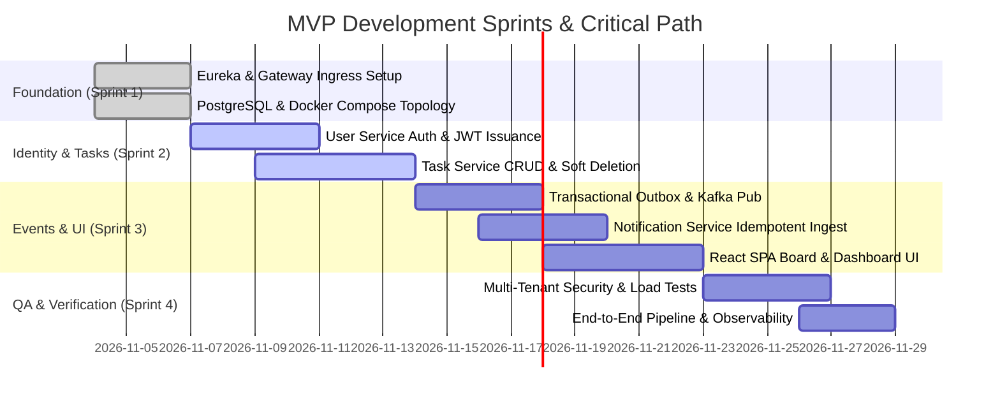

# MVP Prioritization Document: Task Management System

| Metadata Item | Details |
|---|---|
| **Document ID** | DOC-BA-010 |
| **Document Version** | 1.0.0 |
| **Status** | Approved Baseline |
| **Author / Owner Role** | Product Manager & Solution Architect |
| **Creation Date** | 2026-11-03 |
| **Related Documents** | `DOC-REQ-010`, `DOC-REQ-002` |

---

## 1. Executive Summary & Prioritization Philosophy
The Minimum Viable Product (MVP) strategy for the **Task Management System (TMS)** focuses strictly on establishing a rock-solid, production-grade microservices foundation while providing individual users with an ultra-responsive, clutter-free task management experience. 

Non-essential bells and whistles (e.g., email dispatch, WebSockets, social SSO, multi-user teams) are deferred to Post-MVP releases to guarantee that core architecture, data isolation, and event resilience are verified without schedule risk.

---

## 2. Release Increments & Sprint Breakdown

---

## 3. Scope Boundary Rationale

| Capability Domain | MVP Inclusion Rationale | Post-MVP Deferral Rationale |
|---|---|---|
| **Task Management** | Complete CRUD, status transitions, priority tags, and soft deletion are fundamental to the product definition. | Subtasks, recurring reminders, and file attachments add table complexity and object storage dependencies. |
| **Search & Organization** | Case-insensitive text search and multi-attribute filters solve 95% of daily user search queries without external search engines. | Elasticsearch / OpenSearch introduces significant RAM and cluster management overhead to local environments. |
| **Notifications** | In-app notification center via Kafka demonstrates asynchronous decoupled event architecture with zero external costs. | External email dispatch (SMTP) requires external relay credentials, SPF/DKIM records, and spam handling. |
| **Authentication** | Stateless JWT with refresh token rotation provides industry-standard security and horizontal scalability. | OAuth2 Social Login and MFA (TOTP) introduce external identity provider latency and complex credential setup. |
| **Dashboard** | Real-time aggregate count queries on indexed columns give users instant productivity visibility in < 150ms. | Historical velocity graphs and chart exports require time-series databases or complex analytical rollups. |

---

## 4. MVP Quality Gates & Acceptance Thresholds
To achieve MVP production sign-off, the following criteria must be satisfied:
1. **Zero Data Leaks**: Automated security test suite verifies 100% rejection of cross-user task access.
2. **Zero Message Loss**: Killing Kafka broker during task creation does not drop events; outbox table drains completely upon broker restoration.
3. **Sub-250ms Latency**: API Gateway p95 response time is $< 250\text{ ms}$ under baseline load.
4. **Memory Compliance**: Combined Docker Compose memory consumption remains under 10GB RAM.
5. **Clean Builds**: Jenkins automated pipeline builds all services, executes unit/integration tests, and packages Docker images with 0 errors.

---

## 5. Review Checklist
- [x] Clear prioritization philosophy and release increment schedule mapped.
- [x] Detailed inclusion vs deferral rationale documented for every capability domain.
- [x] Five quantitative MVP quality gates defined.

---

## 6. Change History
| Version | Date | Author | Summary of Changes |
|---|---|---|---|
| 1.0.0 | 2026-11-03 | Product Manager | Initial baseline MVP Prioritization document. |

