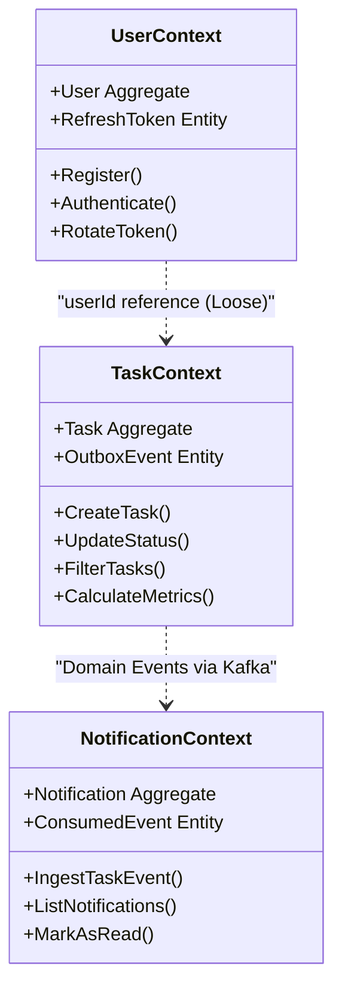
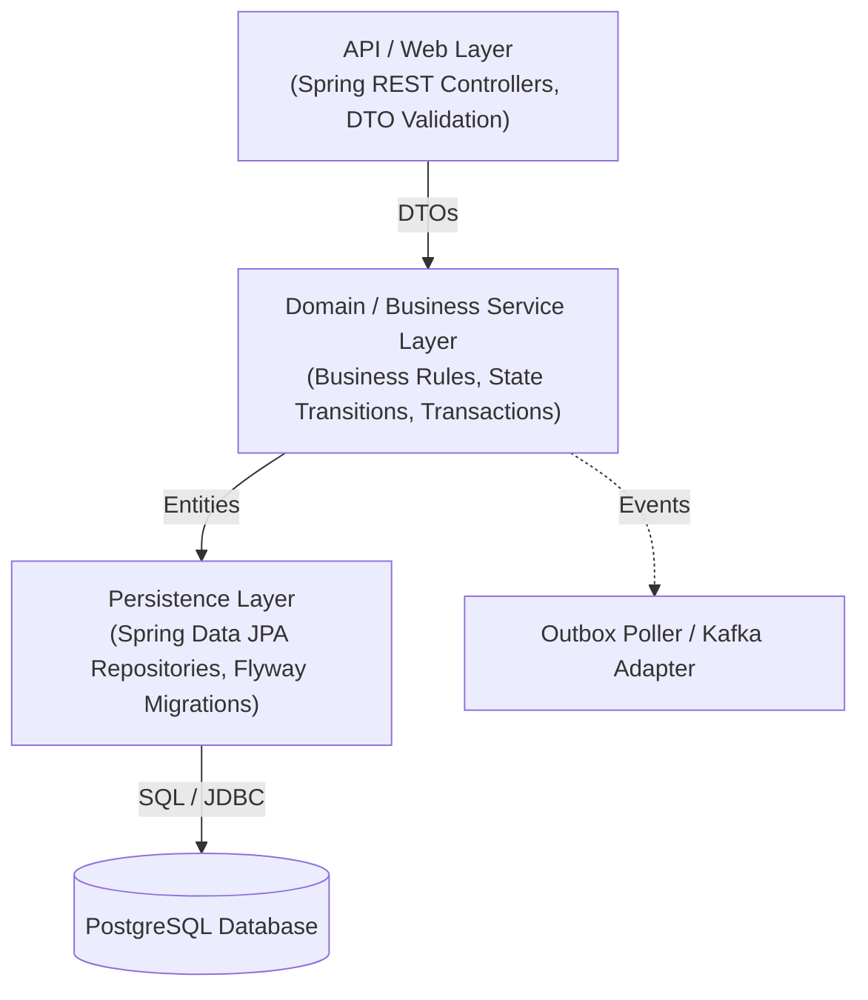

# Microservices Architecture Document: Task Management System

| Metadata Item | Details |
|---|---|
| **Document ID** | DOC-ARCH-002 |
| **Document Version** | 1.0.0 |
| **Status** | Approved Baseline |
| **Author / Owner Role** | Solution Architect |
| **Creation Date** | 2026-11-03 |
| **Related Documents** | `DOC-ARCH-001`, `DOC-REQ-003` |

---

## 1. Domain-Driven Design (DDD) Bounded Contexts
The Task Management System decomposes into three core business bounded contexts and two platform infrastructure contexts:

---

## 2. Microservice Profiles & Autonomy

### 2.1 API Gateway (`api-gateway`)
- **Port**: `8080`
- **Runtime Stack**: Java 21, Spring Boot 3.3.x, Spring Cloud Gateway (Reactive / Netty)
- **Role**: Reverse proxy, SSL termination, global CORS enforcement, JWT verification filter, correlation ID propagation.
- **Data Store**: Stateless; no database.

### 2.2 User Service (`user-service`)
- **Port**: `8081`
- **Runtime Stack**: Java 21, Spring Boot 3.3.x, Spring Data JPA, Hibernate, PostgreSQL, Flyway
- **Role**: Identity management, BCrypt password hashing, JWT signing, refresh token rotation, profile updates.
- **Data Store**: Dedicated PostgreSQL `user_db`.

### 2.3 Task Service (`task-service`)
- **Port**: `8082`
- **Runtime Stack**: Java 21, Spring Boot 3.3.x, Spring Data JPA, Hibernate, PostgreSQL, Flyway, Spring Kafka Producer
- **Role**: Core task management, priority and status state transitions, multi-attribute querying, dashboard metrics calculation, Transactional Outbox persistence.
- **Data Store**: Dedicated PostgreSQL `task_db`.

### 2.4 Notification Service (`notification-service`)
- **Port**: `8083`
- **Runtime Stack**: Java 21, Spring Boot 3.3.x, Spring Data JPA, Hibernate, PostgreSQL, Flyway, Spring Kafka Consumer
- **Role**: Kafka consumer (`notification-service-group`), idempotent deduplication, in-app notification storage, mark-as-read APIs.
- **Data Store**: Dedicated PostgreSQL `notification_db`.

### 2.5 Service Discovery (`service-discovery`)
- **Port**: `8761`
- **Runtime Stack**: Java 21, Spring Boot 3.3.x, Spring Cloud Netflix Eureka Server
- **Role**: Centralized service registry maintaining instance availability and routing metadata.
- **Data Store**: In-memory replicated registry; no persistent database.

---

## 3. Microservice Layered Architecture Pattern
Each backend service follows standard Clean Architecture / Layered Architecture principles:

---

## 4. Contract Governance & Versioning Strategy
1. **REST APIs**: Versioned via URI path prefix (`/api/v1/...`). Backward-incompatible schema changes mandate a version bump to `/api/v2/...`.
2. **Kafka Events**: Encapsulated within an immutable envelope containing `eventVersion: "1.0"`. Producers may add optional fields without breaking consumers; field renames or deletions require new topics or version schemas.

---

## 5. Review Checklist
- [x] Domain-Driven Design bounded contexts visualised.
- [x] Complete technical specifications and port allocations for all 5 microservices.
- [x] Clean architecture layer separation detailed.

---

## 6. Change History
| Version | Date | Author | Summary of Changes |
|---|---|---|---|
| 1.0.0 | 2026-11-03 | Solution Architect | Initial baseline Microservices Architecture document. |

