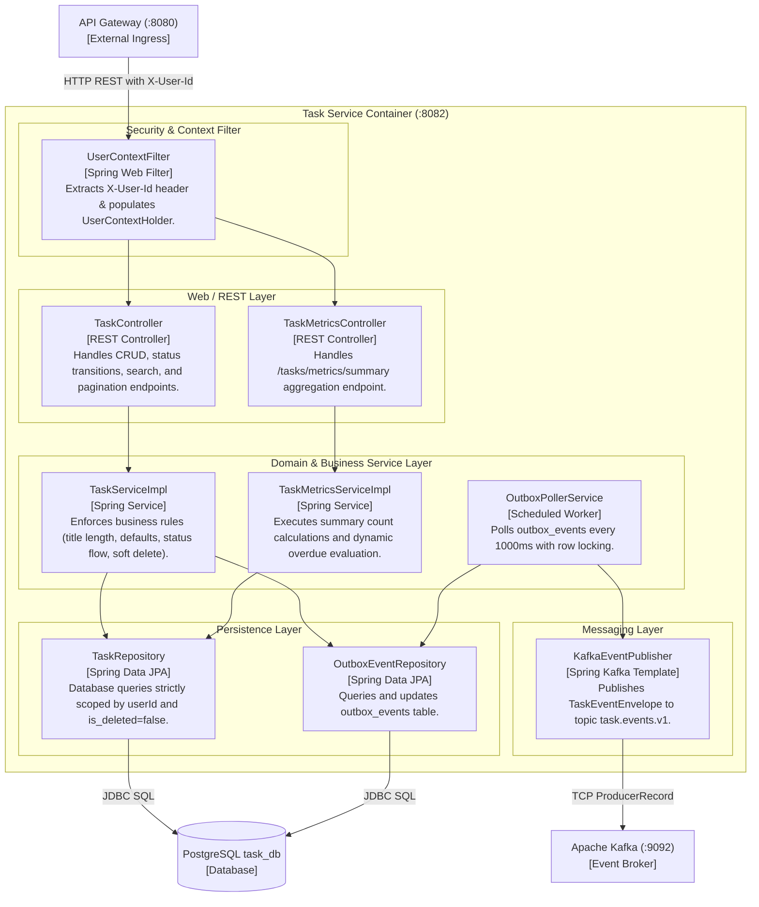

# Component Diagram (C4 Level 3): Task Service

| Metadata Item | Details |
|---|---|
| **Document ID** | DOC-ARCH-005 |
| **C4 Level** | Level 3: Component Diagram |
| **Target Container** | `task-service` (Port 8082) |
| **Document Version** | 1.0.0 |
| **Status** | Approved Baseline |
| **Author / Owner Role** | Software Architect |
| **Creation Date** | 2026-11-03 |
| **Related Documents** | `DOC-ARCH-004`, `DOC-REQ-004` |

---

## 1. Overview
The C4 Component Diagram zooms into the core domain service: **`task-service`**, illustrating internal Spring Boot structural components, interfaces, and persistence interactions.

---

## 2. C4 Level 3 Component Diagram: Task Service

---

## 3. Component Specification Table

| Component Name | Architectural Role | Interface / Method Responsibilities | Dependencies |
|---|---|---|---|
| **UserContextFilter** | Security Interceptor | Inspects HTTP headers; binds `X-User-Id` to `ThreadLocal<UserContext>`. | Spring Security |
| **TaskController** | REST Endpoint Adapter | Exposes `/api/v1/tasks/**`; validates incoming DTOs (`@Valid`). | `TaskServiceImpl` |
| **TaskMetricsController** | REST Endpoint Adapter | Exposes `GET /api/v1/tasks/metrics/summary`. | `TaskMetricsServiceImpl` |
| **TaskServiceImpl** | Domain Orchestration | Enforces `BRULE-001` to `005`; executes task mutations and atomically writes outbox events. | `TaskRepository`, `OutboxEventRepository` |
| **TaskMetricsServiceImpl**| Analytics Aggregator | Executes count queries grouped by status; evaluates overdue criteria dynamically. | `TaskRepository` |
| **OutboxPollerService** | Resilient Dispatcher | `@Scheduled(fixedDelay = 1000)`; fetches unprocessed outbox records with `SKIP LOCKED`. | `OutboxEventRepository`, `KafkaEventPublisher` |
| **TaskRepository** | Data Access | JPA Specification queries for filtering, sorting, pagination, and multi-tenant scoping. | `TaskEntity`, PostgreSQL |
| **OutboxEventRepository** | Data Access | Spring Data JPA interface for querying pending outbox records and updating processed flags. | `OutboxEventEntity`, PostgreSQL |
| **KafkaEventPublisher** | Message Publisher | Encapsulates `KafkaTemplate<String, Object>` to send records with broker callback handlers. | Apache Kafka Client |

---

## 4. Review Checklist
- [x] Standard C4 Level 3 Component conventions applied.
- [x] Clear separation of concerns across Filter, Controller, Service, Repository, and Messaging layers.
- [x] Transactional Outbox poller and Kafka adapter mechanics explicitly modeled.

---

## 5. Change History
| Version | Date | Author | Summary of Changes |
|---|---|---|---|
| 1.0.0 | 2026-11-03 | Software Architect | Initial baseline Component Diagram for Task Service. |

