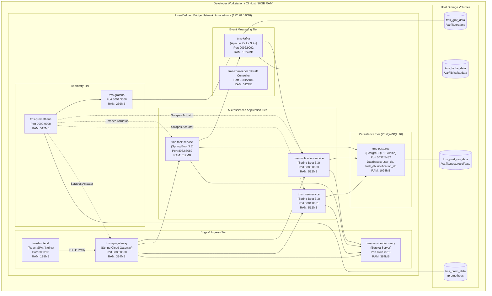

# Deployment Architecture Diagram: Task Management System

| Metadata Item | Details |
|---|---|
| **Document ID** | DOC-ARCH-006 |
| **Document Version** | 1.0.0 |
| **Status** | Approved Baseline |
| **Author / Owner Role** | DevOps Lead & Solution Architect |
| **Creation Date** | 2026-11-03 |
| **Related Documents** | `DOC-ARCH-004`, `DOC-REQ-005` |

---

## 1. Overview
This document specifies the deployment architecture for the Task Management System within a containerized Docker and Docker Compose environment, establishing network topologies, port allocations, persistent volumes, and memory resource boundaries.

---

## 2. Docker Compose Deployment Topology

---

## 3. Container Resource Allocation Matrix

| Container Name | Base Image | Host Port | Internal Port | JVM Memory Limits | Max Container RAM | Volume Mount |
|---|---|---|---|---|---|---|
| `tms-frontend` | `node:20-alpine` / `nginx:alpine` | `3000` | `80` | N/A | 128 MB | None (Static) |
| `tms-api-gateway` | `eclipse-temurin:21-jre-alpine` | `8080` | `8080` | `-Xms128m -Xmx256m` | 384 MB | None |
| `tms-service-discovery` | `eclipse-temurin:21-jre-alpine` | `8761` | `8761` | `-Xms128m -Xmx256m` | 384 MB | None |
| `tms-user-service` | `eclipse-temurin:21-jre-alpine` | `8081` | `8081` | `-Xms128m -Xmx384m` | 512 MB | None |
| `tms-task-service` | `eclipse-temurin:21-jre-alpine` | `8082` | `8082` | `-Xms128m -Xmx384m` | 512 MB | None |
| `tms-notification-service` | `eclipse-temurin:21-jre-alpine` | `8083` | `8083` | `-Xms128m -Xmx384m` | 512 MB | None |
| `tms-kafka` | `confluentinc/cp-kafka:7.6.0` | `9092` | `9092` | `-Xms256m -Xmx768m` | 1024 MB | `tms_kafka_data` |
| `tms-postgres` | `postgres:16-alpine` | `5432` | `5432` | N/A (Shared buffers 256MB) | 1024 MB | `tms_postgres_data` |
| `tms-prometheus` | `prom/prometheus:v2.51.0` | `9090` | `9090` | N/A | 512 MB | `tms_prom_data` |
| `tms-grafana` | `grafana/grafana:10.4.0` | `3001` | `3000` | N/A | 256 MB | `tms_graf_data` |
| **Total System Footprint** | | | | | **~5.25 GB** | **4 Persistent Volumes** |

---

## 4. Operational Startup Sequencing & Health Checks
1. **Tier 1 (Infrastructure Foundation)**: Start `tms-postgres`, `tms-kafka`, and `tms-zookeeper`. Wait for PostgreSQL TCP port `5432` health check.
2. **Tier 2 (Service Registry)**: Start `tms-service-discovery`. Wait for Eureka `/eureka/apps` to report HTTP 200.
3. **Tier 3 (Microservices)**: Start `tms-user-service`, `tms-task-service`, and `tms-notification-service`. Wait for `/actuator/health` to return `{"status":"UP"}`.
4. **Tier 4 (Edge Ingress & UI)**: Start `tms-api-gateway` and `tms-frontend`.
5. **Tier 5 (Observability)**: Start `tms-prometheus` and `tms-grafana`.

---

## 5. Review Checklist
- [x] Complete Docker Compose container topology diagram rendered.
- [x] Detailed memory ceilings cataloged, ensuring total allocation is ~5.25GB (comfortably within 16GB host RAM).
- [x] Strict 5-tier startup sequencing and health check dependencies defined.

---

## 6. Change History
| Version | Date | Author | Summary of Changes |
|---|---|---|---|
| 1.0.0 | 2026-11-03 | DevOps Lead | Initial baseline Deployment Architecture document. |

