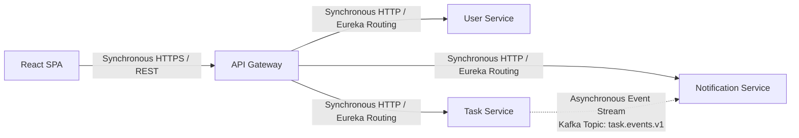
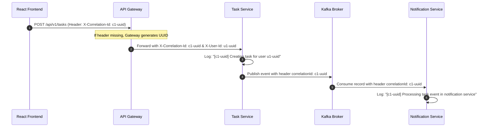

# Inter-Service Communication Design: Task Management System

| Metadata Item | Details |
|---|---|
| **Document ID** | DOC-ARCH-009 |
| **Document Version** | 1.0.0 |
| **Status** | Approved Baseline |
| **Author / Owner Role** | Solution Architect & API Architect |
| **Creation Date** | 2026-11-03 |
| **Related Documents** | `DOC-ARCH-001`, `DOC-REQ-003` |

---

## 1. Overview
The Task Management System utilizes a dual-mode communication model:
1. **Synchronous REST over HTTP/1.1**: Exclusively used for edge client-to-gateway ingress and gateway-to-microservice dynamic request routing.
2. **Asynchronous Event-Driven Messaging over Apache Kafka**: Exclusively used for domain event dissemination between microservices.

---

## 2. Synchronous Routing Protocol (Gateway to Services)
- **Protocol**: HTTP/1.1 with JSON payloads.
- **Service Resolution**: Spring Cloud Gateway resolves targets dynamically via Eureka logical URIs:
  - `lb://user-service`
  - `lb://task-service`
  - `lb://notification-service`
- **Client-Side Load Balancing**: Spring Cloud LoadBalancer handles round-robin distribution across instances.
- **Header Propagation**:
  - `X-Correlation-Id`: Propagated from incoming request or generated at the gateway (`UUID.randomUUID()`).
  - `X-User-Id`: Extracted from validated JWT claims and securely injected upstream.

---

## 3. Asynchronous Event-Driven Protocol (Task to Notification)
- **Protocol**: Apache Kafka binary protocol over TCP port `9092`.
- **Topic**: `task.events.v1`
- **Partitioning Strategy**: Partition key = `aggregateId` (Task UUID). Guarantees that all events for a given task arrive in strict chronological order within the same Kafka partition.
- **Delivery Guarantee**: At-least-once delivery enabled via `acks=all`, producer retries, Transactional Outbox, and consumer idempotency.

---

## 4. Distributed Correlation ID Propagation Flow

---

## 5. Review Checklist
- [x] Clear separation between synchronous edge routing and asynchronous event streaming.
- [x] Correlation ID propagation mapped across HTTP headers and Kafka headers.
- [x] Partitioning strategy ensures per-task ordering.

---

## 6. Change History
| Version | Date | Author | Summary of Changes |
|---|---|---|---|
| 1.0.0 | 2026-11-03 | Solution Architect | Initial baseline Inter-Service Communication Design. |

