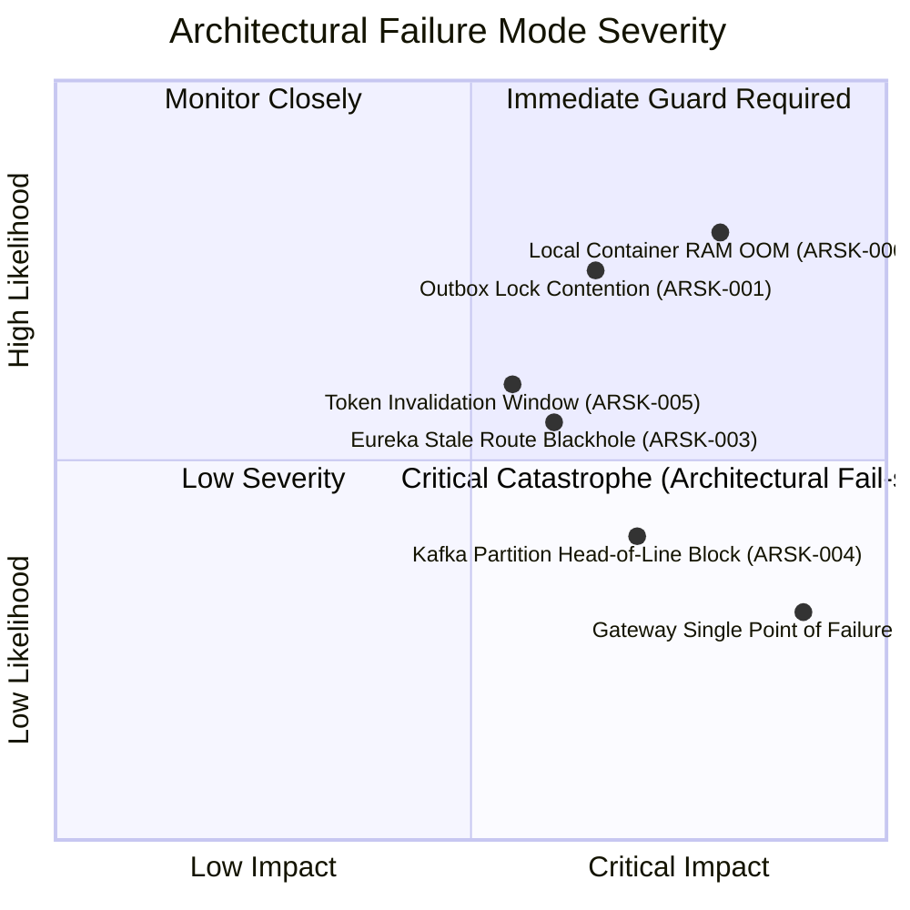

# Architecture Risk Assessment: Task Management System

| Metadata Item | Details |
|---|---|
| **Document ID** | DOC-ARCH-012 |
| **Document Version** | 1.0.0 |
| **Status** | Approved Baseline |
| **Author / Owner Role** | Solution Architect & Security Architect |
| **Creation Date** | 2026-11-03 |
| **Related Documents** | `DOC-INIT-011`, `DOC-ARCH-001`, `DOC-ARCH-011` |

---

## 1. Executive Summary
This document analyzes the systemic and distributed architecture risks inherent in the microservices topology of the Task Management System, evaluating failure modes, potential blast radiuses, and explicit technical countermeasures designed into the system.

---

## 2. Architectural Failure Modes & Risk Evaluation

---

## 3. Master Architectural Risk Register

| Risk ID | Architectural Failure Mode | Likelihood | Impact | Severity | Built-In Architectural Safeguard | Verification Protocol |
|---|---|:---:|:---:|:---:|---|---|
| **ARSK-001** | **Outbox Poller Table Lock Contention** Concurrent poller threads or task updates cause row lock serialization on `outbox_events`. | Med | Med | **Moderate** | Poller uses `SELECT ... FOR UPDATE SKIP LOCKED` with explicit batch limit (50 rows) and indexed `processed` column. | High-concurrency load test (100 writes/sec) with PostgreSQL lock analysis query. |
| **ARSK-002** | **Gateway Single Point of Failure (SPOF)** All client traffic terminates at `api-gateway`. If gateway container crashes, all APIs become unreachable. | Low | High | **High** | Gateway is completely stateless. In staging/production, deploy multiple instances behind an external reverse proxy (Nginx / ALB) with health probes. | Container kill test with Docker Compose auto-restart policy (`restart: unless-stopped`). |
| **ARSK-003** | **Eureka Stale Routing Blackhole** An ungracefully crashed microservice instance remains in Eureka cache during heartbeat window (30s), causing 503 errors. | Med | Med | **Moderate** | Configure Spring Cloud Gateway with Resilience4j circuit breaker and retry filter on `ConnectException` to fail over to alternate healthy instances. | Chaos test: Kill `task-service` container during active API traffic; verify gateway retries gracefully. |
| **ARSK-004** | **Kafka Poison Pill & Head-of-Line Blocking** A malformed JSON payload crashes the Notification Service consumer repeatedly, blocking partition processing. | Low | High | **High** | Configure Spring Kafka `DefaultErrorHandler` with `DeadLetterPublishingRecoverer` and exponential backoff (max 3 retries); divert poison pills to `task.events.v1.DLT`. | Automated poison message test: Publish corrupted JSON to `task.events.v1`; verify message diverts to DLT and partition unblocks. |
| **ARSK-005** | **Token Invalidation Delay on Password Change** Stateless JWT tokens remain valid for up to 15 minutes after user updates password. | Med | Med | **Moderate** | Token lifetime constrained to 15 minutes. Password update API increments a `token_version` in `users` table or client clears token immediately. | Security audit test. |
| **ARSK-006** | **Local Developer Workstation Memory Exhaustion** Running 5 JVMs, 3 DBs, Kafka, Prometheus, and Grafana simultaneously triggers host OS swapping or OOM kill. | High | High | **Critical** | Enforce JVM heap caps (`-Xms128m -Xmx384m`) across all Spring Boot containers. Consolidate databases into single PostgreSQL container with 3 logical DBs. Total allocation ~5.25GB RAM. | Run `docker stats` during full system execution; verify RAM $< 6\text{GB}$. |

---

## 4. Review Checklist
- [x] All 6 critical architectural failure modes analyzed.
- [x] Concrete technical safeguards documented (e.g. `SKIP LOCKED`, Resilience4j, DLT, memory caps).
- [x] Verification protocols defined for each risk.

---

## 5. Change History
| Version | Date | Author | Summary of Changes |
|---|---|---|---|
| 1.0.0 | 2026-11-03 | Solution Architect & Security Architect | Initial baseline Architecture Risk Assessment. |

