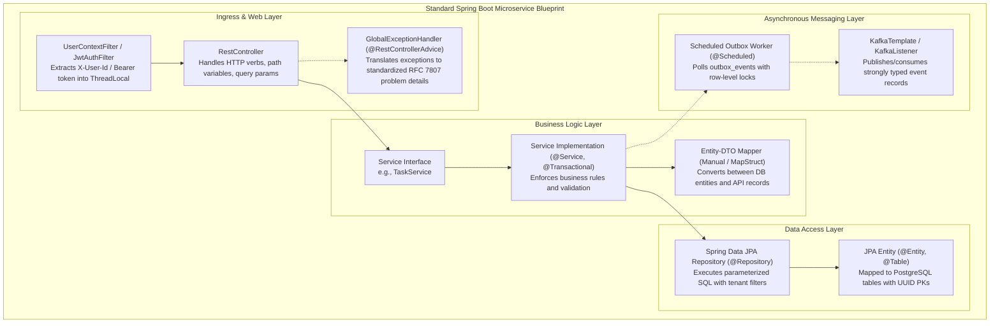

# Low-Level Design Document: Task Management System

| Metadata Item | Details |
|---|---|
| **Document ID** | DOC-LLD-001 |
| **Document Version** | 1.0.0 |
| **Status** | Approved Baseline |
| **Author / Owner Role** | Software Architect |
| **Creation Date** | 2026-11-03 |
| **Related Documents** | `DOC-ARCH-001`, `DOC-ARCH-005`, `DOC-REQ-004` |

---

## 1. Executive Summary & Design Principles
The Low-Level Design (LLD) specifies the concrete software construction details for all microservices in the Task Management System. The design adheres strictly to:
1. **SOLID Principles**: Single responsibility classes, open-closed interfaces, Liskov substitution, interface segregation, and dependency injection via Spring Framework 6.
2. **Modern Java 21 LTS Features**: Immutable `record` classes for DTOs and Kafka event payloads; pattern matching for switch expressions in state machines; sealed interfaces for domain events.
3. **Layered Separation of Concerns**: Strict boundary separation across `controller`, `service`, `repository`, `entity`, `dto`, and `exception` packages.
4. **Resilience & Thread Safety**: Stateless Spring singletons; thread-local context isolation via `UserContextHolder`; row locking via PostgreSQL `SKIP LOCKED` in outbox pollers.

---

## 2. Microservice Internal Blueprint Architecture

---

## 3. Technology Baseline Implementation Specifications
- **Java Language Runtime**: OpenJDK 21 LTS. Virtual threads enabled via `spring.threads.virtual.enabled: true`.
- **Spring Framework**: Spring Boot 3.3.x, Spring Cloud 2023.0.x, Spring Data JPA, Spring Security 6.
- **Persistence Provider**: Hibernate 6.4+ with PostgreSQL 16 dialect.
- **Serialization**: Jackson 2.17+ with JavaTimeModule for ISO-8601 UTC timestamps.
- **Validation**: Hibernate Validator / Jakarta Validation 3.0 (`@NotBlank`, `@Size`, `@Email`, `@Pattern`).

---

## 4. Review Checklist
- [x] Clean architecture layered separation detailed for all microservices.
- [x] Java 21 features (records, virtual threads) incorporated into specifications.
- [x] Threat safety, thread-local scoping, and outbox mechanics explicitly defined.

---

## 5. Change History
| Version | Date | Author | Summary of Changes |
|---|---|---|---|
| 1.0.0 | 2026-11-03 | Software Architect | Initial baseline Low-Level Design document. |

