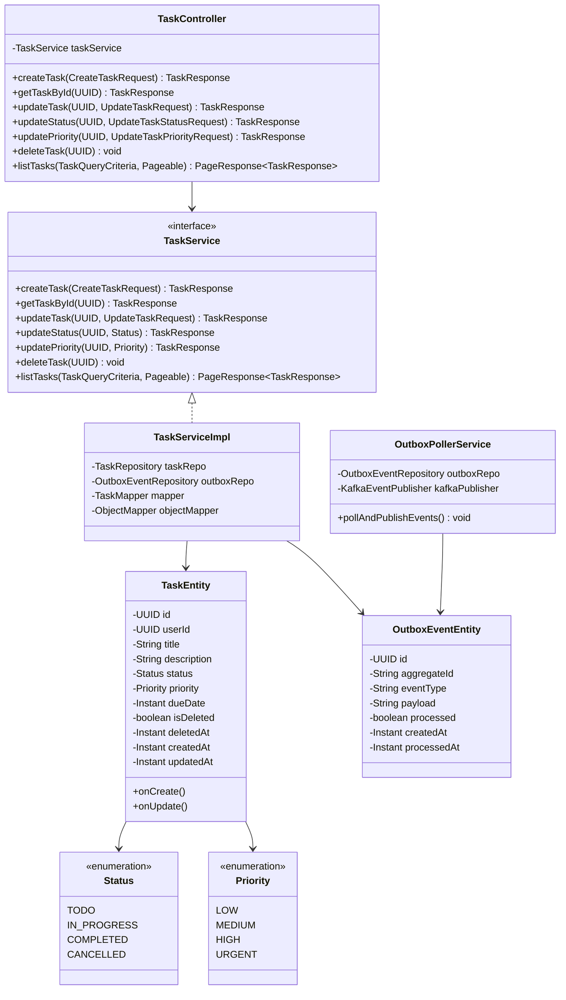
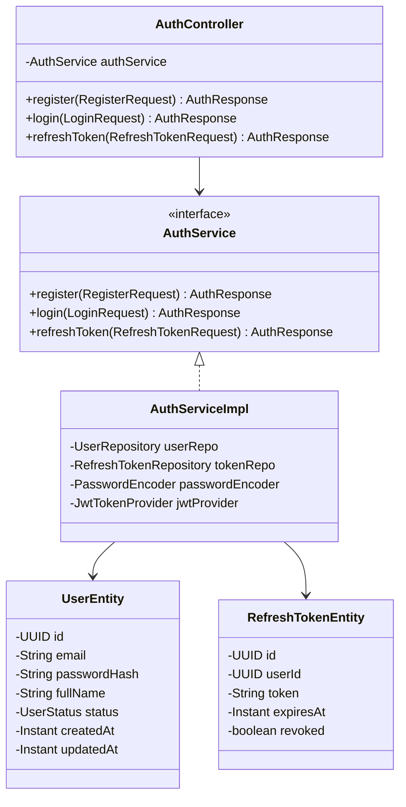
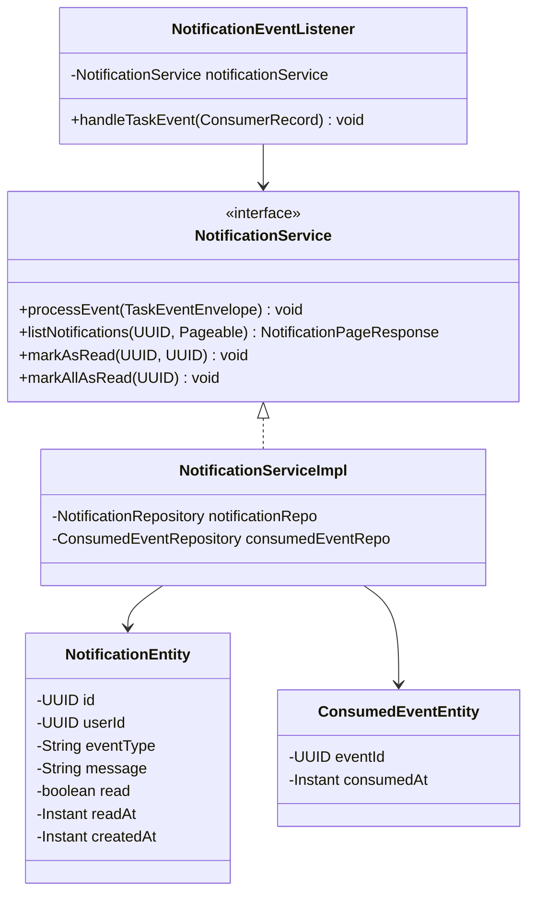

# Class Design Document: Task Management System

| Metadata Item | Details |
|---|---|
| **Document ID** | DOC-LLD-003 |
| **Document Version** | 1.0.0 |
| **Status** | Approved Baseline |
| **Author / Owner Role** | Software Architect |
| **Creation Date** | 2026-11-03 |
| **Related Documents** | `DOC-LLD-001`, `DOC-LLD-002` |

---

## 1. Task Service Class Design

---

## 2. User Service Class Design

---

## 3. Notification Service Class Design

---

## 4. Review Checklist
- [x] Complete class diagrams and interface specifications for Task, User, and Notification services.
- [x] Enums, entities, repositories, services, controllers, and listeners mapped.
- [x] Clean architecture dependency rules verified (high-level services depend on abstractions).

---

## 5. Change History
| Version | Date | Author | Summary of Changes |
|---|---|---|---|
| 1.0.0 | 2026-11-03 | Software Architect | Initial baseline Class Design document. |

