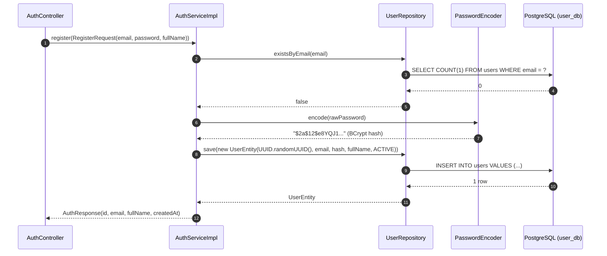
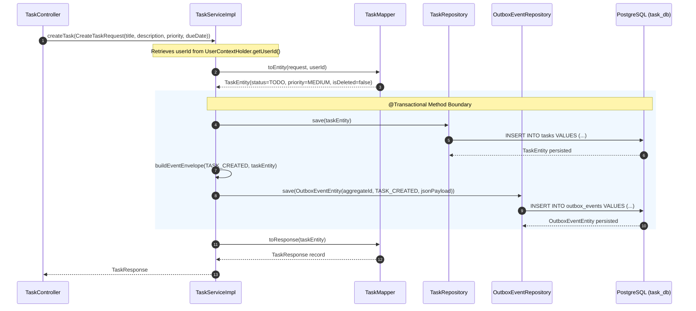
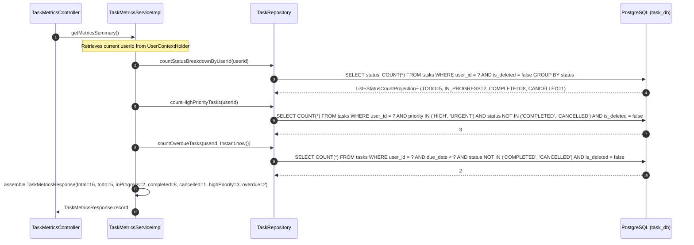

# Low-Level Sequence Diagrams: Task Management System

| Metadata Item | Details |
|---|---|
| **Document ID** | DOC-LLD-005 |
| **Document Version** | 1.0.0 |
| **Status** | Approved Baseline |
| **Author / Owner Role** | Software Architect |
| **Creation Date** | 2026-11-03 |
| **Related Documents** | `DOC-LLD-003`, `DOC-LLD-004` |

---

## 1. Overview
This document provides low-level, method-signature accurate sequence diagrams detailing method invocations, parameter passing, and return types across the microservices.

---

## 2. Sequence Diagrams

### 2.1 User Registration (`user-service`)

---

### 2.2 Task Creation with Transactional Outbox (`task-service`)

---

### 2.3 Dashboard Metrics Aggregation (`task-service`)

---

## 3. Review Checklist
- [x] Precise method names, arguments, and return types documented.
- [x] `@Transactional` boundaries demarcated in Mermaid rect regions.
- [x] Multi-tenancy scoping and SQL parameterization illustrated.

---

## 4. Change History
| Version | Date | Author | Summary of Changes |
|---|---|---|---|
| 1.0.0 | 2026-11-03 | Software Architect | Initial baseline Low-Level Sequence Diagrams. |

