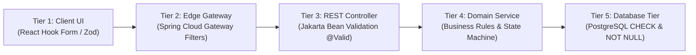

# Validation Design Document: Task Management System

| Metadata Item | Details |
|---|---|
| **Document ID** | DOC-LLD-011 |
| **Document Version** | 1.0.0 |
| **Status** | Approved Baseline |
| **Author / Owner Role** | Software Architect & QA Lead |
| **Creation Date** | 2026-11-03 |
| **Related Documents** | `DOC-LLD-008`, `DOC-REQ-004` |

---

## 1. Multi-Tier Defense-in-Depth Validation Model
Data integrity is enforced across five progressive tiers:

---

## 2. Validation Specifications by Tier

### 2.1 Tier 2: API Gateway Edge Validation
- **Request Size**: Max payload size capped at 100KB (`spring.codec.max-in-memory-size: 102400`) to mitigate denial-of-service memory exhaustion.
- **Content-Type**: Requests with bodies must specify `Content-Type: application/json`.
- **JWT Header**: Protected endpoints must present `Authorization: Bearer <jwt>`.

### 2.2 Tier 3: Controller Bean Validation (DTO Annotations)
- **Email Validation**:
  - Rule: `@NotBlank`, `@Email`, max 255 chars.
- **Password Strength**:
  - Rule: `@Pattern(regexp = "^(?=.*[a-z])(?=.*[A-Z])(?=.*\\d)(?=.*[@$!%*?&])[A-Za-z\\d@$!%*?&]{8,}$")`.
  - Enforces minimum 8 chars, 1 uppercase, 1 lowercase, 1 number, and 1 special symbol.
- **Task Title**:
  - Rule: `@NotBlank(message = "Title must not be blank")`, `@Size(min = 1, max = 255)`.
- **Task Description**:
  - Rule: `@Size(max = 2000, message = "Description cannot exceed 2000 characters")`.

### 2.3 Tier 4: Domain Service Validation
- **Ownership Verification**: Before executing any update or delete, service verifies `task.getUserId().equals(UserContextHolder.getRequiredUserId())`.
- **State Progression Verification**: Enforces valid transitions in `Status` enum (e.g., `CANCELLED` cannot directly transition to `COMPLETED`).
- **Due Date Logic**: While due dates can be set in the past for historical tracking, if provided on creation, a client warning is generated if due date is $< \text{now()}$.

### 2.4 Tier 5: PostgreSQL Database Constraints
- `tasks.title NOT NULL`
- `tasks.status NOT NULL`
- `tasks.priority NOT NULL`
- `tasks.is_deleted NOT NULL`
- `users.email UNIQUE NOT NULL`

---

## 3. Review Checklist
- [x] Five-tier defense-in-depth validation architecture mapped.
- [x] Regular expressions and boundary length constraints specified.
- [x] Database constraint redundancy verifies absolute data integrity.

---

## 4. Change History
| Version | Date | Author | Summary of Changes |
|---|---|---|---|
| 1.0.0 | 2026-11-03 | Software Architect | Initial baseline Validation Design document. |

