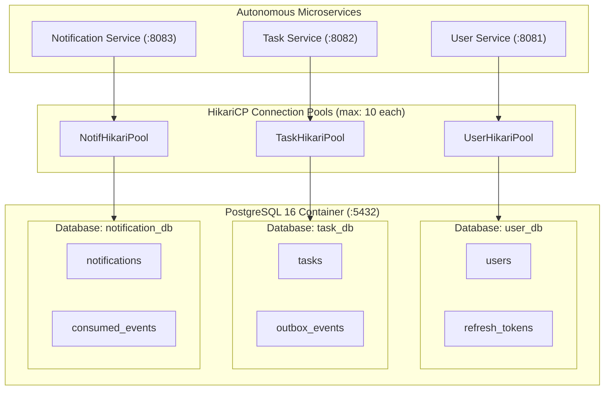

# Database Architecture Document: Task Management System

| Metadata Item | Details |
|---|---|
| **Document ID** | DOC-DB-001 |
| **Document Version** | 1.0.0 |
| **Status** | Approved Baseline |
| **Author / Owner Role** | Database Architect |
| **Creation Date** | 2026-11-03 |
| **Related Documents** | `DOC-ARCH-001`, `ADR-001`, `ADR-004` |

---

## 1. Executive Summary & Engine Selection
The Task Management System utilizes **PostgreSQL 16** as its persistent relational database engine. Relational database storage is chosen for its strict ACID guarantees, rich indexing mechanisms (B-Tree, Partial, Composite), native `UUID` and `JSONB` support, and robust migration tooling via Flyway.

---

## 2. Core Architectural Tenets
1. **Database-per-Service**: Each microservice connects exclusively to its assigned database (`user_db`, `task_db`, `notification_db`). Cross-database queries and foreign keys are strictly prohibited.
2. **Schema Versioning via Flyway**: Every table, index, and constraint is declared in immutable, forward-only versioned migration SQL scripts (`V1__...sql`). Hibernate `ddl-auto` is locked to `validate`.
3. **Multi-Tenant Scoping**: All task and notification tables include a `user_id UUID NOT NULL` column. Every query plan is verified to use composite indexes covering `user_id`.
4. **Deterministic Auditing**: Standard audit columns (`created_at`, `updated_at`) use PostgreSQL `TIMESTAMPTZ` set to UTC (`DEFAULT (now() AT TIME ZONE 'utc')`).

---

## 3. Storage & Connection Specifications

| Parameter | Specification | Rationale |
|---|---|---|
| **RDBMS Engine** | PostgreSQL 16 Alpine | Lightweight, robust open-source engine with high query performance. |
| **Storage Charset** | `UTF8` with `en_US.UTF-8` collation | Standardized Unicode text representation supporting international characters. |
| **Connection Pool** | HikariCP (10 max, 5 idle per service) | Limits concurrent DB connections across 3 services to $\le 30$, preventing socket exhaustion. |
| **Primary Key Standard** | Native PostgreSQL `UUID` | Prevents ID enumeration attacks; supports decentralized ID generation. |
| **Transaction Isolation** | `READ COMMITTED` (PostgreSQL default) | Optimal balance of consistency and concurrency; prevents dirty reads without lock overhead. |

---

## 4. Review Checklist
- [x] Clear database topology diagram showing independent logical databases and Hikari pools.
- [x] Strict adherence to Database-per-Service rules verified.
- [x] Storage engine, charset, and connection pool parameters specified.

---

## 5. Change History
| Version | Date | Author | Summary of Changes |
|---|---|---|---|
| 1.0.0 | 2026-11-03 | Database Architect | Initial baseline Database Architecture document. |

