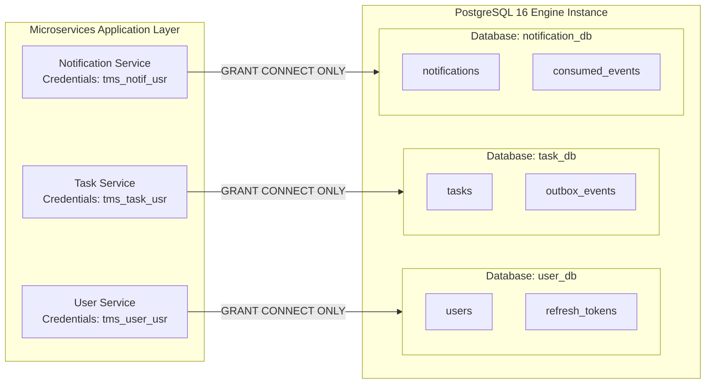

# Database per Service Design: Task Management System

| Metadata Item | Details |
|---|---|
| **Document ID** | DOC-DB-002 |
| **Document Version** | 1.0.0 |
| **Status** | Approved Baseline |
| **Author / Owner Role** | Database Architect & Solution Architect |
| **Creation Date** | 2026-11-03 |
| **Related Documents** | `DOC-DB-001`, `ADR-001` |

---

## 1. Overview
The Database-per-Service pattern guarantees bounded context isolation by ensuring that each microservice maintains sole ownership over its data store. No other service may read, write, or hold references to foreign database schemas.

---

## 2. Logical vs. Physical Isolation Strategy



### 2.1 Role-Based Access Control (RBAC) Enforcement
To prevent accidental or malicious cross-database querying, each database is assigned a dedicated PostgreSQL role with strictly scoped privileges:
1. `tms_user_usr`: Granted `CONNECT`, `SELECT`, `INSERT`, `UPDATE`, `DELETE` *exclusively* on `user_db`. Has zero privileges on `task_db` or `notification_db`.
2. `tms_task_usr`: Granted access *exclusively* to `task_db`.
3. `tms_notif_usr`: Granted access *exclusively* to `notification_db`.

---

## 3. Resolving Cross-Context References Without Foreign Keys
In a monolith, `tasks.user_id` would have a foreign key constraint referencing `users.id`:
```sql
-- PROHIBITED IN MICROSERVICES ARCHITECTURE
ALTER TABLE tasks ADD CONSTRAINT fk_user FOREIGN KEY (user_id) REFERENCES users(id);
```

### Architectural Solution
1. **Unconstrained UUID Reference**: In `task-service`, `user_id` is defined as a standard `UUID NOT NULL` column. Referential integrity is not validated via database foreign keys.
2. **Context Trust at Ingress**: The API Gateway cryptographically verifies the user's JWT token and injects the verified `X-User-Id` header into the upstream request.
3. **Event-Driven Lifecycle Sync**: If an account deletion policy is activated in the future, `user-service` publishes a `USER_DEACTIVATED` event over Kafka, allowing `task-service` and `notification-service` to archive or delete associated records asynchronously.

---

## 4. Review Checklist
- [x] Dedicated PostgreSQL roles and credential boundaries defined.
- [x] Cross-database foreign keys explicitly prohibited.
- [x] Unconstrained UUID foreign reference and event synchronization pattern documented.

---

## 5. Change History
| Version | Date | Author | Summary of Changes |
|---|---|---|---|
| 1.0.0 | 2026-11-03 | Database Architect | Initial baseline Database per Service Design. |

