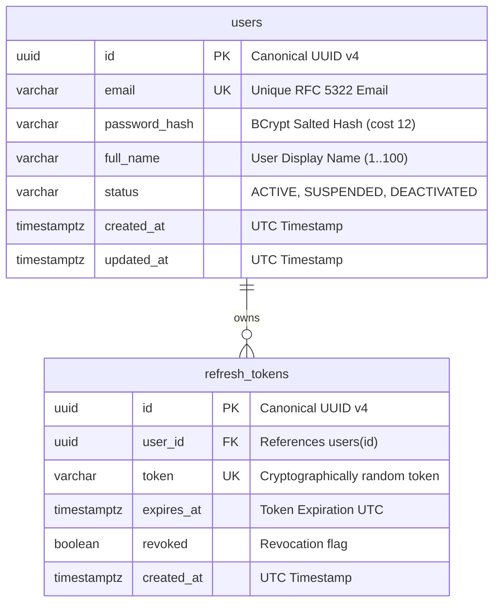
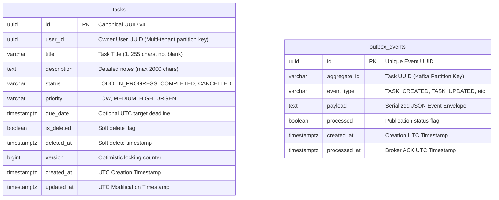
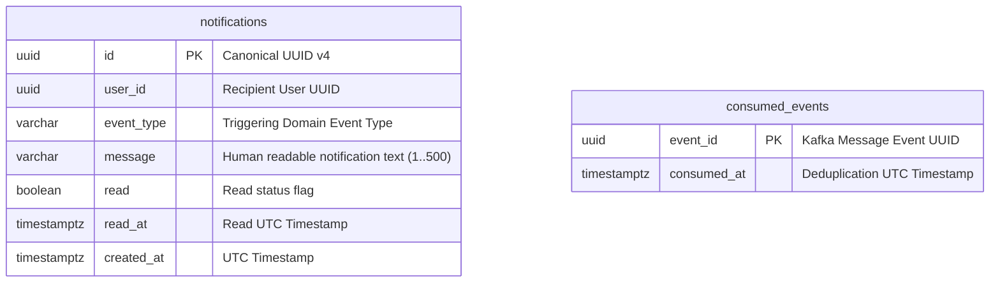
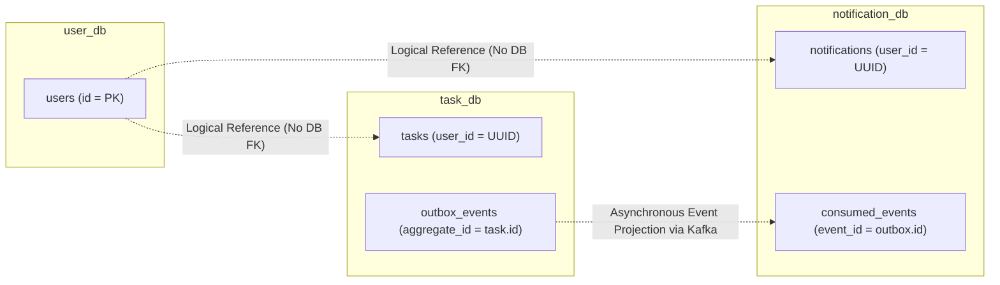

# Entity Relationship Diagrams: Task Management System

| Metadata Item | Details |
|---|---|
| **Document ID** | DOC-DB-003 |
| **Document Version** | 1.0.0 |
| **Status** | Approved Baseline |
| **Author / Owner Role** | Database Architect |
| **Creation Date** | 2026-11-03 |
| **Related Documents** | `DOC-DB-001`, `DOC-DB-002`, `DOC-BA-008` |

---

## 1. Subsystem Entity-Relationship Diagrams

### 1.1 `user_db` ERD (User Service)

---

### 1.2 `task_db` ERD (Task Service)

---

### 1.3 `notification_db` ERD (Notification Service)

---

## 2. Global Cross-Context Logical Data Map

---

## 3. Review Checklist
- [x] Standard Mermaid `erDiagram` syntax used for all three service databases.
- [x] Primary keys (PK), foreign keys (FK), unique constraints (UK), and data types specified.
- [x] Global logical map clearly illustrates decoupled asynchronous relationships.

---

## 4. Change History
| Version | Date | Author | Summary of Changes |
|---|---|---|---|
| 1.0.0 | 2026-11-03 | Database Architect | Initial baseline Entity Relationship Diagrams. |

