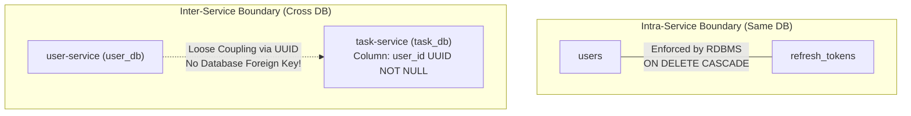

# Primary and Foreign Key Strategy: Task Management System

| Metadata Item | Details |
|---|---|
| **Document ID** | DOC-DB-006 |
| **Document Version** | 1.0.0 |
| **Status** | Approved Baseline |
| **Author / Owner Role** | Database Architect |
| **Creation Date** | 2026-11-03 |
| **Related Documents** | `DOC-DB-001`, `DOC-DB-004` |

---

## 1. Primary Key Strategy: Evaluation & Adoption
The architecture team evaluated three primary key models:

| Evaluation Criteria | Auto-Increment `BIGSERIAL` | Client/DB Generated `UUID v4` (Adopted) | `UUID v7` (Time-Ordered) |
|---|---|---|---|
| **Security / Enumeration** | **High Risk**: Allows sequential guessing of record volumes and IDs (`/tasks/101`). | **Zero Risk**: 128-bit cryptographically random space ($2^{122}$ entropy). | **Zero Risk**: Random suffix with temporal prefix. |
| **Distributed Autonomy** | **Requires Central DB**: Cannot generate valid ID before database roundtrip. | **Fully Autonomous**: Microservices and clients can generate valid UUIDs in memory. | **Autonomous**: Can be generated before DB write. |
| **B-Tree Fragmentation** | **Optimal**: Appends to end of B-Tree without node splits. | **Acceptable for Scale**: Random distribution causes minor page splits (negligible at $< 10\text{M}$ rows). | **Optimal**: Preserves temporal clustering. |
| **Standard Support** | Native PostgreSQL | Native PostgreSQL `UUID` type and `gen_random_uuid()`. | Requires custom extension or Java 21 library. |

### Decision
Standardize on **UUID Version 4** across all entity primary keys.
- **Generation Standard**: Generated in the Java application layer via `UUID.randomUUID()` to allow entity and outbox event correlation prior to database commit, with database fallback default `DEFAULT gen_random_uuid()`.

---

## 2. Foreign Key Strategy (Intra-Service vs. Inter-Service)

### 2.1 Intra-Service Foreign Keys (Enforced)
Within a single microservice database, relational integrity is strictly enforced via database foreign keys:
- `refresh_tokens.user_id` references `users.id` with `ON DELETE CASCADE`.

### 2.2 Inter-Service Foreign References (Unconstrained)
Across microservice boundaries, database foreign keys are strictly prohibited:
- `tasks.user_id` is an indexed, unconstrained UUID column.
- `notifications.user_id` is an indexed, unconstrained UUID column.
- Validation is handled upstream at the API Gateway via JWT signature verification.

---

## 3. Review Checklist
- [x] Clear evaluation matrix justifying UUID v4 adoption over sequential BIGSERIAL.
- [x] Clear demarcation between intra-service enforced foreign keys and inter-service unconstrained UUIDs.
- [x] Application-layer UUID pre-generation pattern articulated for Transactional Outbox alignment.

---

## 4. Change History
| Version | Date | Author | Summary of Changes |
|---|---|---|---|
| 1.0.0 | 2026-11-03 | Database Architect | Initial baseline Primary and Foreign Key Strategy document. |

