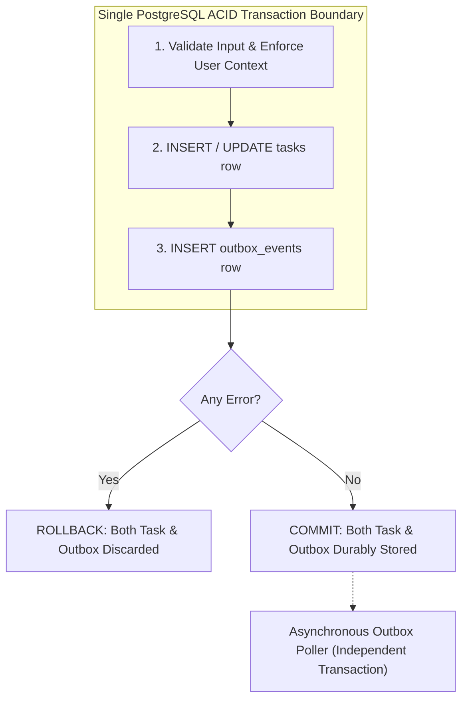

# Transaction Management Design: Task Management System

| Metadata Item | Details |
|---|---|
| **Document ID** | DOC-DB-010 |
| **Document Version** | 1.0.0 |
| **Status** | Approved Baseline |
| **Author / Owner Role** | Database Architect & Software Architect |
| **Creation Date** | 2026-11-03 |
| **Related Documents** | `DOC-DB-001`, `DOC-LLD-006`, `ADR-005` |

---

## 1. Overview & ACID Boundary Architecture
Transaction management ensures that state transitions and outbox event persistence occur atomically within PostgreSQL database transactions. Dual-write inconsistencies are completely eliminated by keeping entity mutations and event creation within a single transactional boundary.



---

## 2. Transaction Configuration & Isolation Parameters

| Parameter | Configuration Value | Rationale |
|---|---|---|
| **Isolation Level** | `ISOLATION_READ_COMMITTED` | Standard PostgreSQL isolation. Prevents dirty reads while allowing non-conflicting concurrent writes without serialization aborts. |
| **Propagation** | `PROPAGATION_REQUIRED` | Joins an existing active transaction or creates a new one if none exists. Ensures composite operations share the same commit/rollback scope. |
| **Rollback Rule** | `rollbackFor = Exception.class` | Rolls back on both checked and unchecked runtime exceptions. |
| **Transaction Timeout** | `10 seconds` (`@Transactional(timeout = 10)`) | Automatically aborts long-running or stalled transactions to prevent connection pool exhaustion. |
| **Read-Only Optimization**| `@Transactional(readOnly = true)` | Applied to queries (`GET` endpoints). Instructs Hibernate to disable dirty-checking flushes, reducing CPU overhead. |

---

## 3. Concurrency & Deadlock Prevention

### 3.1 Lock Acquisition Hierarchy
To prevent deadlocks when updating multiple entities, locks are acquired in a consistent, deterministic order:
1. Always acquire task entity row lock before updating related outbox rows.
2. In batch operations, records are sorted by primary key UUID (`id ASC`) prior to acquiring locks.

### 3.2 Non-Blocking Row Locking in Outbox Poller
```sql
SELECT id, aggregate_id, event_type, payload 
FROM outbox_events 
WHERE processed = false 
ORDER BY created_at ASC 
LIMIT 50 
FOR UPDATE SKIP LOCKED;
```
- **Mechanics of `SKIP LOCKED`**: PostgreSQL locks only the 50 selected rows. If another concurrent instance of `task-service` runs a poller query simultaneously, it immediately skips those locked rows and processes the next 50 rows without waiting or blocking.

---

## 4. Review Checklist
- [x] ACID transaction boundary diagram illustrates atomic entity + outbox commitment.
- [x] Spring `@Transactional` isolation, propagation, and timeout parameters specified.
- [x] Non-blocking concurrency via `FOR UPDATE SKIP LOCKED` verified.

---

## 5. Change History
| Version | Date | Author | Summary of Changes |
|---|---|---|---|
| 1.0.0 | 2026-11-03 | Database Architect | Initial baseline Transaction Management Design. |

