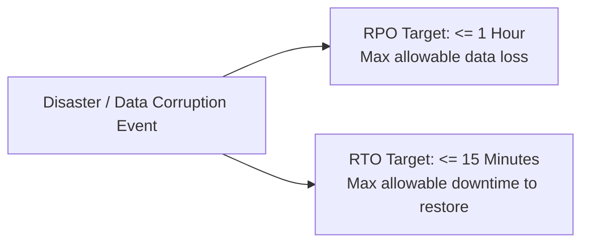

# Database Backup and Recovery Strategy: Task Management System

| Metadata Item | Details |
|---|---|
| **Document ID** | DOC-DB-012 |
| **Document Version** | 1.0.0 |
| **Status** | Approved Baseline |
| **Author / Owner Role** | Database Architect & DevOps Lead |
| **Creation Date** | 2026-11-03 |
| **Related Documents** | `DOC-DB-001`, `DOC-REQ-005` |

---

## 1. Objectives & Service Level Benchmarks



- **Recovery Point Objective (RPO)**: $\le 1\text{ hour}$. In the event of catastrophic data loss, no more than 1 hour of task data may be lost.
- **Recovery Time Objective (RTO)**: $\le 15\text{ minutes}$. Databases must be restored and services reconnected within 15 minutes of failure declaration.

---

## 2. Backup Mechanisms

### 2.1 Daily & Hourly Logical Backups (`pg_dump`)
Automated backup jobs run against each microservice database using PostgreSQL `pg_dump` with custom directory compression:
```bash
#!/bin/bash
# Backup script: backup-databases.sh
TIMESTAMP=$(date +"%Y%m%d_%H%M%S")
BACKUP_DIR="/backups/postgres"

for DB in user_db task_db notification_db; do
  echo "Backing up ${DB}..."
  pg_dump -h localhost -p 5432 -U postgres -d ${DB} -F c -b -v -f "${BACKUP_DIR}/${DB}_${TIMESTAMP}.dump"
done

# Retention: Remove backups older than 7 days
find ${BACKUP_DIR} -type f -name "*.dump" -mtime +7 -delete
```

### 2.2 Point-in-Time Recovery (PITR) via Write-Ahead Logging (WAL)
In production environments, PostgreSQL Write-Ahead Logs (`pg_wal`) are continuously archived to an external backup mount, enabling recovery to any exact second prior to an accidental data corruption event.

---

## 3. Database Restore & Verification Procedure
```bash
# Restoration command for task_db
createdb -h localhost -p 5432 -U postgres task_db_restored
pg_restore -h localhost -p 5432 -U postgres -d task_db_restored -v "/backups/postgres/task_db_20261103_120000.dump"
```
- **Automated Verification**: Scheduled monthly restore drills verify that restored database tables match primary row counts and pass Flyway schema validation checks.

---

## 4. Review Checklist
- [x] RPO ($\le 1\text{ hour}$) and RTO ($\le 15\text{ minutes}$) targets documented.
- [x] Automated `pg_dump` script and retention cleanup commands provided.
- [x] Verification restore procedures defined.

---

## 5. Change History
| Version | Date | Author | Summary of Changes |
|---|---|---|---|
| 1.0.0 | 2026-11-03 | Database Architect | Initial baseline Backup and Recovery Strategy document. |

