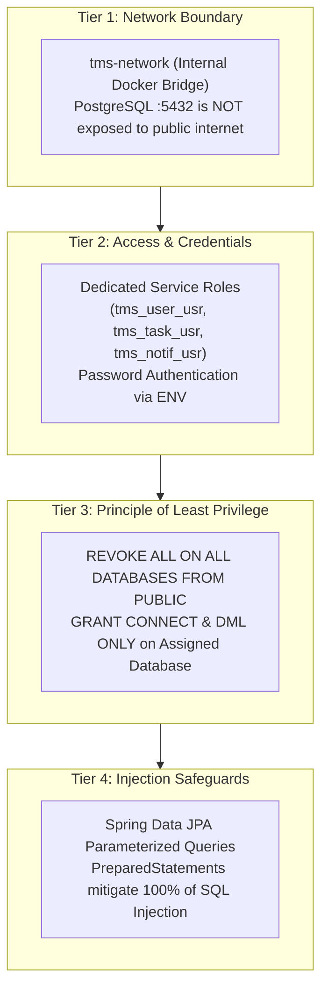

# Database Security Design: Task Management System

| Metadata Item | Details |
|---|---|
| **Document ID** | DOC-DB-014 |
| **Document Version** | 1.0.0 |
| **Status** | Approved Baseline |
| **Author / Owner Role** | Security Architect & Database Architect |
| **Creation Date** | 2026-11-03 |
| **Related Documents** | `DOC-DB-001`, `DOC-DB-002`, `DOC-REQ-005` |

---

## 1. Defense-in-Depth Database Security Model



---

## 2. Least Privilege Role Grants (`init-db-roles.sql`)

```sql
-- Security Hardening Script: init-db-roles.sql

-- 1. Create Dedicated Service Roles with strong passwords
CREATE ROLE tms_user_usr WITH LOGIN PASSWORD '${USER_DB_PASSWORD}';
CREATE ROLE tms_task_usr WITH LOGIN PASSWORD '${TASK_DB_PASSWORD}';
CREATE ROLE tms_notif_usr WITH LOGIN PASSWORD '${NOTIF_DB_PASSWORD}';

-- 2. Revoke default public schema permissions
REVOKE ALL ON SCHEMA public FROM PUBLIC;

-- 3. Grant scoped access on user_db
\c user_db
GRANT CONNECT ON DATABASE user_db TO tms_user_usr;
GRANT USAGE, CREATE ON SCHEMA public TO tms_user_usr;
GRANT SELECT, INSERT, UPDATE, DELETE ON ALL TABLES IN SCHEMA public TO tms_user_usr;
ALTER DEFAULT PRIVILEGES IN SCHEMA public GRANT SELECT, INSERT, UPDATE, DELETE ON TABLES TO tms_user_usr;

-- 4. Grant scoped access on task_db
\c task_db
GRANT CONNECT ON DATABASE task_db TO tms_task_usr;
GRANT USAGE, CREATE ON SCHEMA public TO tms_task_usr;
GRANT SELECT, INSERT, UPDATE, DELETE ON ALL TABLES IN SCHEMA public TO tms_task_usr;
ALTER DEFAULT PRIVILEGES IN SCHEMA public GRANT SELECT, INSERT, UPDATE, DELETE ON TABLES TO tms_task_usr;

-- 5. Grant scoped access on notification_db
\c notification_db
GRANT CONNECT ON DATABASE notification_db TO tms_notif_usr;
GRANT USAGE, CREATE ON SCHEMA public TO tms_notif_usr;
GRANT SELECT, INSERT, UPDATE, DELETE ON ALL TABLES IN SCHEMA public TO tms_notif_usr;
ALTER DEFAULT PRIVILEGES IN SCHEMA public GRANT SELECT, INSERT, UPDATE, DELETE ON TABLES TO tms_notif_usr;
```

---

## 3. Cryptographic Data Protection & Injection Mitigation
1. **SQL Injection Elimination**: Developers are strictly prohibited from constructing SQL strings via concatenation (`"SELECT * FROM tasks WHERE title = '" + input + "'"`). All database interactions use Spring Data JPA repository methods or parameterized `@Query` annotations using named binds (`:userId`).
2. **Credential Ingestion**: Database credentials must be supplied via runtime environment variables (`DB_USER`, `DB_PASSWORD`). No database passwords are committed to Git repositories or baked into Docker container images.
3. **Network Confinement**: In production, the PostgreSQL container does not bind port `5432` to the host network interface (`0.0.0.0:5432`); only containers on the internal `tms-network` can communicate over TCP port 5432.

---

## 4. Review Checklist
- [x] Dedicated service roles and granular least-privilege grant script documented.
- [x] Defense-in-depth security model maps network, credential, authorization, and ORM tiers.
- [x] Zero plain-text credentials in repository; environment variable binding enforced.

---

## 5. Change History
| Version | Date | Author | Summary of Changes |
|---|---|---|---|
| 1.0.0 | 2026-11-03 | Security Architect | Initial baseline Database Security Design. |

