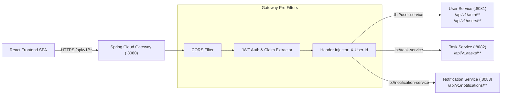

# API Architecture Document: Task Management System

| Metadata Item | Details |
|---|---|
| **Document ID** | DOC-API-001 |
| **Document Version** | 1.0.0 |
| **Status** | Approved Baseline |
| **Author / Owner Role** | API Architect & Solution Architect |
| **Creation Date** | 2026-11-03 |
| **Related Documents** | `DOC-ARCH-001`, `DOC-ARCH-004`, `REG-RTM-001` |

---

## 1. Architectural Philosophy & Principles
The Task Management System API architecture provides a unified, secure, and predictable RESTful interface across all microservices:
1. **API Gateway Facade**: All external client communication passes through Spring Cloud Gateway on port `8080`. Microservices are isolated from public internet exposure.
2. **RESTful Resource Maturity (Richardson Maturity Model Level 2/3)**: Proper HTTP verbs (`GET`, `POST`, `PUT`, `PATCH`, `DELETE`), clean resource URIs, standard HTTP status codes, and consistent error envelopes.
3. **Stateless Operations**: No server-side HTTP session state. Every protected request carries a cryptographically signed Bearer JWT token.
4. **Contract-First & Type Safety**: APIs adhere to strict OpenAPI 3.0 specifications; client TypeScript models directly mirror backend request and response schemas.

---

## 2. API Edge Ingress & Routing Topology

---

## 3. Core Resource Hierarchy & URI Taxonomy

| Bounded Context | Base Resource Path | Resource Description |
|---|---|---|
| **Authentication** | `/api/v1/auth` | Public endpoints for registration, login, and token refresh. |
| **User Identity** | `/api/v1/users` | Authenticated user profile retrieval and modification. |
| **Task Operations** | `/api/v1/tasks` | Task creation, listing, search, filtering, and deletion. |
| **Task Status** | `/api/v1/tasks/{id}/status` | Sub-resource for atomic task state machine transitions. |
| **Task Priority** | `/api/v1/tasks/{id}/priority`| Sub-resource for atomic priority updates. |
| **Productivity Metrics**| `/api/v1/tasks/metrics/summary`| Aggregated status and overdue counts for the user dashboard. |
| **Notifications** | `/api/v1/notifications` | In-app notification retrieval and read status updates. |

---

## 4. Review Checklist
- [x] Clear API architecture principles and Richardson Maturity Model alignment detailed.
- [x] API Gateway routing and header injection topology mapped with Mermaid.
- [x] Canonical resource URI taxonomy established.

---

## 5. Change History
| Version | Date | Author | Summary of Changes |
|---|---|---|---|
| 1.0.0 | 2026-11-03 | API Architect | Initial baseline API Architecture document. |

