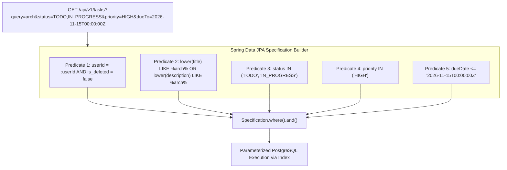

# Filtering and Sorting Design: Task Management System

| Metadata Item | Details |
|---|---|
| **Document ID** | DOC-API-009 |
| **Document Version** | 1.0.0 |
| **Status** | Approved Baseline |
| **Author / Owner Role** | API Architect & Software Architect |
| **Creation Date** | 2026-11-03 |
| **Related Documents** | `DOC-API-003`, `DOC-DB-007` |

---

## 1. Overview
Filtering and sorting allow users to isolate, organize, and navigate tasks across complex multi-criteria queries. The system enforces strict parameter whitelisting to eliminate SQL injection and protect against un-indexed database query execution.

---

## 2. Multi-Criteria Filtering Protocol

### Supported Filter Parameters

| Parameter | Type | Cardinality | Example | SQL Translation |
|---|---|:---:|---|---|
| `query` | String | Single | `query=architecture` | `AND (lower(title) LIKE '%architecture%' OR lower(description) LIKE '%architecture%')` |
| `status` | String list | Multi (CSV) | `status=TODO,IN_PROGRESS` | `AND status IN ('TODO', 'IN_PROGRESS')` |
| `priority` | String list | Multi (CSV) | `priority=HIGH,URGENT` | `AND priority IN ('HIGH', 'URGENT')` |
| `dueFrom` | ISO-8601 | Single | `dueFrom=2026-11-01T00:00:00Z` | `AND due_date >= :dueFrom` |
| `dueTo` | ISO-8601 | Single | `dueTo=2026-11-15T23:59:59Z` | `AND due_date <= :dueTo` |

---

## 3. Sorting Specification & Whitelisting
To prevent database errors and SQL injection via `ORDER BY`, sort parameters are validated against a strict property whitelist:
- **Whitelisted Properties**: `dueDate`, `priority`, `createdAt`, `title`.
- **Default Sort**: `createdAt,desc` (Newest tasks first).
- **Direction**: `asc` (Ascending) or `desc` (Descending).
- **Validation**: Any request passing an illegal sort property (e.g., `sort=passwordHash,asc` or `sort=1;DROP TABLE;`) is rejected immediately with HTTP 400 Bad Request (`ERR_VALIDATION_FAILED: Sort field not permitted`).

---

## 4. Review Checklist
- [x] Multi-criteria filtering logic and parameter specification mapped.
- [x] Strict sorting whitelist protects against SQL injection and un-indexed sorting.
- [x] Spring Data JPA Specification combination logic documented.

---

## 5. Change History
| Version | Date | Author | Summary of Changes |
|---|---|---|---|
| 1.0.0 | 2026-11-03 | API Architect | Initial baseline Filtering and Sorting Design. |

