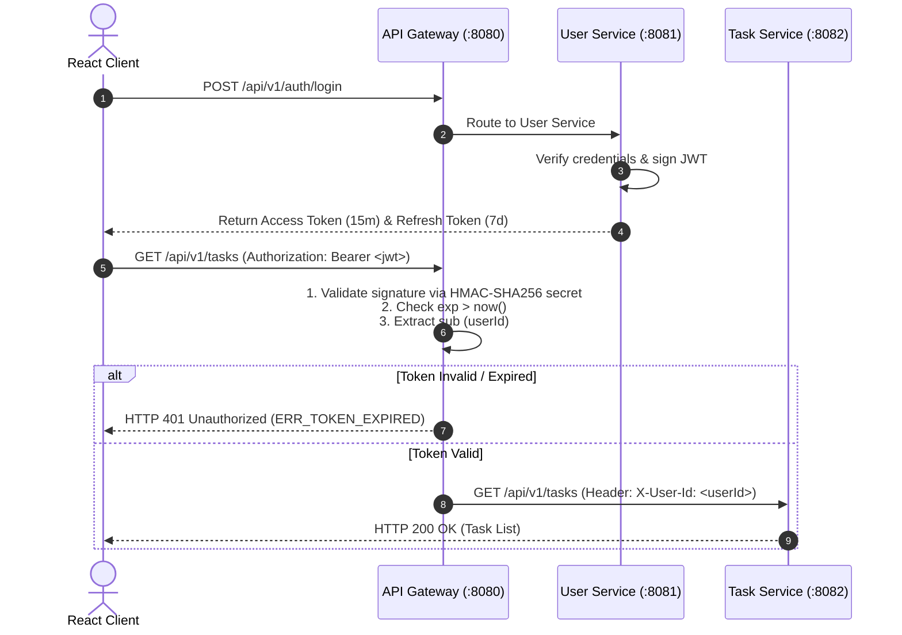

# API Authentication Design: Task Management System

| Metadata Item | Details |
|---|---|
| **Document ID** | DOC-API-010 |
| **Document Version** | 1.0.0 |
| **Status** | Approved Baseline |
| **Author / Owner Role** | Security Architect & API Architect |
| **Creation Date** | 2026-11-03 |
| **Related Documents** | `DOC-ARCH-003`, `ADR-003`, `DOC-API-003` |

---

## 1. Authentication Architecture Overview
The Task Management System employs **Stateless JSON Web Tokens (JWT)** conforming to RFC 7519:
1. **User Service**: The sole authority for validating passwords and issuing cryptographically signed tokens.
2. **API Gateway**: The edge enforcement point that validates token signatures and claims before routing requests to upstream microservices.
3. **Downstream Services**: Receive verified identity via trusted internal headers, eliminating redundant token parsing and database lookups.



---

## 2. JWT Token Structure & Claims Specification

### 2.1 Header
```json
{
  "alg": "HS256",
  "typ": "JWT"
}
```

### 2.2 Payload (Standard & Custom Claims)
```json
{
  "sub": "550e8400-e29b-41d4-a716-446655440000",
  "email": "sarah.connor@example.com",
  "role": "ROLE_USER",
  "iss": "tms-user-service",
  "iat": 1793700000,
  "exp": 1793700900
}
```

| Claim Name | Type | Value / Purpose |
|---|---|---|
| `sub` | String (UUID) | Subject: Unique identifier of the authenticated user. |
| `email` | String | User's registered email address. |
| `role` | String | Authorization role: `'ROLE_USER'`. |
| `iss` | String | Issuer: `'tms-user-service'`. |
| `iat` | Integer | Issued At: Epoch seconds timestamp. |
| `exp` | Integer | Expiration: Epoch seconds timestamp ($iat + 900\text{ seconds}$). |

---

## 3. Refresh Token Rotation Mechanism
- **Format**: High-entropy 64-character cryptographically secure random string.
- **Storage**: Persisted in PostgreSQL `refresh_tokens` table in `user_db` with `expires_at = now() + 7 days`.
- **Rotation**: When `/api/v1/auth/refresh` is called, the provided token is marked `revoked = true` and a completely new refresh token is issued alongside the new access token. If a revoked token is presented, all refresh tokens for that user are immediately invalidated (compromise detection).

---

## 4. Review Checklist
- [x] Stateless JWT lifecycle, algorithm (HS256), and claims documented.
- [x] Edge Gateway validation sequence mapped with Mermaid.
- [x] Refresh token rotation and breach detection rules specified.

---

## 5. Change History
| Version | Date | Author | Summary of Changes |
|---|---|---|---|
| 1.0.0 | 2026-11-03 | Security Architect | Initial baseline API Authentication Design. |

