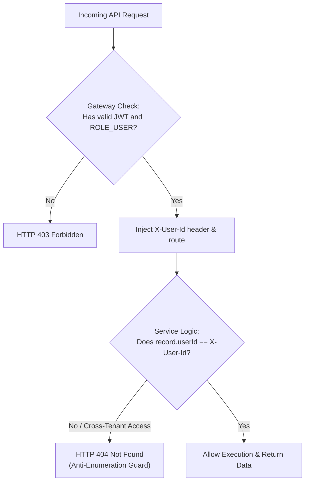

# API Authorization Design: Task Management System

| Metadata Item | Details |
|---|---|
| **Document ID** | DOC-API-011 |
| **Document Version** | 1.0.0 |
| **Status** | Approved Baseline |
| **Author / Owner Role** | Security Architect |
| **Creation Date** | 2026-11-03 |
| **Related Documents** | `DOC-API-010`, `DOC-REQ-009`, `BRULE-001` |

---

## 1. Overview & Two-Tier Authorization Model
Authorization in the Task Management System is enforced at two distinct tiers:
1. **Tier 1 (Role-Based Access Control - RBAC)**: Enforced at the API Gateway and service controllers via Spring Security (`@PreAuthorize("hasRole('USER')")`).
2. **Tier 2 (Tenant Data Ownership Isolation)**: Enforced inside microservice domain logic and repository queries. Users are strictly constrained to accessing their own data partitions.



---

## 2. Multi-Tenant Data Isolation & Anti-Enumeration Principle
A critical security requirement is preventing unauthorized users from detecting whether a specific task or notification ID exists in the system:
- **Flawed Monolithic Approach**: Returning `403 Forbidden` when User B accesses User A's task confirms to User B that Task 101 exists, enabling resource enumeration and targeted attacks.
- **TMS Security Standard**: If a task exists in the database but `task.userId != currentUserId`, the service returns **`404 Not Found`** (`ERR_RESOURCE_NOT_FOUND`). The system behaves identically as if the ID did not exist, completely neutralizing ID harvesting and resource enumeration.

---

## 3. Method-Level Security Annotations
Within Spring Boot microservices, method security is activated via `@EnableMethodSecurity`:
```java
@RestController
@RequestMapping("/api/v1/tasks")
@RequiredArgsConstructor
public class TaskController {

    private final TaskService taskService;

    @PostMapping
    @PreAuthorize("hasAuthority('ROLE_USER')")
    public ResponseEntity<TaskResponse> createTask(@Valid @RequestBody CreateTaskRequest request) {
        return ResponseEntity.status(HttpStatus.CREATED).body(taskService.createTask(request));
    }
}
```

---

## 4. Review Checklist
- [x] Two-tier authorization model (RBAC + Tenant Data Scoping) mapped.
- [x] Anti-enumeration principle enforced via HTTP 404 responses.
- [x] Method-level `@PreAuthorize` security annotations specified.

---

## 5. Change History
| Version | Date | Author | Summary of Changes |
|---|---|---|---|
| 1.0.0 | 2026-11-03 | Security Architect | Initial baseline API Authorization Design. |

