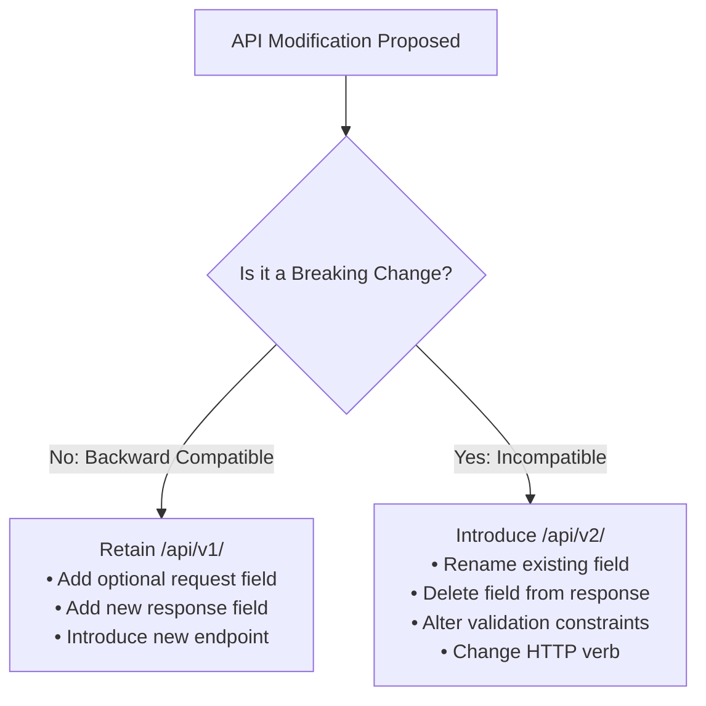

# API Versioning Strategy: Task Management System

| Metadata Item | Details |
|---|---|
| **Document ID** | DOC-API-012 |
| **Document Version** | 1.0.0 |
| **Status** | Approved Baseline |
| **Author / Owner Role** | API Architect |
| **Creation Date** | 2026-11-03 |
| **Related Documents** | `DOC-API-001`, `DOC-API-002` |

---

## 1. Versioning Mechanism Evaluation & Decision
The architecture team evaluated three versioning approaches:
1. **URI Path Versioning (Adopted)**: Embedding the major version in the URL path (`/api/v1/tasks`).
2. **Custom Request Header**: `X-API-Version: 1.0`.
3. **Accept Header Content Negotiation**: `Accept: application/vnd.tms.v1+json`.

### Decision
Standardize on **URI Path Versioning** (`/api/v1/...`):
- **Clarity & Explicitness**: Immediately visible in browser developer tools, server logs, API documentation, and Postman collections.
- **Gateway Simplicity**: Simplifies Spring Cloud Gateway route predicates (`Path=/api/v1/**`).
- **Caching Ergonomics**: Preserves distinct cache keys across different API versions.

---

## 2. Breaking vs. Non-Breaking Change Criteria

### 2.1 Non-Breaking Changes (Retain `/api/v1`)
- Adding new optional request parameters with sensible defaults.
- Adding new properties to response JSON payloads (clients must ignore unknown fields via `@JsonIgnoreProperties(ignoreUnknown = true)`).
- Adding entirely new endpoint routes (e.g., `/api/v1/tasks/export`).

### 2.2 Breaking Changes (Mandates `/api/v2`)
- Renaming or removing existing fields in request or response bodies.
- Tightening validation rules on existing request fields (e.g., reducing max length or making optional fields mandatory).
- Changing response data types (e.g., converting a single object into an array).
- Modifying HTTP response status codes.

---

## 3. Deprecation & Sunset Lifecycle Policy
When a breaking change necessitates `/api/v2`:
1. **Coexistence**: Both `/api/v1` and `/api/v2` run concurrently in the service for a minimum **90-day grace period**.
2. **Deprecation Headers**: Responses from `/api/v1` include standard RFC 8594 headers:
   - `Deprecation: true`
   - `Sunset: 2027-03-31T23:59:59Z`
   - `Link: </api/v2/tasks>; rel="successor-version"`
3. **Decommission**: Upon sunset date arrival, `/api/v1` routes return HTTP `410 Gone`.

---

## 4. Review Checklist
- [x] URI path versioning (`/api/v1/...`) adopted and justified.
- [x] Unambiguous criteria established for breaking vs non-breaking changes.
- [x] RFC 8594 deprecation header standards and 90-day grace period defined.

---

## 5. Change History
| Version | Date | Author | Summary of Changes |
|---|---|---|---|
| 1.0.0 | 2026-11-03 | API Architect | Initial baseline API Versioning Strategy document. |

