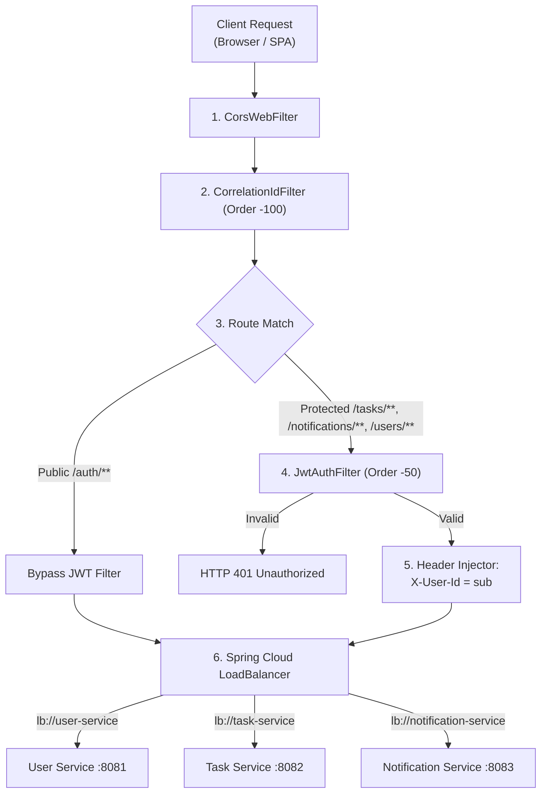

# API Gateway Routing Document: Task Management System

| Metadata Item | Details |
|---|---|
| **Document ID** | DOC-API-014 |
| **Document Version** | 1.0.0 |
| **Status** | Approved Baseline |
| **Author / Owner Role** | Solution Architect & API Architect |
| **Creation Date** | 2026-11-03 |
| **Related Documents** | `DOC-ARCH-001`, `DOC-API-001`, `DOC-API-003` |

---

## 1. Overview & Gateway Architecture
Spring Cloud Gateway acts as the reverse-proxy entry point on port `8080`. It routes client requests dynamically to Eureka-registered service instances while enforcing global CORS, correlation ID generation, and JWT authentication.



---

## 2. Spring Cloud Gateway Configuration (`api-gateway/src/main/resources/application.yml`)

```yaml
server:
  port: 8080

spring:
  application:
    name: api-gateway
  cloud:
    gateway:
      discovery:
        locator:
          enabled: false # Use explicit routes below
      globalcors:
        cors-configurations:
          '[/**]':
            allowedOrigins:
              - "http://localhost:3000"
              - "http://127.0.0.1:3000"
            allowedMethods:
              - GET
              - POST
              - PUT
              - PATCH
              - DELETE
              - OPTIONS
            allowedHeaders:
              - Authorization
              - Content-Type
              - X-Correlation-Id
            exposedHeaders:
              - X-Correlation-Id
              - Location
            allowCredentials: true
            maxAge: 3600

      routes:
        # Route 1: User Service (Auth & Profile)
        - id: user-service-route
          uri: lb://user-service
          predicates:
            - Path=/api/v1/auth/**, /api/v1/users/**
          filters:
            - name: CircuitBreaker
              args:
                name: userServiceCircuitBreaker
                fallbackUri: forward:/fallback/user-service

        # Route 2: Task Service (CRUD, Status, Metrics)
        - id: task-service-route
          uri: lb://task-service
          predicates:
            - Path=/api/v1/tasks/**
          filters:
            - name: CircuitBreaker
              args:
                name: taskServiceCircuitBreaker
                fallbackUri: forward:/fallback/task-service

        # Route 3: Notification Service (In-App Notices)
        - id: notification-service-route
          uri: lb://notification-service
          predicates:
            - Path=/api/v1/notifications/**
          filters:
            - name: CircuitBreaker
              args:
                name: notificationServiceCircuitBreaker
                fallbackUri: forward:/fallback/notification-service

eureka:
  client:
    service-url:
      defaultZone: http://${EUREKA_HOST:localhost}:${EUREKA_PORT:8761}/eureka/
```

---

## 3. Review Checklist
- [x] Complete Spring Cloud Gateway route configurations documented with Eureka load-balanced targets (`lb://`).
- [x] Global CORS configuration explicitly allows frontend SPA origin (`http://localhost:3000`).
- [x] Ingress filter execution order and header injection specified.

---

## 4. Change History
| Version | Date | Author | Summary of Changes |
|---|---|---|---|
| 1.0.0 | 2026-11-03 | Solution Architect | Initial baseline API Gateway Routing Document. |

